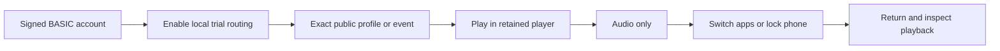

# Audio-only and background playback rehearsal

Status: source implementation in progress. The relay is not enabled. Full hosted
release remains blocked by the existing `RELEASE_BLOCKER`.

## Intended phone test

BASIC opens the ordinary VRDex profile or event, opts into the operator trial,
and presses Play. Audio only selects the native audio rendition. The retained
player continues across VRDex navigation. The phone test then checks app switching,
locking the screen, system playback controls and returning to the page.

The October 28 protected test already established native synthetic audio/video
and real VRCDN HLS video on BASIC's iPhone. Its copy-AAC rendition passed FFprobe
and decode checks. This trial finishes integration into the actual product. It
does not repeat transport discovery or substitute another standalone test page.
See the [original experiment](../../scripts/mobile-media-spike/hosted/README.md)
and [approved design](../superpowers/specs/2026-10-28-mobile-vrcdn-playback-design.md).

## Finite integration contract

The trial reuses existing Convex grants, public-source authorization and revision
checks, worker identity and epoch, source leases, registry, publisher, readiness
and gateway authorization. Browser opt-in changes only that viewer's routing;
it cannot activate deployment operations. The global relay flags remain off.

A trusted internal operation activates one immutable configuration: exact signed
operator, public context and source, worker binding, gateway origin, evidence and
absolute expiry. Changing that configuration invalidates activation. A trial ID
cannot be rebound. At most two grants can be issued during that trial, including
released grants. These are bearer capabilities, so this is not a hard count of
physical listeners.

The selected host is a finite Vercel Sandbox with one vCPU, 2 GiB RAM, no snapshot
and a maximum fifteen-minute lifetime. The original shared FFmpeg packager
copies H264/AAC into both HLS renditions. Only the selected rendition reaches the
browser. Its scratch directory must be a verified bounded tmpfs; startup refuses
an ordinary filesystem or privileged worker process. The host qualification
proved a 512 MiB tmpfs rejects a 600 MiB allocation. It did not prove relay delivery.

Memory storage reserves bounded segment reads, verifies completed-file stability,
and retains finite rolling windows. One source acquisition is allowed. Forwarded
input bytes, delivered body bytes and request count have independent limits.
Copied URLs debit the same aggregate delivery allowance. Expiry or budget
exhaustion stops the worker; the HTTP server also closes at expiry. The VM's
independent hard deadline is a final containment boundary. Byte allowances do not
represent a total platform billing cap or prove zero in-flight network overshoot.

The initial limits must be selected from measured source bitrate before activation.
Reaching a byte limit may end playback before fifteen minutes. Operator shutdown
must disable the trial and verify source, process and VM cleanup.

## Policy preserved

The normal twelve-hour grant policy remains unchanged. Native requests read
existing authority and do not renew viewer grants. Expiry while backgrounded
requires deliberate resume. Native HTTP demand sustains the source without page
JavaScript during the existing idle grace period.

The first test establishes one-source audio-only and background playback.
Automatic handoff from video when backgrounding and DJ changes while the phone is
suspended require separate qualification. Previously downloaded segments cannot
be recalled by revoking their grant; future gateway requests recheck authority.

## Evidence still required

Before activation: source and backend tests, Linux packaged-artifact verification,
real packager cleanup on source limit and expiry, timestamp/codec/decode checks,
process memory and scratch bounds, exact operator lookup, and root review of the
binding, limits, cost and cleanup plan. Then test the actual provider and retained
player before handing the ready URL to BASIC. Physical phone acceptance remains
separate from desktop browser evidence.

The earlier finite audio producer and delivery components remain proof comparators,
not the deployed replacement for the approved shared native HLS product. The
native-request renewal proposal is deferred.
