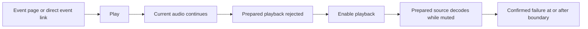

# Event lineup player

Timed public lineups with a current public performer stream are watchable without
staff enabling performer sequence. The editor's Automatic choice uses this local
browser viewer. Event stream retains the explicitly enabled event source.
Automatic requests never open native relay grants or broadcasting tools.

Fresh Play uses the same inferred current slot in the inline surface, standalone
surface and playback owner. A past or future performer's stream does not make a
unique unlinked current performer watchable. Staff-enabled performer sequences
use the same rule. Already-started sessions retain manual selection and continuation.

When authored windows overlap or their order is ambiguous, an actually active
public source keeps the existing manual performer selector reachable. Starting
that session opens no stream until the viewer selects one. Future-only links,
gaps and a unique unlinked current performer still do not offer Play.

The viewer clock refreshes at slot starts and inferred/authored ends. The
new-start control changes at the boundary without waiting for the normal minute
tick or a visibility event. Existing playback keeps its independent continuation
and projection-revalidation rules. A retained retry that becomes ineligible after
its source was released reports Stream unavailable instead of remaining paused
without feedback.

## Ownership and updates

`EventPublicPage` retains its server-provided content until one event-scoped
`events.getPublicBySlug` subscription has an authoritative result. That projection
updates both the roster links and the watch component. The root playback owner
retains active media across page navigation and independently revalidates its
public projection. A null projection, cancellation, removing playable sources or changing the
request transport revokes or replaces that active request. There is no subscription per performer.

`EventLineupSession` owns one current source and at most one prepared next source.
A generation check runs before creating an asynchronous source and again before
accepting playback results. Projection edits, manual selection and disposal
invalidate prepared requests. A pending current connection reconciles its captured
slot again when accepted, so a unique replacement key remains the active final
slot for overtime pause/resume. Pause also invalidates initial transport imports and
source play attempts awaiting audio-context resume. Sources are owned before
awaiting playback, so hiding a source or unmounting releases them even when
resume or play completion never resolves. Exact slot keys retain source identity. Replaced
keys require exactly one matching performer slug, authored start and selected
normalized stream ID. A hidden or changed selected source stops the session and
requires viewer action. An unchanged stream may retain its connection while its
slot key changes.

A save rejected for an unavailable stream selection shows `Stream unavailable`.
The editor marks the submitted explicit stream choices invalid until changed or
resubmitted. The backend error identifies the selection category, not a slot.

The existing standalone `VrcdnStreamPlayer` API is unchanged. It and the observed
event source share `attachVrcdnTransport` and `releaseVrcdnTransport`. Event playback
uses different buffered-failure handling, with the existing `VrcdnPlayerControls`
and play poster. Transport setup failure releases partially attached players;
teardown attempts every transport step even if an earlier step throws.

## End inference

Public lineup rows, timed slots, event previews and browser playback share
`inferLineupEnds` from the API contracts package. Explicit ends stay unchanged,
including authored gaps and overlaps. A missing end uses the immediate next
unambiguous later start; the final timed row can use a valid later event end.
Inference follows canonical lineup order. Untimed rows are barriers, and equal,
locally out-of-order or nonfinite starts leave affected ends unknown. A later
ambiguous section does not prevent an earlier ordered transition. Absolute
instants carry overnight schedules across midnight without inventing a duration.

These are derived display and runtime values. Authored rows and database values
remain unchanged; the helper returns copies and performs no backfill.

## Following policy

Schedule-gated watch surfaces, lineup players and inline controls use the same
clock hook. Each instance caches its own rendered timestamp. It starts as null
on mount, including server rendering and hydration, then refreshes on the
queued initial subscription tick, every minute and on visibility changes. Reading the timestamp never samples a new clock value during rendering;
timers and listeners are removed when the hook unmounts.

Wall time selects schedule candidates. Monotonic `performance.now()` timestamps
measure audio progress and failure intervals. The two clock domains are never
subtracted. Current playback retains its source across schedule boundaries.
A healthy source is never cut off because its posted end has passed.

Only the immediate next slot can be prepared. Missing, freeform and unplayable
slots are barriers. Out-of-order or simultaneous starts adjacent to the current or
candidate slot block that transition, including a candidate with a same-time sibling.
Ambiguity later in the lineup does not block an earlier unambiguous transition.
Native relay preparation begins 120 seconds before the later of current end and
next start. Local browser preparation begins five minutes before that boundary.
Failure promotion waits for the later boundary; local silence promotion uses the
window described below. Preparation alone never authorizes promotion. A current
source that fails before the boundary is retried while the next source stays muted.
Joining during simultaneous active intervals still refuses an ambiguous selection.
If current end is absent, next start provides the handoff boundary only.
An immediate next slot whose effective interval has ended is no longer a
candidate for preparation or handoff. Its explicit end, or the following slot's
start when its end is absent, closes that interval. A different-source slot remains a barrier, so
following never skips ahead to a later performer. A prepared source is released
if that interval ends while the healthy current source continues overtime.

Consecutive slots with the same normalized stream ID advance logical identity at
`max(current.endAt ?? next.startAt, next.startAt)`. They retain the current media
connection and never prepare a duplicate. After a delayed or hidden observation,
following can catch up across consecutive expired same-source slots. Different,
missing or unplayable sources and ambiguous ordering still block that traversal.

Each decoded source routes through an analyser and source gain before the shared
viewer gain. Prepared source gain is zero. Three consecutive progressing samples
are required before it is ready to replace the current source. Viewer mute and
volume affect output gain, not silence measurements.

UI subscribers receive a new snapshot only when a snapshot field changes.
Media observation continues every 100 ms regardless of UI notifications.

The November 6 local browser trial enables silence handoff after 15 continuous
seconds below -60 dBFS, within five minutes before or after the inferred current
set end. The window also cannot begin more than five minutes before the next
set starts or before the current set starts. The next source must have decoded
readiness, following must be active, and observation must remain fresh and in
the foreground. Silence before the eligible window cannot shorten its required
15 seconds. Pause, hidden documents, analysis suspension and audible input reset
evidence. Viewer mute and volume do not affect it. These numerical defaults are
a trial, not calibration against real DJ music.

Native relay and broadcasting policies remain separate, with no silence trial
added by this change. Established playback must stop progressing for at least
1000ms before failure qualifies. Healthy decoded progress cancels failure
evidence, including buffered playback after transport failure or clean EOF.
EOF alone neither releases playback nor advances the lineup.

A newly connected source has up to fifteen seconds to begin decoded playback
before destructive reconnection. This prevents repeatedly restarting a source
awaiting a slow first keyframe. The original five-second cold-start guard still
records unavailability evidence and releases to a ready successor at its boundary;
it does not hold an incoming decoded performer for fifteen seconds. A synthetic
seven-second startup regression retains its original connection. This does not
establish live-provider or physical-phone startup performance. Once a source
progresses, the established one-second failure interval applies. The longer retry
allowance does not make a successor ready or bypass pause/revocation fences.
An offline or never-progressing cold source can take ten seconds longer to reach
its first destructive retry, while internal failure evidence and handoff keep
their earlier guard. The retained legacy viewer keeps its loading presentation
through the first connection's protected cold start. Later offline retries keep
failure feedback visible. A viewer retry resumes the existing session
rather than replacing its connection.

Retries use 1, 2, 4, then 10 second intervals. Each successful handoff resets the
preparation retry count and deadline for the next candidate. Replacing a prepared connection also
observes the first retry interval to avoid immediate reconnect bursts after
pause/resume or edits. A pending `video.play()` promise cannot block retries.
Failed next-source attempts retain the current source. Pause disables transition
decisions and releases preparation. Current-source play rejection leaves the shared
Play action. A rejected prepared
source remains muted and owned, with automatic reconnects suspended. The
`Enable playback` control retries that exact source under a viewer gesture while
current audio continues. Another gesture supersedes a pending retry on the same
source. Only the latest attempt can change pending or blocked state, and handoff
waits for that attempt to settle. Successful retry must still produce three progressing
samples before normal handoff is allowed. Projection changes, manual selection,
pause, candidate expiry, hidden-document release and disposal clear rejection
state and invalidate pending retry callbacks.

Manual selection disables following. Return to live re-evaluates the scheduled
slot. Resuming following also re-evaluates it, except an already-active final slot
can resume after posted event end, including while its transport is being recovered.
The reconciled selected slot retains this identity through failed or pending connections.
Removed or changed sources lose it. New sessions after event end are refused.
A lineup with no playable source offers no initial player. An already-started
session keeps its recovery controls when its sources become unavailable. There
is no automatic wraparound.

## Browser visibility

Hidden documents deliberately stop analysis, preparation and handoff decisions;
current audio can continue. Visibility changes and audio-context state changes
clear evidence. The first active sample after a reset does not inherit old timers.
Sampling gaps over 500 ms also reset evidence. This is foreground automatic
following, not a claim of background switching or OS-suspension support.

## Verification

The guarded `/playwright/event-lineup-live` route uses the actual query hook,
public playback normalization and standalone player for legacy lifecycle tests.
Its `composed` variant mounts the actual public page and retained root owner;
desktop/mobile tests prove one advancing media element survives consumer unmount.
The Convex projection is synthetic, and generated MPEG-TS traverses the real
browser media transport. Backend
`event-playback-projection.test.ts` tests the actual public query and projection,
including hidden links, removed sources, cancellation and unpublished events.
Only the guarded fixture overrides schedule time. The loopback MPEG-TS server
provides audible, quiet, connected silent, musical-break and unavailable sources.
Browser tests also map the canonical event-stream fetch to loopback inside the
test page. This tests URL resolution and the existing player without contacting a
live provider.

Run with the same local fixture server and environment variables documented in
[event-playback-proof.md](event-playback-proof.md), replacing the test filename
with `event-lineup-live.spec.ts`. The test explicitly launches Chromium and Firefox
and attaches screenshots, browser messages, connection statistics and visibility
observations. Each proof-server invocation generates private MPEG-TS files in a
unique directory and removes that directory after stopping its media processes.
Simultaneous invocations cannot truncate another server's transport inputs. Generated artifacts remain ignored under
`apps/web/playwright-artifacts/`.

Safari is unavailable on the Windows test host. A mobile viewport verifies layout,
not Safari/iOS audio or hardware-volume behavior. Live-provider CORS/encoders and a
human listening comparison require separate evidence. Native visibility results
must be read from the recorded browser attachment, not inferred from headless
foreground playback.

The September 15 product runs passed Chromium and Firefox lifecycle and recovery
cases. Both peaked at two connections and ended with zero connections and FFmpeg
children. Chromium minimization and Firefox foreground-tab attempts both left
`document.visibilityState` as `visible` on this headless host. Real native hidden
window behavior therefore remains unverified. The dev Issues indicator in the
controlled-failure screenshots corresponds to injected HTTP 503 and EarlyEOF
transport errors; neither run recorded an uncaught page error.

One isolated-fixture Firefox run reported an uncaught error with the message
`Object`. A focused follow-up with stack and rejection diagnostics passed, but
the earlier error remains unclassified. The failed report is preserved as
`playwright-artifacts/task-5-isolated-final.json`, with its extracted failure in
`event-playback-proof/firefox-unclassified-error.json`. The clean follow-up does
not establish that this error is fixed.

## Transport cancellation ownership

The shared MPEG-TS configuration disables the IO startup stash and cleans old
SourceBuffer media once it exceeds 30 seconds behind playback, retaining 15
seconds. This reduces startup buffering and decoded media retention for both
standalone and retained players. It may expose network jitter sooner. The
November 6 loopback proof verified continued playback and removal of old buffered
media; it does not measure phone CPU or background playback.

Audio-only availability belongs to the adapter. Native HLS and relay adapters
declare a separate audio rendition; legacy MPEG-TS adapters do not. Retained
controls omit Audio only for those legacy adapters while preserving Video
recovery and saved preferences. A restored audio preference blocks automatic local
video too, before creating its session. The player shows Unsupported and a Video
choice instead of a repeatable Enable playback action; explicit Video and Play
recover it.
Legacy lineup adapters do not implement a mode switch that only hides video.
Hiding local lineup video is not audio-only
decoding. See the [investigation and live-index proposal](../planning/player-performance-and-live-index-2026-11-06.md).

The shared transport uses mpegts.js 1.8.1's supported customLoader interface.
`VrcdnFetchLoader` owns fetch, the response reader, and all cancellation promises.
It keeps range/seek headers, configured headers, credentials, referrer policy,
redirect notification, byte offsets, content length, EOF and HTTP/read errors.
The mpegts parser, media-source player, stash buffering and public controls remain
unchanged. This loader serves the current HTTP(S) VRCDN MPEG-TS callers with Fetch
and ReadableStream; it does not add WebSocket or legacy XHR transport support.

A deterministic Firefox browser test held a naturally fulfilled response until
after player unmount. The original library then called body.cancel without
returning or handling its promise, producing an uncaught native AbortError from
FetchStreamLoader.open. The maintained loader handles rejected cancellation only
for its owned cleanup; active HTTP/read errors still reach the player error
callback. No global rejection filter is installed. Reader cancellation and late
response fulfillment are generation-scoped so obsolete callbacks cannot change a
new request.

This reproduces and fixes a concrete teardown leak consistent with the historical
Object symptom. The historical recording did not retain the exception fields, so
its exact identity remains unprovable. Preserve that failed artifact alongside
the cancellation RED/GREEN evidence; a clean rerun alone is not the explanation.

The [final local verification ledger](event-lineup-verification.md) records the
connected authored-event serialization test, final editor snapshots and remaining
operational evidence.

## Failed playback presentation

The retained player collapses its media rectangle while playback is unavailable
or blocked and the current media has no metadata/frame to present. A transient
lineup stall with presentable media keeps the picture and automatic recovery;
it does not offer a destructive session retry. Sequence recovery uses automatic
reconnection or the existing performer selector. An ambiguous initial selection
shows that selector without unavailable prose or playback/retry controls only
until a playable source has ever been selected in that session. The runtime
records this selection history explicitly. A later revoked selection or return
to an authored gap retains playback controls and Stream unavailable feedback.
A blocked or offline Twitch
iframe stays visible because its provider recovery controls must remain
interactive. A profile transport-end notification also
preserves the picture because buffered video may still be playing. Event and
profile placeholders share the measured controls/status height and a responsive
picture region. Controls use their natural height; a secondary mode/PiP row
retains its existing minimum spacing. Missing rows leave no reserved strip.
The existing media node stays mounted and owned by the same transport; a status
change alone does not revoke, stop or recreate playback. Successful recovery
reveals normal media again. Unavailable playback keeps source identity, controls
and Close in both inline and compact presentation. Try again is available for
recoverable failures, but not an unsupported transport or a visible Twitch embed.
Fullscreen geometry never updates the inline reservation or compact clearance.

Legacy lineup adapters opt out of Picture-in-Picture because an automatic handoff
replaces their video element. Exposing the current media for buffered recovery
does not enable that control. Native and direct-stream controls keep their existing
capability handling; native PiP continuity across handoffs remains unqualified.

## Asynchronous playback intent

The root owner's `interactionRevision` is separate from its transport generation.
Playback controls advance the interaction revision even when pause or resume
retains the same adapter. Metadata revalidation does not create a new viewer intent.

This is a caller contract, not an automatic guard around arbitrary asynchronous
work: a surface must capture `beginInteraction()` before resolving a source and
compare both `interactionRevision` and `generation` before accepting the result.
The homepage consumer and its pending-lookup pause/resume regressions are delivered
in [PR #468](https://github.com/BITRATE-Labs/VRDex/pull/468). The owner contract alone
does not add a homepage surface or protect an unmodified caller.
