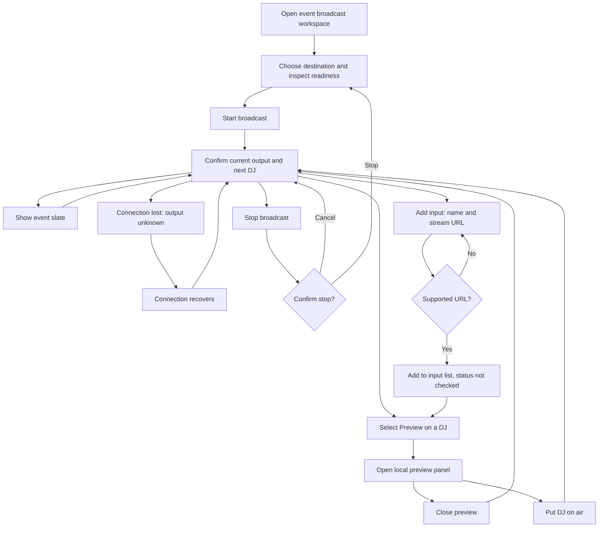

# Broadcasting design jam, November 9, 2026

## Locked design baseline

Implementation handoff: [staged plan for the real broadcast flow](../superpowers/plans/2026-11-09-locked-broadcast-implementation.md).

Locked decision: BASIC approved the current broadcast flow on November 9, 2026, after the person-lookup iteration. The accepted baseline includes the shared app header, compact destination card, optional connection-test wizard, contextual source previews, manual Next DJ that preserves mode, and confirmation for live stream changes. Quick switch supports both person lookup with dropdown results and pasted links, followed by checking, preview and confirmation.

The [final UX review and iteration notes](broadcast-ux-review-2026-11-09.md) record the resulting behavior. This approval locks the reviewed design. It does not approve a deployment or establish real media playback, provider verification, credential storage, or worker support for every illustrated source. Audio uploads and other unbuilt expanded capabilities remain proposals in their separate brief.

## Earlier iterations

Make broadcasting understandable before the operator has learned the worker model. The following notes describe the iterations leading to the approved baseline above. The local fixture is not a production implementation. No production broadcast or repair operations are in scope.

The first candidate keeps preparation and live operation in one workspace. Before start, destination, readiness and Start are grouped together. While live, output, current DJ, next DJ, automatic/manual control and the event slate are prominent. Stream quality, destination configuration and diagnostics are disclosed on demand. Preview remains separate from putting a DJ on air.

Latest direction: BASIC requested manual Next DJ, paste-and-switch, broader video sources including YouTube, and exploration of slate/audio capabilities. The prototype now demonstrates Next DJ, temporary link switches and explicit slate hold/resume. The [expanded capability brief](broadcast-expanded-capabilities-2026-11-09.md) separates existing worker support from proposed source types, compares implementation approaches, and records the open audio decision. No new backend capability is implied by recognizing a link in the fixture.

Latest copy/control iteration: stream status now says Live. Next asks for confirmation. Quick switch replaces Switch to a video link and explicitly accommodates an open-decks DJ's stream. The World stream destination exposes copyable PC/Quest output URLs, marked as examples in this fixture.

Latest setup iteration supersedes that example annotation and the destination selector. The prototype starts unconfigured, offers Set up broadcast, and has a Connection → Playback → Test wizard with simulated failure, cancellation, retry and completion. A configured destination is plain text. [Setup flow and verification boundary](broadcast-setup-flow-2026-11-09.md) explain the proposal and the backend gap; there is still no real provider verification or credential storage.

BASIC's latest direction requires confirmation for every action that changes the live stream. One shared confirmation now covers source switches, slate, resume, automatic/manual mode and Stop. The [control brief](broadcast-expanded-capabilities-2026-11-09.md#user-controls) records the exact scope. Local preview, copying and next-start settings remain immediate.

Setup now has Twitch/VRCDN/Custom presets, plain URL errors, a live PC/Quest link preview for VRCDN input, an optional test, and a success-only confetti burst with Back to broadcast. Skipping is recorded as Not tested and does not block Start. The [setup note](broadcast-setup-flow-2026-11-09.md) records the revised journey and the difference between preset selection and the single configured destination.

Preview audio is user-controlled through the player's own mute and volume controls, not permanently muted. The separate mockup toggle was removed as redundant. The fixture still has no real player or audible preview. Changing local monitoring does not change broadcast audio and does not require a live-stream confirmation.

The initial recommendation was to iterate the state-based workspace visually. Later iterations added the connection wizard described above; the approved baseline supersedes the initial alternatives.

## Local preview

- [Candidate preview](http://127.0.0.1:3047/playwright/broadcast-jam)
- [Current production component with synthetic fixture receipts](http://127.0.0.1:3047/playwright/event-operator)
- Isolated checkout: `C:/Users/steve/.codex/worktrees/broadcast-design-jam/VRDex`
- Source: `apps/web/src/app/playwright/broadcast-jam/`
- Server session at creation: `65821`, port `3047`, loopback only.
- Startup: from `apps/web`, set `VRDEX_ENABLE_PLAYWRIGHT_FIXTURES=true`, then `node --import tsx node_modules/next/dist/bin/next dev --webpack --hostname 127.0.0.1 --port 3047`.
- No Clerk or Convex configuration copied. Candidate state is browser-local. Output images, signals, readiness and timings are fictional. No provider embeds, streams, probes or broadcast commands are used by the candidate.

## Proposed host journey

This diagram describes the candidate, not verified worker behavior. Authentication remains owned by the existing production route and is absent from the guarded local fixture.

## Reference evidence

Research date: November 9, 2026. Platform: web. Query: `live streaming setup and starting a broadcast`. Mobbin native search succeeded. The connection did not expose account identity. Local image download failed due sandbox filesystem/socket restrictions; browser navigation to the returned source image URLs succeeded. Images were inspected, not exported.

| Reference | Inspected sequence | Pattern used | Limits |
| --- | --- | --- | --- |
| [Substack: Starting a live](https://mobbin.com/flows/8476fa5a-dce2-4685-aecb-15236c19d096?tab=screens) | Positions 1, 4, 6 via search previews; 2, 3, 5 via individual images. Entry menu, setup sidebar, loading, guest selection/Go live, connecting, live. | Keep output preview stable while setup becomes live controls. State the transition to live explicitly. | Camera/microphone broadcasting differs from switching remote DJ inputs. Recovery, permission grants and backend readiness are not established by the capture. |
| [Behance: Setting up a livestream](https://mobbin.com/flows/ec76c8d2-c9c3-479f-adc9-a14c98fa6c25?tab=screens) | Sampled positions 1, 4, 6 only. Create entry, stream setup, ended state. | Show setup and ended states as different moments. | Unsampled positions 2, 3, 5. External encoder workflow; no claim about complete journey or recovery. |

Substack flow ID: `8476fa5a-dce2-4685-aecb-15236c19d096`. Individual inspected positions: 2 `4597989d-c601-4307-a764-d86715b0531c`, 3 `28114376-e30f-4eae-9245-080855861c07`, 5 `1b430f49-edc8-4da7-8a40-bcbf0d5736d8`. Behance flow ID: `ec76c8d2-c9c3-479f-adc9-a14c98fa6c25`.

## First visual review and recycle

Rendered the current component and the candidate. Reviewed candidate setup and live states, plus a 390-pixel viewport with no horizontal overflow. Findings and changes:

- Start looked like every secondary action. Changed it to the shared primary Button variant.
- The next DJ's missing signal was only in the input list. Added Next DJ beside current output and mode.
- Narrow setup initially hid readiness checks. Retained their compact labels.
- Stop confirmation needed native keyboard focus handling. Used a native modal dialog; Escape cancels and returns focus to Stop.
- Removed an ineffective Add input shortcut. Custom inputs remain a clearly illustrative disclosure.
- Reconnection now shows output as Unknown and identifies the last confirmed output separately.

Exercised simulated start/preparing/live, slate, stop dialog, Escape cancellation, lost connection/recovery, and preview-to-air preparation. This is a first self-review of rendered UI, not independent UX research or production acceptance.

## Open design questions and limits

### Iteration after BASIC's first feedback

BASIC found the disabled dropdowns and destination-flipping button confusing, and suggested opening the input preview only after selecting a DJ. The candidate now starts with no input preview. Preview opens that input's panel, focuses its heading, and Close returns focus to the triggering button. Without a preview, the input list uses the full width.

The destination-flipping button and duplicate destination setup disclosure are removed. One explicit selector remains visible and is locked during startup and live operation. Quality selectors work locally; changing them while live changes the next-start settings, while the on-air quality remains distinct.

Add input now opens an inline name/URL form. It reuses the existing broadcast input parser to reject unsupported URLs, prevents duplicate canonical inputs, and adds accepted entries to the same list. These entries show Not checked and cannot be put on air. They are never probed. This is a proposed first custom-input flow for BASIC to review, not a decision to ship it. Edit/remove and actual playback remain deferred.

Browser checks exercised supported/unsupported URL entry, adding a custom input, opening and closing its preview, destination selection, resolution/frame-rate changes, and preserving on-air quality when next-start settings change. The visible browser needed a reload after stale script errors before interactions worked. Focused ESLint passed.

BASIC has not reviewed or accepted the first candidate yet. Assess preview size, the balance between output and DJ inputs, whether setup needs a separate view, and the language for automatic switching and slate.

Destination selection, adding inputs and quality controls now work in browser-local state. No real monitoring audio, provider readiness, allocation/admission, leases, output authorization, deadline, simulcast consent, handoff policy or persistence proof is supplied. These existing production constraints must be preserved if the design is implemented. Multiple destinations and advanced handoff controls need a later design pass. Public copy in this fixture is proposed only; no shipping approval is implied.

No commit, push, deployment, historical repair, or real Start/Stop was performed. The lead coordination message was rejected by automatic approval review; no workaround message was sent.
