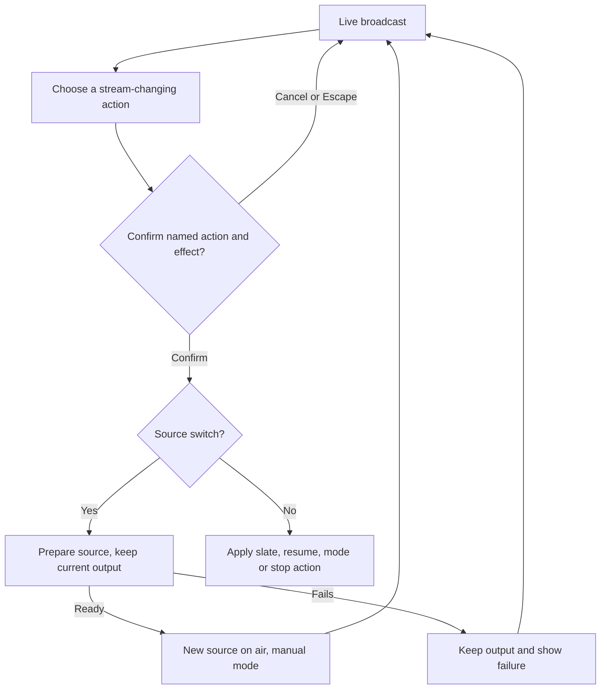

# Expanded broadcasting: sources, manual control and audio

Implementation handoff: the [locked-design implementation plan](../superpowers/plans/2026-11-09-locked-broadcast-implementation.md) supersedes earlier descriptions here of Next entering manual mode, immediate paste switching, absent person lookup and forced-muted previews. The locked behavior is mode-preserving Next, person or link lookup, check/preview before confirmation, and player-controlled local audio. Uploaded audio and custom slate content below remain candidate directions.

## Outcome and decisions

Candidate direction from BASIC's November 9 design jam: broadcasting should handle video sources beyond DJ streams, explicitly including YouTube. Keep direct manual control through Next DJ, immediate link switching and a hold slate. Explore uploaded audio without making the page a full production studio.

The local prototype demonstrates Next DJ, paste-and-switch, and explicit slate hold/resume. It recognizes additional link types without acquiring or playing them. No production provider support is added. The [ongoing jam notes](broadcast-design-jam-2026-11-09.md) contain preview and worktree details.

Current recommendation: keep one broadcast workspace with a short control row and progressively disclosed setup. Build broader input support in stages behind the existing command and worker model. Verify each source before reporting that it is on air. BASIC's judgment is needed on uploaded audio: should it play only over the slate, replace the current source's audio, or mix over a DJ?

## User controls

Locked direction from BASIC's latest feedback: any operator action that changes the stream while live must have a confirmation flow. The prototype now uses one native dialog for Next DJ, preview-to-air, quick switch, Hold slate, Resume, Hold current, Return to auto and Stop. It names the action, explains the effect, and defaults focus to Cancel. Quick-switch confirmation also shows the captured target URL. Nothing is submitted or prepared until confirmation; Cancel and Escape leave the requested change unapplied.

Preview selection, copying playback links, adding an unused input and quality changes that apply only on the next start remain immediate. Actual edits to live picture, audio or level must follow the same confirmation rule when those capabilities are introduced. Preview-state simulation controls also ask before replacing an active simulated session.

### Next DJ

Show the next performer's name in the action itself. Next opens a confirmation naming that performer; Cancel or Escape leaves the broadcast unchanged. Confirming prepares that slot and enters manual mode on success. It does not silently skip a source that fails to prepare. At the end of the lineup, disable the action and say End of lineup. A temporary video override should not reorder or consume the lineup.

The prototype starts on the slate, with Next DJ selecting the first DJ. Its Live scenario starts on Aurora, with Nova next. Sources are simulated as available for trying the happy path. This does not establish real provider readiness.

### Paste and switch

Keep this separate from Add input. The section is now called Quick switch, with the field hint DJ stream or video link. It covers bringing on an open-decks DJ as well as videos. Paste a URL and press Switch now without naming or saving it first. Show Preparing while keeping the old source on air. Success replaces output and enters manual mode; failure preserves output and identifies the failed source. The prototype does not save a temporary switch to the input list. Person-name lookup has not been added.

Current recommendation: pasting does not switch the output. Switch now opens the confirmation, which captures the intended source before applying it. No naming or saving step is needed. Decide later whether successful temporary inputs get a Save input action.

### Hold slate

Hold slate takes priority over an ordinary source preparation and cancels it. It remains on slate until an explicit Resume, Next DJ, successful manual switch or Return to auto. Resume returns to the prior source in manual mode; it does not enable automatic handoffs. Real execution must recheck that source and stay on slate if it cannot prepare.

Current recommendation: provide one event slate first, with a short title and optional uploaded image. Later candidates are separate Starting soon, Intermission and Ended presets, or a video loop. The prototype's decorative slate is not evidence of a customizable worker slate.

## Confirming a live change

This proposed product journey extends the existing controls. The local fixture has simulated transitions and does not run the real handoff rules.

### Copying the world playback link

The configured destination displays playback URLs with copy buttons, reusing the canonical VRCDN URL builder and shared CopyValueRow. Recognized VRCDN links have separate PC and Quest forms. These program output links stay independent of the selected DJ or quick-switch input. The product-level Example links annotation has been removed. Demo data still uses the fictional afterglow-demo stream ID and is not live playback proof. The [setup flow](broadcast-setup-flow-2026-11-09.md) now supplies the configured destination; there is no invented second Twitch destination in this fixture.

## Sources and current support

Frame the section as Video sources, with DJs as one source of inputs. Broad input support is a product direction, not a promise that every webpage or every video can play.

| Source | Evidence in this checkout | Proposed experience | Work still needed |
| --- | --- | --- | --- |
| VRCDN streams | Canonical source parser and worker acquisition path exist. | Add, preview, take or quick switch. | Preserve current decoder readiness and session constraints. |
| Twitch channels | Canonical source parser and worker acquisition path exist. | Same controls. | Preserve provider-specific acquisition and output rules. |
| YouTube video/live URLs | Official browser-player API exists. No worker input path found. | Recognize the link and expose the same controls when qualified. | Prove acquisition or rendering into the continuous shared output; handle blocked/private/removed videos, autoplay and end-of-video behavior. |
| Direct media URLs | Prototype recognizes HTTPS MP4, WebM, TS and HLS path suffixes. No corresponding generic worker source path found. | Add or paste-and-switch after checking the actual media. | Implement bounded fetch/decoding and protocol, redirect, credential and network-address validation. Extensions are only a UI hint. |
| Uploaded video or audio | No upload-to-worker playback flow established. | Choose file, prepare, then play. | Asset storage, access, decoding, duration, limits, cleanup and playback state. |
| Camera, screen or arbitrary web content | OBS documents separate device/media/browser source types. VRDex has no equivalent acceptance evidence here. | Use an external encoder publishing to an existing supported stream initially. | A native capture or browser-rendering feature would be a separate extension. |

A YouTube embed is not evidence of a usable raw-media worker input. The official API controls an embedded player; inferring that a browser preview alone implements a continuous server broadcast would be incorrect. Source permissions, availability and technical restrictions also vary by video. No extraction tool or provider bypass has been selected or installed.

### Approaches considered

| Approach | Benefit | Tradeoff | Recommendation |
| --- | --- | --- | --- |
| Extend managed decoding one input type at a time | Fits current worker ownership, switching and output observation. | Provider acquisition and finite-file playback need proof per type. | First choice for direct media and uploaded assets. |
| Render provider players in a managed browser | Could cover sources whose actual player must run in a browser. | Browser lifecycle, autoplay, buffering, audio capture and cost expand the runtime substantially. | Bounded YouTube feasibility spike before choosing it. |
| External OBS into an existing supported stream | Supports richer local production without rebuilding a studio in VRDex. | Operator runs and maintains the encoder. | Keep as an available path, not a substitute for the requested managed feature. |

## Uploaded audio

Current recommendation: first support an uploaded file played over the hold slate, with Play, Pause, Restart, Stop, level and optional Loop. Stop broadcast stops playback. Returning to a DJ stops the slate track. Local preview audio is explicitly separate from what the audience hears. No sound should start merely because a file was chosen.

This recommendation is not yet BASIC's decision. The alternatives differ materially:

| Intent | User controls needed | Complexity |
| --- | --- | --- |
| Music or announcements over a slate | File, transport, loop and level. | Smallest useful version. |
| Replace a DJ's audio while retaining their video | Explicit audio selection and a clear return action. | Requires independently controlled picture and sound. |
| Play announcements or effects over a DJ | Per-source levels, ducking or mixing, clipping protection and clear on-air indicators. | A mixer or soundboard, which is a larger feature. |

OBS's media-source reference makes looping, restart-on-activation and end behavior explicit. Those are useful product decisions for VRDex too. Recommended defaults: no autoplay on upload, no loop unless chosen, slate stays visible after its audio ends, and volume controls do not affect the browser's local monitor.

## Other considerations worth deciding

- Finite video: start position, pause/resume, replay, and what happens at the end. Prefer return to slate and manual choice initially, rather than automatically cutting to an unexpected DJ.
- Automatic versus manual ownership: Next, quick switches and slate hold must have visible, predictable effects on the existing schedule and healthy-set rules. Returning to auto must be explicit.
- Failed preparation: preserve audible output, expose cancellation, and never equate a reachable URL with decoded readiness.
- Picture and sound: aspect ratio, letterboxing, silent video, audio-only assets, gain and clipping need deliberate defaults.
- Reconnection and resume: live sources reconnect; finite files may need a known position. Do not silently replay an announcement after worker recovery.
- Asset limits: file size, duration, retained storage and per-event cleanup. Existing worker capacity evidence cannot be assumed to cover new decoders, browsers or audio mixing.
- Preview: only load on explicit selection, start muted, release on close, and maintain the existing foreground playback ownership rule.
- Arbitrary links: validate redirects and destination addresses at the worker fetch boundary, bound downloads/decoding, avoid exposing credential-bearing URLs, and retain existing source authorization. The local prototype never fetches pasted media links.

These are planning considerations, not additional features already authorized for production implementation. Hotkeys, transitions, overlays, a scene editor and a general audio mixer are deferred until the core controls prove useful.

## Research evidence

Read on November 9, 2026:

- [YouTube IFrame Player API](https://developers.google.com/youtube/iframe_api_reference): embedded-player controls, playback states, blocked autoplay and errors for unavailable or embedding-disabled videos. Evidence supports browser playback capability, not server restreaming. Offset-bearing links are recognized by the prototype but their offsets are not preserved; support needs an explicit implementation decision.
- [OBS sources guide](https://obsproject.com/kb/sources-guide): separates media, image, browser and device sources rather than assuming every source is an interchangeable URL.
- [OBS media sources](https://obsproject.com/kb/media-sources): uploaded audio/video formats, loop, restart on activation and playback-end behavior. Used for product controls, not as evidence of VRDex support.
- [OBS browser source](https://obsproject.com/kb/browser-source): browser rendering is a distinct source with viewport, frame-rate and lifecycle choices. Used to identify the cost and ownership of a possible browser-based source path.
- Mobbin query `live streaming studio with media sources`, web, two screens. [Substack](https://mobbin.com/screens/40af2ece-579a-46eb-98c5-dbc176047f36) and [Whop](https://mobbin.com/screens/c2bdf4f1-d630-43a1-9584-4b7e32baf4eb) inline previews were inspected. Both put session-level controls beside output; neither inspected screen supplied a reusable multi-source queue or uploaded-audio flow. Do not claim these answer the custom-source journey.
- The FFmpeg protocol documentation failed to open twice. No new protocol-support claim is based on that failed read.

Owning local sources inspected: `convex/_eventBroadcastSources.ts`, `workers/restream/input-manager.mjs`, `workers/restream/program-renderer.mjs`, and the approved October 19 event-broadcast design. Current parser allows VRCDN/Twitch; input manager selects between those factories; the renderer's fallback writes its hold frame plus silence. This checkout is design-jam evidence, not independently refreshed deployed behavior.

## Local verification

The URL recognizer's focused test passed for VRCDN, Twitch, three YouTube URL shapes and direct HLS, plus invalid IDs, spoofed hosts, credentials, insecure URLs and ordinary webpages. Focused ESLint passed. The web TypeScript check produced no diagnostics.

In the rendered fixture, Start selected the first DJ as next; Next advanced Aurora then Nova. A temporary YouTube link showed Preparing while Nova stayed on air, then switched without consuming the next Orion slot. An unsupported webpage preserved the YouTube output. Hold slate and Resume restored that temporary source in manual mode. These are browser-local simulation checks, not actual YouTube/media decoding or shared output proofs.

Follow-up checks covered Next confirmation, Escape cancellation with focus returning to Next, confirmed preparation, and both world-URL copy actions. Clipboard readback matched the example Quest playback URL. Focused ESLint passed after these changes.

Latest confirmation checks covered mode changes, quick switch, preview-to-air, Next, slate, resume and Stop. Cancel/Escape preserved the current output, and a quick-switch assertion verified that preparation did not begin before confirmation. The in-app browser connection and local server reset during this pass; the server was restored and remaining checks ran in a separate Chrome QA tab. Focused lint, parser tests and a fresh web TypeScript check passed after regenerating stale route types. These checks remain limited to the local simulation.
