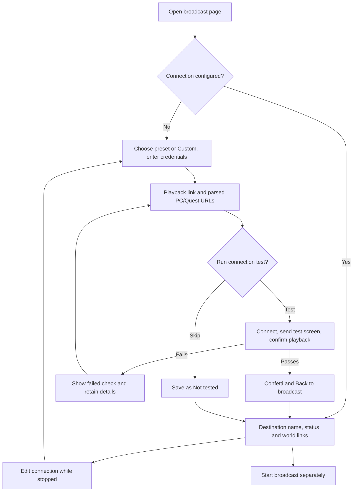

# Broadcast connection setup

## Proposed outcome

Let an event host connect their stream from the broadcast page, optionally test that it reaches the world playback link, and return ready to start. A host with one configured destination sees its name and status, not a destination dropdown. A host with none sees Set up broadcast.

This is a local design prototype for BASIC's review. It does not store real credentials, publish a test slate, or verify a provider. The preview tools fill fictional details and simulate test outcomes. The earlier Example links annotation has been removed from product content; the prototype boundary stays in the design-preview bar and this note.

Current recommendation: a three-step setup page inside the broadcast workspace. Keep credentials separate from playback URLs, make the optional test a deliberate action, and return without starting the actual event broadcast. BASIC requested provider presets, parsed VRCDN playback links, an optional test and confetti on success; those are now represented in the candidate. The remaining review is whether the rendered flow feels right.

## Host experience

1. **Connection:** choose Twitch, VRCDN or Custom. Presets fill the server address and require only the masked stream key. Custom exposes an editable Server URL. Switching providers clears the previous key and playback link. Invalid URLs show a plain-language message, never a raw URL-constructor error.
2. **Playback:** enter the public playback or VRCDN preview link. Recognized VRCDN links immediately show separate, copyable PC and Quest URLs and update as the input changes. An invalid partial link removes the parsed preview; validation is shown on Continue.
3. **Test:** review the destination without showing the key, then choose Run test or Skip test. Product copy calls it a test screen. Display connection, transmission and playback as separate checks. A passing test triggers a brief decorative confetti burst and a Back to broadcast CTA. Reduced-motion preferences suppress the confetti.

A failure identifies the failed stage, retains entered details, and offers editing, retry or skipping. Cancel test stops the test and permits another attempt. Skipping saves the connection as Not tested, without confetti, and leaves Start broadcast available. A passing result returns as Ready. Both outcomes expose the playback links and neither starts the event broadcast. The real Start path must still enforce its existing authorization and resource requirements; skipping this optional test does not bypass those.

Configured state has an Edit connection action while stopped. The prototype retains the configured server and lets the host leave the key blank to keep the simulated saved credential. Changed setup has a keep-editing or discard confirmation. A real integration must preserve the stored credential reference when editing playback, unless the host replaces it. Discarding must leave the previous working configuration intact.

## First setup and return to broadcasting

Direct event entry and returning from setup share the same broadcast page. An implementation should preserve the intended event through sign-in and setup. The local fixture is already an unauthenticated design route; production authentication has not changed.

## Why this approach

| Option | Benefit | Tradeoff |
| --- | --- | --- |
| Three-step wizard, recommended | Separates publishing credentials, player links and proof. Gives failures a clear place to recover. | Adds two Continue actions. |
| One large connection form | Faster for an experienced operator. | Repeats the existing editor problem and makes output versus playback easy to confuse. |
| Always send hosts to global settings | Reusable account management. | Interrupts the event task; the return and readiness state need additional coordination. |

The broadcast page has no destination dropdown when there is only one configured destination. Multiple configured destinations can introduce selection when they actually exist. Provider choice belongs in connection setup.

The new Twitch/VRCDN/Custom choice is inside connection setup and chooses how to configure the output. It is distinct from choosing among multiple already-configured destinations on the broadcast page. Preset addresses are supported by the checked-in output parser. The [Twitch Stream Key FAQ](https://help.twitch.tv/s/article/twitch-stream-key-faq?language=en_US) documents live.twitch.tv as an ingest-server example; [Twitch's broadcast guide](https://dev.twitch.tv/docs/video-broadcast/) documents the server/app/key structure and ingest discovery. The VRCDN preset uses the checked-in ingest.vrcdn.live/live contract; an attempted VRCDN wiki read was unavailable. No provider reachability is established by selecting a preset.

## Current source and implementation gap

The existing `event-editor-form.tsx` VRCDN card selects a preconfigured output account and saves watch/PC/Quest links through `configureVrcdnOutput`. The mutation takes an account key or credential reference, not a raw stream key. Its sanitizer rejects raw secret fields. Configuration state Ready currently depends on the credential reference and accepted gates; this is not a fresh successful connection test.

Therefore the proposed raw-key entry and end-to-end test need an actual protected setup path. Implementation must keep the key in the existing provider secret store and persist only the reference through the event control plane. Do not add a raw stream key to the existing mutation arguments or expose it in review summaries, URLs or logs. The fixture keeps its masked input only in local component memory and does not pass it back to the broadcast page.

The actual verification job must respect authorization, active-output reservations and resource admission. It must prove decoded playback from the configured output, distinguish an accepted connection from an audible/visible result, and clean up on completion, failure and cancellation. Running it may be visible to anyone already using that output URL, which is why the review says a test screen will play before Run test. Store proof against the configuration tested and invalidate it when that configuration changes. No real provider test or backend setup path was run here.

## Reference research

Research date: November 9, 2026. Platform: web. Task intent remained the existing broadcast design prototype.

| Reference | Inspected evidence | Useful pattern | Gaps |
| --- | --- | --- | --- |
| [AirOps: Add a database](https://mobbin.com/flows/f605249e-96ba-4854-9bee-e4a038300f90?tab=screens) | All five positions inspected: 1/3/5 via search previews, 2/4 via individual source images. Empty connections page, provider selection, credential form, populated form, connection failure. | Separate first connection from ordinary use; keep field values visible after failure and allow correction. | Database connection, not broadcasting. No success return or actual retry captured. |
| [Okta: Adding a connection](https://mobbin.com/flows/c6297e7e-ac17-46af-832d-76322a87acdb?tab=screens) | Sampled 1/3/5 only: connection list, populated modal, list afterward. | Accessible entry from the owning workspace and masked credentials. | Uninspected 2/4; no end-to-end playback proof. |
| [Retool: Create a resource](https://mobbin.com/flows/05e7d9d2-77e5-4d27-a628-0d0670c5e066?tab=screens) | Sampled 1/4/6 only: resource list, provider choices, Slack configuration. | Distinguish configuration from ordinary operation. | No relevant streaming verification/recovery evidence; not used to claim the proposed test works. |

Queries: `connecting an integration with credentials and testing connection`, limit two; refinement `connecting a database with credentials and testing the connection`, limit one. The connector supplied no account identity. AirOps full sequence inspection does not establish behavior beyond the visible captures. No Mobbin assets were exported or copied into the UI.

## Local verification and limits

- Focused setup/parser tests passed, including ingest versus playback protocols, credential-bearing URL rejection and canonical VRCDN PC/Quest links.
- Focused ESLint and the web TypeScript check passed.
- Rendered the empty entry and connection wizard. Checked three-step navigation, simulated failure, retained playback link, edit/retry, cancel test and successful return.
- A stale Next development overlay after hot reload cleared on full reload. The fresh flow reproduced no issue overlay or new console errors.
- No production changes, credential-store writes, provider probes, real test-slate publication or broadcast Start/Stop occurred. Reloading the local prototype clears its configured state.
- Latest iteration: malformed server/playback URLs, all three preset controls, reactive VRCDN PC/Quest links, Skip test returning Not tested, and a passing test returning Ready were exercised in the browser. Skipping rendered no confetti; success rendered 24 decorative pieces. A temporary reduced-motion browser override hid the effect and was then reset. Lint, parser tests and the web TypeScript check passed.
