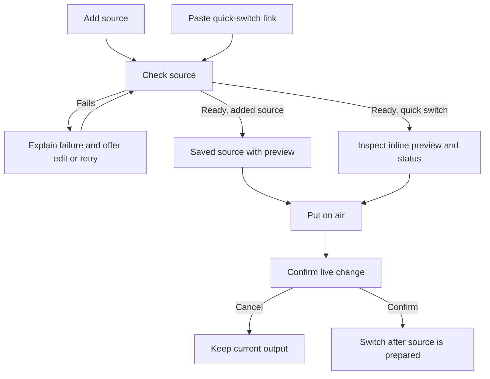

# Broadcast UX review

## Recommended next pass

Make source readiness and broadcast state predictable before adding more controls. The layout is settled enough to expose the remaining interaction gaps. BASIC approved applying this review to the local prototype. The changes below are now represented in the preview, not a release decision.

The main judgment for BASIC is whether Next DJ should preserve automatic scheduling. Recommendation: it should advance the lineup once and preserve the current mode. Choosing an unrelated source should pause scheduling, with that consequence stated in confirmation. Preserving mode reduces surprises, but an automatically scheduled transition could follow a manual advance soon afterward. The confirmation should name that next transition when schedule data exists.

## Review findings and accepted direction

| Priority | Observed experience | Recommended change |
| --- | --- | --- |
| 1 | Add input accepts a YouTube link, then leaves the source at Not checked. Preview offers a disabled Put Guest DJ on air button with no way to become ready. The same link reaches a switch confirmation through Quick switch. | Give both entry paths the same readiness process. Adding keeps the source in the list; Quick switch checks it and then asks to take it live. Show checking, ready, and failure with retry. Keep the current output until the replacement is ready. |
| 1 | Immediately after Start, the opening screen offers Next DJ: Aurora and Resume Aurora, although Aurora has never played. Hold current also refers to Aurora in its confirmation while the opening screen is on air. | Only offer Resume when there is an actual previous source. Make hold refer to the item currently on air. |
| 1 | Next DJ's confirmation says it pauses automatic switching. After taking Aurora, the page changes to Manual. | Preserve mode when advancing the lineup. Reserve the mode change for an explicit hold or unrelated source takeover. Keep the required live confirmation. |
| 1 | After stopping, the summary retains Manual and Next DJ Nova, while the card says Automatic lineup. Starting again resets to the opening screen and first DJ. | Make the offline summary describe the next start accurately. For the current reset behavior, display Automatic and Aurora before the user starts again. A resume-from-here feature is a separate decision. |
| 2 | On the wide live view, the large output image puts source selection and its preview well below the primary live controls. | Reduce the output preview's footprint or place source selection beside it on wide screens. Keep the selected source preview contextual. Test at an ordinary laptop height before choosing the layout. |
| 2 | During connection loss, the summary says On air Unknown, while Aurora's source row still says On air and destination Unknown is green. | Use Last on air for the source row during interruption and a warning or neutral destination status. Keep source availability distinct from output delivery. |
| 2 | The test page has a clear retry path, but success retains the Test your connection heading and a Back button. Setup also has two exits with different labels, Cancel and Back to broadcast. | Give success its own heading and one primary return action. Distinguish step Back from leaving setup. Editing should preserve saved credentials and unsaved work should not disappear through an ambiguous exit. |
| 3 | The page uses Video sources, Add input, Stream URL, Quick switch, and Put on air for related actions. Sources cannot be renamed, edited, or removed in this prototype. | Use Add source and Source URL consistently. Add a small source action menu when building source management. Retain the broad DJ stream or video link framing. |

Candidate copy for a future local iteration: Add source, Source URL, Connection test passed, Last on air. These are proposals, not approval to ship new public prose.

## Source-to-air journey

Current: Add input leads to Not checked with no recovery action; Quick switch proceeds directly to confirmation. Proposed: share readiness and keep the decision to broadcast explicit.

The setup page sequence remains Connection, Playback, optional Test, return to Broadcast. Existing [setup research and flow](broadcast-setup-flow-2026-11-09.md) support retaining that structure. This review does not propose a different onboarding journey. Uploaded audio and opening-screen customization remain in the [expanded capability brief](broadcast-expanded-capabilities-2026-11-09.md).

## Evidence and limits

Walked the current local fixture through setup entry, VRCDN playback parsing, simulated test failure and successful retry, return, start, Next DJ confirmation and completion, adding and previewing a custom source, Quick switch confirmation and cancellation, connection loss, and confirmed stop. Inspected rendered setup, failure, live view, and switch dialog screenshots. Checked the restart behavior against the fixture's Start handler. No backend or code-quality review was performed.

This pass used a wide desktop viewport. Mobile, full keyboard navigation, actual media playback, real provider readiness, and real broadcast recovery were not checked. The local preview server was restarted on port 3047, session 93047. No real stream was started or stopped.

## Implemented iteration

The local preview now shares simulated source checks between Add source and Quick switch. Adding opens its contextual preview. Failed sources offer a URL correction and retry. Quick switch checks before asking to broadcast; confirmation cancellation leaves the current output alone. Saved source names remain intact when the same link is used for a quick switch.

Next DJ preserves the current automatic/manual mode. Resume appears only after a source has played, and holding the opening screen names that screen. Stop clears pending work and resets the displayed next start to Automatic and Aurora. Connection loss uses Last on air on the previous source and a neutral Unknown destination status.

The broadcast workspace is narrower, reducing the output preview and bringing sources upward. Add source and Source URL are used consistently. Setup success has its own heading and one return action, with the redundant separator removed. Editing preserves the configured server and offers retaining the saved key without re-entry. Leaving changed setup asks whether to keep editing or discard; step Back retains the draft.

The implementation remains in preview.tsx, preview.module.css, setup-wizard.tsx and destination-setup.ts. Source checks and saved credentials are simulated. No key is persisted by this fixture. General rename/remove menus remain deferred source-management work.

Validation exercised source failure, retry, readiness, confirmation cancellation, Next preserving Automatic, first-start Resume absence, connection-loss labels, stopped reset, saved-key reuse, unsaved-edit recovery and the simplified passing-test return. Parser tests, focused lint and web typechecking are the automated checks for this iteration. Desktop screenshots at an effective 1280 by 800 viewport and a narrow 391-pixel layout were inspected; the narrow layout had no horizontal overflow. Temporary viewport overrides were reset. A CSS hot-reload error cleared on full reload, and the fresh live flow rendered without the issue overlay. Actual provider/media integration remains outside this design jam.

### Header and Quick switch follow-up

BASIC requested the existing app header and removal of design-preview language. Both Broadcast and connection setup now use PageNav and BrandLink, including the shared search, theme and account controls. Design notices, simulated-output captions and test controls are absent from the normal page. The fixture guard remains in place; review-only controls are available with the explicit tools=1 query parameter.

Quick switch now checks availability and opens an inline source preview before any broadcast confirmation. It can be checked while offline. Only a ready source while live offers an enabled Put on air action. Editing the URL clears the result and cancels an in-progress check. Failed checks allow retry. Status and media remain simulated in this local fixture, and the preview image is a placeholder.

Updated source-to-air sequence: paste link, Check source, inspect status and preview, Put on air, confirm, prepare replacement, switch. Cancel keeps the current output. This replaces the earlier immediate confirmation after a successful quick-source check.

### Person lookup

Quick switch now offers Find a person and Or paste a link together. The dropdown reuses the public people-search hook and shared profile-result presentation. Selecting a person resolves public stream links through a fixture-guarded endpoint. One link opens the check and preview directly; several links require selecting the source. Missing links and lookup failures retain the pasted-link fallback. Changing the person query clears the previous preview. Arrow keys, Enter, Escape and pointer selection are supported.

The local environment uses the existing public-search fixtures. This is a functioning search-and-select interaction, while media readiness and preview playback remain simulated. Keyboard selection of DJ Aurora, multiple source choices, offline Put on air disabling, pasted-link fallback and stale preview clearing were checked in Playwright. The browser was unavailable through CUA during this iteration, so the connected Playwright tool supplied the rendered check.
