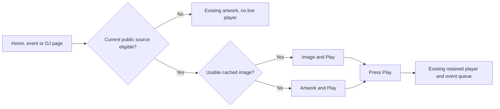

# Cached stream images before Play

## Recommendation

Show a small cached stream image where the Play poster is now, without constructing a player or opening video on page load. Start with Twitch's supplied thumbnails; keep event artwork, then DJ artwork, as the fallback. VRCDN needs a separate capture service unless its operator confirms an undocumented image endpoint. Do not make that larger service a prerequisite for the player repairs or homepage Live now.

This is research and a candidate implementation direction, not approval to launch polling, provision workers, or change provider configuration. BASIC's hybrid listening and no-autoplay decisions stay intact.

## What is confirmed

Source inspection at local commit `7c43a621ba81a1c1be2002fe715b024a3cfe4470`:

- `apps/web/src/lib/server/twitch-live.ts` already calls Get Streams, caches observations for 30 seconds, and keeps stale successful state for up to 60 seconds on errors. It currently discards stream ID and thumbnail URL.
- `apps/web/src/app/_components/vrcdn-stream-player.tsx` renders a gradient Play poster. Its intended contract is no stream connection before Play. This research did not run a browser network test.
- `apps/web/src/lib/server/vrcdn-live.ts` probes with a five-second timeout and 30-second server cache. The underlying probe opens `.live.ts`, then cancels its response body. That does not produce a frame.
- `docs/planning/player-performance-and-live-index-2026-11-06.md` proposes a shared event-scoped live index, not per-visitor polling. Viewer-slot impact is still an open question.
- The separate home-radio preview document already excludes an event when its canonical current performer has no source, even if a future performer is broadcasting. A cached image must never override that rule or explicit event-stream precedence.

Twitch's current official [Get Streams documentation](https://dev.twitch.tv/docs/api/reference/streams) supplies `thumbnail_url`: a frame from the preceding five minutes, with width/height placeholders. It accepts app or user tokens and up to 100 logins per query. Its response can exclude discovery-restricted streams, so an absent result is not universal proof that a channel is offline. Tokens belong on the server.

VRCDN's [public schema](https://api.vrcdn.live/api-docs.json) was fetched read-only on November 12, 2026. Its complete path inventory is `/health`, `/status`, `/viewers/{streamName}`. No thumbnail endpoint is documented. This establishes the public schema's limitation, not that no private capability exists. Neither provider stream was opened during research.

## Small first slice

1. Extend the shared liveness projection with provider identity, broadcast ID when available, thumbnail URL, observation time and expiry. Reuse its existing checks and public-visibility rules. A snapshot is decoration, never evidence of current liveness.
2. For Twitch, use the returned URL template at one fixed size, for example 640 by 360. Reuse the response already fetched for liveness; no extra Helix call per image. Do not construct undocumented CDN URL patterns from logins.
3. Render the cached image immediately when it belongs to the selected current source and a fresh live observation. Otherwise use existing event/DJ artwork. Image failure also falls back. Reserve aspect ratio to prevent layout movement.
4. Pressing Play constructs the existing retained player. Until then, fetch only an image, never an iframe, media manifest, transport stream, hidden video or browser canvas screenshot.

### What appears before and after Play?

Proposed cache behavior: refresh the shared live observation on its own cadence; reuse each image cache key for two minutes, rather than a random parameter per viewer. Twitch's provider frame may already be five minutes old, so this is not an exact live view. Keep that uncertainty internal unless the interface explicitly promises recency. A confirmed offline result, expired eligibility or different broadcast/source stops showing the old snapshot. A transient failure does not extend expiry indefinitely. Avoid a spinning image refresher in every browser.

The smallest Twitch version stores only metadata and uses the provider-hosted image. If first-party caching is required, use the existing image-delivery infrastructure with a narrow approved-host policy and bounded two-minute caching. Do not introduce object storage and a retention service solely for Twitch thumbnails. A direct provider image exposes the visitor's IP/referrer to that image host; a first-party image cache reduces that exposure. Keep the Twitch label and link to the actual broadcaster, without adding a new badge or attribution essay. Current provider display/retention terms still need review before shipping a copied image store.

## VRCDN later slice

If no provider image endpoint exists, capture one frame on the server, shared across viewers. Reuse an already-connected managed relay only when that relay is genuinely active; do not enable broadcast or relay just to obtain thumbnails. Community events without a relay need a bounded independent decoder task. Existing FFmpeg worker infrastructure is a possible host, not proof of a ready screenshot feature.

Candidate defaults: active event sources only, deduplicated by canonical VRCDN identity; at most one capture per source per five minutes; small concurrency limit and lease; an overall connection/decode deadline; first valid frame only; no audio output; fixed 640x360 JPEG/WebP and strict output byte cap. Encode from the decoded frame without EXIF/other metadata. Cache the latest successful image, not a history. Store under an opaque source/broadcast version key; mark capturedAt and expiresAt. Stop serving it after ten minutes or earlier source/offline/visibility changes, and delete stored objects after 24 hours at the latest. These are proposed limits, not measured requirements.

A capture needs enough input to reach a video keyframe. Its source-byte consumption and viewer-slot duration cannot be inferred from the output JPEG size. Separate processes every five minutes cost startup and reconnect overhead; a permanently running decoder costs continuous bandwidth/CPU. Benchmark one authorized test stream before choosing either. An audio-only stream has no frame and should simply keep artwork.

## Cost and trust boundaries

At N eligible VRCDN sources and one capture every five minutes, the upper bound is 12N attempts per hour while eligible. At 50 sources this is 600 attempts per hour. A proposed 100-KB image cap and one retained image per source is about 5 MB stored for 50 sources, but source traffic and decoder CPU dominate. Viewer image egress is requests times actual compressed image bytes. No dollar estimate or provider slot assurance has been measured.

Twitch API usage should reuse batched live-index reads. Follow actual `Ratelimit-Limit`, `Ratelimit-Remaining` and `Ratelimit-Reset` headers and back off on 429, rather than assuming an account allowance. [Official rate-limit guide](https://dev.twitch.tv/docs/api/guide/#twitch-rate-limits).

Do not offer an arbitrary-URL screenshot endpoint. Derive a fixed HTTPS VRCDN playback URL from the existing validated stream identifier, or accept only a current Twitch API thumbnail from a narrowly allowed image host. Reject credentials, unsafe schemes, private network destinations and unexpected redirects. Bound input bytes, decode time, dimensions and memory. Native decoders should run with minimal credentials and restricted egress. Avoid granting the capture worker ingest keys or broadcast-control permissions. Recheck public visibility before projecting metadata; invalidation must prevent a hidden profile's cached frame remaining discoverable.

## Qualification and remaining decisions

The player repair can ship with artwork fallback. The homepage can ship with cached public liveness and provider thumbnails where available. VRCDN screenshot coverage is separate.

Before shipping the first slice, test no pre-Play media requests, same image for multiple viewers, expired/offline fallback, missing current URL despite future URL, explicit event stream precedence, source/broadcast change invalidation, failed image fallback and private-profile exclusion. Visually review real desktop/mobile images and keyboard Play behavior. Provider integration tests must distinguish a successful image download from confirmed current broadcasting.

Not checked: production Twitch token configuration, live image responses/cache headers, exact provider capture quotas or billing, VRCDN viewer-slot accounting, screenshot reuse terms, physical-phone behavior, or a live FFmpeg capture. No implementation, deployment, provider configuration or stream playback was performed.
