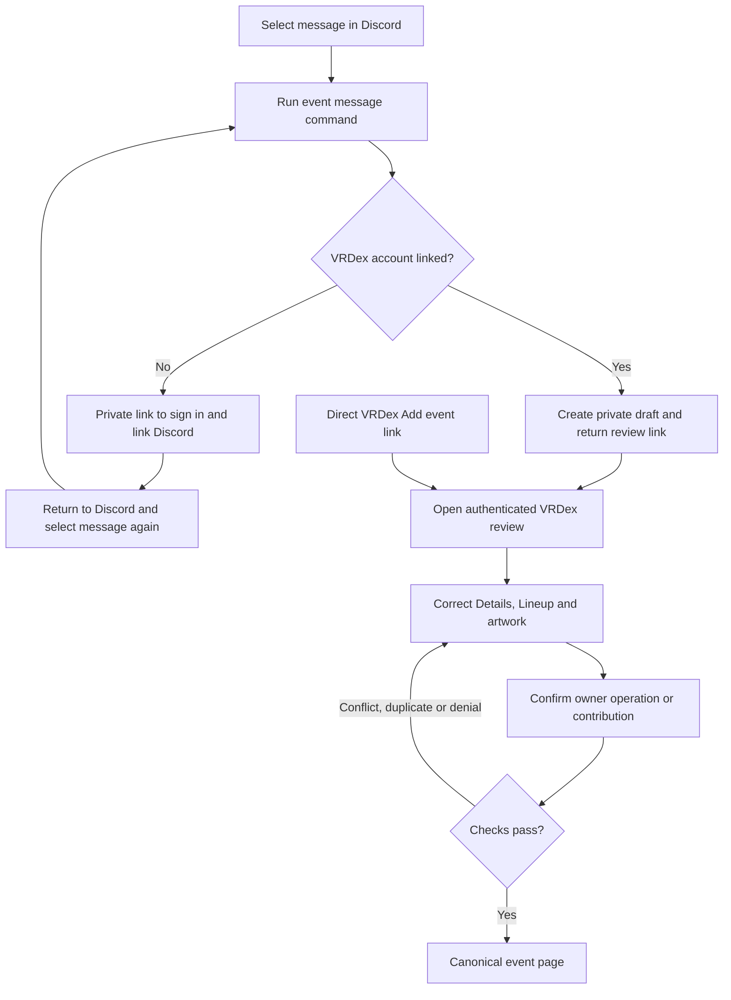

# Personal Discord event intake

## Recommendation and decisions

Use a user-installed Discord message command to send one selected announcement into a private VRDex draft. Open the existing website editor to review extracted details, correct the lineup, and explicitly publish. This reaches DMs and servers where the bot is absent without asking community admins to install it.

Research supports feasibility. The [implementation plan](../superpowers/plans/2026-11-16-discord-personal-event-intake.md) turns this scope into tasks. Neither document authorizes app configuration, private-message collection, publication, or deployment.

| Status | Decision |
| --- | --- |
| Locked decision | BASIC selected one message, then review on VRDex. Multi-message collection is outside v1. |
| Current recommendation | One message command, private acknowledgement, authenticated website review. Use the current gateway rather than changing the existing application's interaction delivery. |
| Locked decision | BASIC approved linking the VRDex account before capture. An unlinked user links their account, returns to Discord, and selects the message again. No anonymous private-message inbox. |
| Current recommendation | Use the existing contribution route for unrelated communities and authenticated owner create/update routes for BASIC's owned communities. An owner denial stops the operation, with no contributor fallback. |
| Locked decision | BASIC selected using the poster as event artwork by default, with a remove option during review. The preview must make the proposed public image visible before publication. |
| Deferred | Collecting several selected messages, automatic updates, history reads, new distribution destinations, and a complete Discord editor. |

## Confirmed Discord capabilities

A global command supporting `USER_INSTALL` can be invoked in guild channels, the bot's DMs, and private channels with other users, including group DMs. Bot membership in the guild is unnecessary. A message command supplies the selected message through resolved interaction data; it does not take additional arguments. Its content is an exception to the privileged message-content restriction. Available text, attachments and embeds can be used, but missing fields and incomplete message objects must be handled. [User-install tutorial](https://docs.discord.com/developers/tutorials/developing-a-user-installable-app), [message commands](https://docs.discord.com/developers/interactions/application-commands#message-commands), [message-content exception](https://docs.discord.com/developers/events/gateway#message-content-intent).

User installation supplies no general conversation access. A message URL does not authorize fetching neighboring messages or private history. Slash commands can accept explicit text or attachment options, but cannot silently read the surrounding conversation. They are a fallback only if message selection proves inadequate on a supported client. [Installation model](https://docs.discord.com/developers/quick-start/getting-started), [command options](https://docs.discord.com/developers/interactions/application-commands#application-command-option-type).

Reply privately within Discord's three-second acknowledgement window, then use the website for the longer review. Interaction tokens last 15 minutes, so they cannot be the draft's lifetime or its authorization. A denied `USE_EXTERNAL_APPS` permission prevents public replies from an external user-installed app, while still allowing private replies. [Interaction responses](https://docs.discord.com/developers/interactions/receiving-and-responding), [permissions](https://docs.discord.com/developers/topics/permissions#bitwise-permission-flags).

Direct install links and App Directory discovery are separate. Portal settings, verification status and distribution eligibility have not been inspected. Desktop/browser and mobile app use are documented, but exact message-menu behavior and the complete website handoff still need client tests. See the [capability research](./discord-user-app-capabilities-research-2026-11-16.md) for the context matrix, OAuth details and distribution sources.

## Proposed journey: turn one announcement into an event

The direct Add event path remains usable without Discord installation. It opens or creates a draft after authentication. The selected-message path supplies a private draft reference, never raw chat text or signed attachment URLs in the browser URL. A reference alone grants no access.

The website previews candidate fields privately. It must show unresolved date/timezone and identity questions before publication. Missing context is corrected manually. A user can discard the import, save the draft, or continue later from My events. Closing Discord or exhausting its interaction token must not discard a saved draft.

## Bounded v1

- Add one message command supporting user installation and the relevant invocation contexts. Keep guild-management commands restricted to guilds and Manage Server. Do not loosen the existing `/vrdex connect` command to obtain the new behavior.
- Capture only the selected message's useful text and available embed text. Treat links, embeds and author claims as untrusted input, not as permission to fetch more messages. Do not traverse reply chains, forwarded messages or arbitrary external pages.
- Handle one poster using the existing image validation and private storage. Use it as artwork by default and let the user remove it during review. If the message contains several images, ask the user to choose one on VRDex. The shared extractor currently accepts one poster. Do not silently select an unrelated image or fetch arbitrary embed URLs.
- Reuse extraction, public identity lookups, local-time resolution, tentative fields, Details, Lineup and Review. Keep the submitter's accepted fields separate from suggestions. Extraction failure leaves manual editing available.
- Bind submission and review to the actual interaction actor's stable Discord ID and authenticated VRDex account. App installation and Discord guild membership do not grant VRDex ownership. Recheck owner or staff authority when committing an owner operation.
- Confirm the exact event and operation before writing. Existing-event updates need a fresh revision and an explicit target. Preserve unrelated fields and lineup rows; do not replace a lineup from a partial announcement. Exact duplicate contribution publication returns the existing event rather than applying the draft as an update.

## Reuse and required differences

Current main already has a shared extraction package, a gateway announcement relay, community-authorized connectors, poster storage and resumable website intake. The connector collects channel context and can publish under its approving staffer's authority. That orchestration is unsuitable for personal submissions: reuse its helpers where appropriate, but keep the personal draft actor-bound and explicitly reviewed. [Shared extractor](https://github.com/BASIC-BIT/VRDex/blob/301286c713aa9ca1d55bb6ef68f372df669969db/packages/event-intake-agent/src/index.ts), [connector runner](https://github.com/BASIC-BIT/VRDex/blob/301286c713aa9ca1d55bb6ef68f372df669969db/convex/discordIntakeRun.ts), [gateway](https://github.com/BASIC-BIT/VRDex/blob/301286c713aa9ca1d55bb6ef68f372df669969db/apps/discord-gateway/src/index.ts).

The current Discord account resolver requires exactly one successfully verified account mapping and checks its current linked Discord provider ID. Reuse its conservative identity checks, while checking whether ordinary Discord sign-in needs a simpler supported linking path. Do not resolve by display name or accept a caller-supplied VRDex user ID. [Resolver](https://github.com/BASIC-BIT/VRDex/blob/301286c713aa9ca1d55bb6ef68f372df669969db/convex/_discordIntake.ts), [Discord OAuth](https://docs.discord.com/developers/topics/oauth2).

Owner browser/API/MCP create and update commands exist. The contribution editor does not automatically turn into that owner workflow, so the handoff must explicitly choose the authorized editor and map reviewed fields. Discord source provenance must survive separately from official management labels. [Owner commands](https://github.com/BASIC-BIT/VRDex/blob/301286c713aa9ca1d55bb6ef68f372df669969db/convex/events.ts), [draft/editor implementation](https://github.com/BASIC-BIT/VRDex/blob/301286c713aa9ca1d55bb6ef68f372df669969db/apps/web/src/app/events/event-intake-form.tsx).

The ordinary contribution path still has a flat 10-new-publications-per-account rolling-day cap, without an elevated-role exemption. Connector publications have separate authority and quota treatment. A personal submission must not masquerade as a connector to evade the cap. Any change to the account cap is a separate issue. [Preflight](https://github.com/BASIC-BIT/VRDex/blob/301286c713aa9ca1d55bb6ef68f372df669969db/convex/_eventContributionPreflight.ts), [publication](https://github.com/BASIC-BIT/VRDex/blob/301286c713aa9ca1d55bb6ef68f372df669969db/convex/_eventIntake.ts).

## Private sources, retries and recovery

| Case | Required behavior |
| --- | --- |
| Private conversation content | Extract event facts only. Do not copy chat quotations, private author details, message URLs or surrounding conversation into public summary/source fields. Keep original source attribution separate from organizer authority. |
| Poster | Distinguish private evidence from public artwork. Current completion automatically prepares/selects artwork, which fits BASIC's selected default. Show that artwork and its remove option before the user confirms publication. Removing artwork should not erase reviewed event details. |
| Retention | Proposed default: retain only the selected, necessary evidence under the existing bounded private draft/source lifecycle, no full interaction payload or conversation archive. Existing drafts expire after 30 days of inactivity; private image evidence has its own bounded expiry. Text/model evidence needs an explicit cleanup policy before launch, including publication and discard. Private-source deletion must not remove published event facts or intentionally selected public artwork. |
| Expired or missing attachment | Keep text and reviewed fields. Offer reattachment or text-only continuation. Do not promise to refresh a CDN URL through inaccessible message history. |
| Repeat delivery or repeated selection | Use the Discord interaction ID to make delivery retries idempotent. Repeated deliberate selection of the same source should offer the existing draft or event, not silently overwrite it. Scope source IDs to the submitting actor. Keep content revision/fingerprint separate from message identity. |
| Publication retry | Reuse the existing actor/draft/version-bound idempotency key and deterministic duplicate checks. A near match needs review; a failed owner write stays failed. |
| Source edit/delete after selection | Treat the draft as a reviewed snapshot. No passive synchronization or automatic event deletion. A later explicit submission can be reviewed as a new operation. |
| Provider failure, quota or concurrent edit | Preserve manual edits, report the actual failure privately, and let the user resume or retry. Do not silently create a contribution after an owner denial or overwrite a newer revision. |

The existing source policy and poster bridge are useful references, not proof that all private-DM requirements already exist. The bridge auto-selects artwork today. The extractor uses `store:false`, but that is not a promise of zero provider retention. Review the applicable provider controls before sending private material. [Source policy](../backend/event-intake-sources.md), [current poster bridge](https://github.com/BASIC-BIT/VRDex/blob/301286c713aa9ca1d55bb6ef68f372df669969db/apps/web/src/lib/server/discord-intake-posters.ts).

## Unknowns and validation before release

Use owned fixture announcements to test guild-without-bot, DM and group-DM selection on desktop/browser, iOS and Android. Include text-only, embed-only, poster-only, several images, expired attachments and unavailable content. Verify denied external-public replies remain private. Exercise account mismatch, ambiguous identity mapping, sign-in return, revoked authority, the existing quota, duplicate selection/publication and stale draft/event revisions. Confirm owner updates preserve untouched lineups and provenance, and that a private source link or chat quotation never reaches public projections.

Current app user-install settings, registered commands, distribution eligibility and live client behavior remain unverified. The shared gateway is documented as Gateway-first. Reusing it avoids changing the application's interaction delivery; a separate HTTP application would only be justified if a demonstrated hosting or isolation requirement warrants it. No live app or infrastructure inspection was needed for this feasibility pass.

## UX reference check

Bounded Mobbin research on November 16, 2026 used `saving a message to another app` on iOS, then one refinement, `saving an article with a browser extension` on web. The Executor Mobbin route worked under its configured Default service account. Account identity beyond that catalog designation was not checked. All returned inline preview positions were inspected; high-resolution originals and live behavior were not inspected.

| Reference | Observed preview sequence | Implication and gap |
| --- | --- | --- |
| [Telegram: saving a message](https://mobbin.com/flows/c42701d2-79f2-4057-a377-68dcb868e77c) | Positions 1 and 2 show a forwarding destination picker; position 3 shows a Saved Messages confirmation. | Keep an explicit destination and receipt. No external app, authentication or event review is shown. |
| [NGL: saving a message](https://mobbin.com/flows/83ce5eb7-a6ca-4708-9d8a-709414f7e9a0) | Position 1 shows a message and download control; position 2 shows a saved confirmation. | A short confirmation can complete capture. It does not establish persistence or external review behavior. |
| [New York Times: saving an article](https://mobbin.com/flows/14a44131-6082-4207-9eea-5b2cb76f5f72) | Positions 1 and 2 show the article with an outlined, then filled bookmark. | Keep capture lightweight. The requested browser-extension/authentication handoff is absent. |

These captures do not answer authentication recovery. The recommendation instead uses VRDex's existing sign-in return and resumable draft behavior, plus an explicit re-selection for unlinked accounts. No additional Mobbin search is needed for this initial scope.

## Evidence appendix

- Reviewed current GitHub main at `301286c713aa9ca1d55bb6ef68f372df669969db` through read-only GitHub API calls. Main source was read into a temporary directory, without switching branches or updating the checkout.
- The shared checkout was on `claude/event-platform-designs` at `d2f2febba`, with unrelated untracked changes. Its older gateway code is not evidence of current main behavior. Those changes were left untouched.
- Official Discord documentation was read on November 16, 2026. The [capability note](./discord-user-app-capabilities-research-2026-11-16.md) preserves detailed links and the distinction between verification, Discovery and privileged-intent review.
- No application configuration, permission changes, private-message collection, posting, publication or deployment occurred. This research does not prove deployed runtime health or extraction accuracy.
