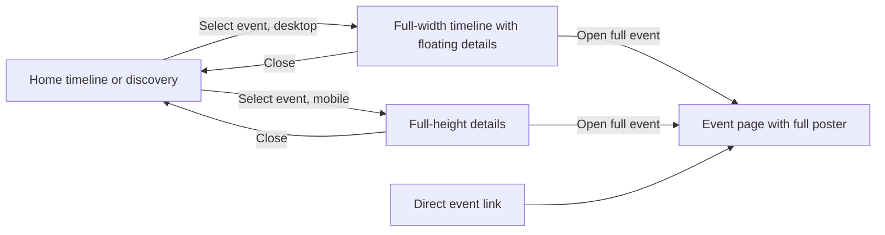
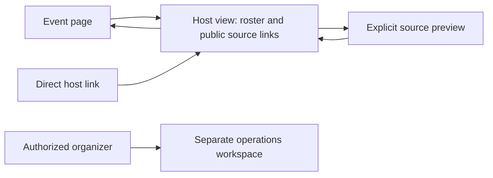
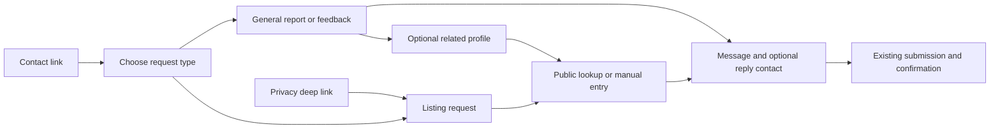

# Event design jam, November 5, 2026

## Integration status, November 11

The accepted UI is integrated on `codex/public-ui-integration` in a native managed worktree. The original jam branch remains the immutable visual reference. Current-main analytics consent, broadcast behavior and past-24-hour timeline retention are preserved. Real provider image retrieval remains deferred.

[PR #457](https://github.com/BITRATE-Labs/VRDex/pull/457) carries the integration with `ci:browsers` and `ci:visuals` selected. BASIC requested publication and iteration to merge-ready after merging #456. Its exact-candidate setup is integrated, and the current-branch signed-in lane now includes the host grant/revocation flow. Publication is not merge readiness: that test and the latest-head checks must pass before readiness is reported. Local verification and PR evidence are recorded in the final appendix.

## Accepted checkpoint, November 11

BASIC called the current UI good enough and asked to lock it in for now. This freezes the local design candidate, including shared header/footer, timeline spacing, profile links and compact stream cards, worlds and thumbnails, event/host controls, contact/report lookup, logo variants and media details with synthetic fixture history. Earlier candidate notes below are iteration history and are superseded by the final source. This acceptance is not merge, deployment or live-provider acceptance.

Checkout: `D:/bench/VRDex-wt/event-design-jam-1105`, branch `codex/event-design-jam-1105`. Use this branch and its checkpoint only for historical comparison; continue production integration on `codex/public-ui-integration`. Preview URL: `http://127.0.0.1:3015`; backend: `http://127.0.0.1:3210`. Previous process IDs are historical. Restart and verify services before relying on the preview after a session restart. Existing captures remain in `apps/web/.cache/jam/`; local caches are intentionally excluded from the source checkpoint.

The narrow `host_events` permission is community-wide, with owner/manage_events access retained. It does not grant broadcast controls. Real provider world/group image fallback remains deferred. Fixture photo history is synthetic and only enabled outside production with the existing fixture flag. Support backend destinations and privacy/suppression safeguards remain unchanged.

At the jam checkpoint, verification consisted of the focused checks below. The integration appendix supersedes that historical verification status. Real signed-in role assignment, provider acceptance and deployment remain outstanding. The broader worker suite previously passed 179/181, with two dispatch-fixture failures reproduced on Windows. A release pass must rebase onto current main, rerun relevant checks, resolve those failures and review public-copy changes before shipping.

## Iteration record

## First local experiment

Explore event details while preserving the timeline width, with the full poster available on the event page. This is a throwaway local experiment for BASIC to react to, not an approved redesign or release candidate.

- Current main verified at `2f58403fb2eb6ee66e8bf697bd34ad0ec223bc18`.
- Isolated checkout: `D:/bench/VRDex-wt/event-design-jam-1105`, branch `codex/event-design-jam-1105`.
- [Browsing preview](http://127.0.0.1:3015/?at=1794524170305). Click Afterglow Harbor Sessions.
- [Poster page](http://127.0.0.1:3015/playwright-afterglow-social/events/playwright-afterglow-harbor-sessions).
- Synthetic local seed supplies browsing data. The poster page uses the existing server fixture. These are distinct representative states, not production content.
- Native in-app browser unavailable; Playwright connector profile occupied. BASIC approved localhost plus chat feedback. Disposable headless browser used for render checks.

## Decisions and proposals

Confirmed: remove Full lineup, prioritize the full poster, remove When duplication, preserve saved interests and backend schedule semantics. BASIC rejected the first split experiment because it squeezed the timeline.

Current experiment: the timeline keeps its full width. Details use a floating 520px panel on desktop. This is a local candidate, not an accepted final layout. Mobile details occupy the full viewport and Close returns to browsing. Club artwork uses a compact landscape frame. The event page replaces When with the full uncropped poster and retains existing host/world links.

Add event now shares the Hosted events heading row, using the existing Media kit section pattern and wrapping with a gap on small screens.

Open for BASIC: how should details coexist with the full-width timeline? Full page composition, shallow lineup links, reporting modal, hero blur and organizer consolidation remain for later iterations.

## Proposed navigation

## Saved-night finding

Known code behavior: active lanes exclude timed events whose endAt is at or before now. The fallback collection includes every save outside those visible lanes, including expired events. This explains why old interests remain under My night. No saved data was removed or persistence changed.

Candidate direction: active-night membership uses event instants and preserves ongoing overnight events across midnight. Past interests remain accessible separately. Missing ends and the boundary of a night still need a product decision. This finding is source inspection, not a reproduction against BASIC's private saved state.

## Mobbin evidence

Read-only native search succeeded on November 5, 2026. Connected account identity is not exposed by these operations. Findings are sampled inline captures; full-resolution originals were not downloaded. No collections or comments were written.

Task intent: Explore a poster-first VRChat event browsing and detail experience in a local prototype. Output destination: code.

| Reference | Observed capture | Implication and limits |
| --- | --- | --- |
| [Sweatpals schedule detail](https://mobbin.com/flows/6562c7c9-6f6b-4504-9034-5a9715f4823e) | Positions 1, 2, 3 sampled: experience list, calendar, event popover with Details | Keeps schedule context; popover does not establish a true split or its mobile equivalent. |
| [Luma management overview](https://mobbin.com/screens/0f628d55-3cd1-47b3-b83f-2c74f1522ccd) | Overview with event preview, management tabs and separate Event Page link | Useful organizer/public separation. Permissions and navigation behavior unobserved. |
| [Posh ticket choices](https://mobbin.com/screens/4e6455be-bc03-4071-a359-eb6919356bd5) | Full portrait artwork beside ticket options, blurred artwork behind the modal | Supports preserving artwork shape separately from the backdrop. This is checkout, not event discovery. |

Queries: browsing events and viewing event details (web, two flows); Luma event detail page (web, two screens); event ticket page with event poster (web, two screens). Mixpanel analytics event details was an irrelevant match and rejected. Eventbrite checkout was inspected but not used. Luma's second overview was redundant. Transparent-logo and shallow-lineup references remain unresearched.

## Evidence and remaining work

Local screenshots: `apps/web/.cache/jam/`. Runtime logs: `.cache/jam/`. Web process started as 114520; backend lifecycle is not tied to production. Use loopback port 3015 for web and 3210 for local Convex.

TypeScript check passed before the final CSS height correction. Desktop split open and mobile Close checked with a disposable headless browser. Full-poster page visually inspected. No release checks, merge, deployment, real-content mutation, production-media change or Discord write.

The Faceless original/served alpha is UNKNOWN. Current synthetic fixtures do not establish anything about that asset. Reporting, links and organizer architecture remain unchanged.

## November 6: shared site layout

BASIC requested one common header/footer owned by the application layout after noticing the event-page logo differed from Home. The footer already lived in the root layout. The header now lives there too, using one wordmark and the same navigation, search, theme and account controls on every route, including sign-in.

Pages retain only contextual PageActions. Removed the page-owned PageNav/BrandLink API and migrated its callers and preview fixtures. Public copy and auth permissions were not changed. The mobile header wraps navigation links below the logo and utility controls.

Local verification: TypeScript and lint passed; the calendar export suite passed 9 tests. A new browser regression passed across Home, profile, event, sign-in, support and API-reference pages on desktop and mobile. It checks one common header, expected navigation, one footer and no page overflow. Home, event and sign-in screenshots were visually inspected at both widths. Signed-in account behavior and release CI remain unverified. The preview remains a local experiment.

November 9 profile tweak: BASIC rejected the submission label and date near the top. The ownership row now shows only Unclaimed plus the existing claim/edit actions. Source metadata stays in the data model. Desktop and mobile render checks confirmed removal of the label/date and retention of claim actions.

## November 9: world artwork and community banners

Confirmed by BASIC: remove the world-page heading Place, vibe, context; show world artwork and creator profile pictures; explore a VRChat group banner as the default community banner.

The local world page now uses the existing heading About this world and a landscape image beside the title. Creator credits use public profile reads, with live-provider probes disabled, to get the same avatar shown on the linked profile. Missing or unavailable public photos retain the shared initials fallback. No new Convex API, schema or permission change was introduced.

[World preview](http://127.0.0.1:3015/playwright-neon-harbor) and [community preview](http://127.0.0.1:3015/playwright-afterglow-social).

Important preview limit: Neon Harbor and Afterglow are fictional fixtures. Their world image and banner are synthetic local artwork, not VRChat provider data. Group banner support is illustrated by setting the existing fixture banner field. It is not an implemented provider fallback.

Current recommendation for the later provider slice: retain custom VRDex artwork when present; otherwise use the linked VRChat world image or selected group's banner. Respect hidden/disabled media preferences and use the existing source-selection rules when several groups are linked. The current provider image cache stores group icons but no group banners, and the public world projection has no separate cached VRChat image. Default retrieval therefore needs a normal backend/worker design and verification pass. Do not create a new provider fetch on every public page view or overwrite owner's media to achieve this visual.

Desktop/mobile browser checks pass for world artwork, creator pictures and copy removal. Both world and community layouts were captured at 1440px and 390px and checked for overflow. Provider reads, real-world images and group-banner retrieval are not verified.

## November 9: profile links, first visual candidate

BASIC asked to improve link presentation. Current recommendation for reaction: equal-width rows with a platform icon or existing destination picture, owner label, quiet platform/domain text and an open action. Discord's existing copy control now sits in a matching row. Desktop uses two columns; phones use one. Labels, destination URLs, verification details and clipboard behavior remain intact. Twitch/VRCDN viewing and stream-copy surfaces have not been redesigned in this pass.

[Try BASICBIT's links](http://127.0.0.1:3015/basicbit). This is a candidate, not an accepted final layout. It trades some extra vertical space for consistent targets and easier scanning. The earlier uneven button cluster remains visible in `.cache/jam/links-before.png` under apps/web; candidate captures use `links-candidate-1440.png` and `links-candidate-390.png`.

Mobbin read-only search on November 9, query creator profile social links, web, limit two. Task intent: Improve how external links are presented on VRDex public profiles in a local design prototype. Output destination: code. Native operation succeeded; account identity remains unavailable. Inline captures inspected, no images exported or collections written.

| Reference | Observed | Implication and limits |
| --- | --- | --- |
| [Magnific author profile](https://mobbin.com/screens/4e87da99-f61e-416f-b3f9-cc8cf5a5562a) | Two small labeled social buttons below author information | Keep socials compact and recognizable. VRDex also needs varied custom links, readable destinations and copy actions, so small icon buttons alone are insufficient. |
| [Patreon creator profile](https://mobbin.com/screens/c65e143d-93d4-4b76-83f5-28c7d85021c9) | Social marks visible in the creator's banner artwork | Weak match, not used to infer clickable link behavior. |

These are screen samples, not inspected journeys or evidence of usability. No navigation sequence or auth gate changed, so no new journey diagram is needed for this styling experiment.

Verification: TypeScript and lint passed. Eight existing public-connection fixture checks passed across desktop/mobile. A local clipboard stub confirmed Copy Discord writes basic_bit at both widths. Candidate renders were checked for overflow and visually reviewed. No external navigation, provider writes or release verification was performed.

November 9 link revision: BASIC suggested icon buttons. The new local candidate uses 48px buttons for recognizable destinations, with visual labels on hover/focus and accessible names. Discord uses the existing clipboard control with a brand icon and success check. Ambiguous website/custom links and verified connections retain readable text. Desktop/mobile icon size, keyboard hint visibility and clipboard value were checked; eight connection fixture checks pass. The row-card candidate is superseded for visual comparison, not accepted as release behavior. Captures: apps/web/.cache/jam/link-icons-final-1440.png and link-icons-final-390.png.

November 9 accepted link refinement: BASIC approved Discord as a compact username/copy control and requested service icons for icon buttons. Discord now shows its service icon, visible handle and copy/check action in one button. Compact VRChat/Discord-server destinations use their service mark; SoundCloud, Spotify, YouTube, Bandcamp and Twitch reuse existing service icons. Verified destination rows keep their identity/verification detail. Fixed the link/watch grid's mobile minimum width after Aurora exposed horizontal overflow. BASICBIT and Aurora now fit both viewport sizes. Ten clipboard/verification fixture checks, TypeScript and lint passed; fresh desktop/mobile captures were visually reviewed. No new service integration or release occurred.

November 9 VRChat revision: BASIC found the service mark too small and requested a card-style button. VRChat destinations now use a wider card with a larger mark or destination picture, a visible account/group label and platform/verification details. Other service icons stay compact; Discord keeps its visible handle/copy control. Hover labels are anchored within the link section so they do not extend past narrow screens. Twelve focused link/verification checks passed, plus TypeScript and lint. BASICBIT and Aurora were visually checked at desktop/mobile widths with no overflow. This remains a local visual candidate.

November 9 consistency correction: BASIC rejected mixing three link styles in one list. All profile links now share a compact card grid with the same height, width, icon area, label/destination hierarchy, border and spacing. Discord uses that same presentation and differs only in its copy/check action. Removed icon-only branching and its tooltips. Existing verification information remains visible. Twelve focused checks pass; BASICBIT card dimensions match at desktop/mobile sizes and both BASICBIT/Aurora fit without overflow. Current captures use apps/web/.cache/jam/unified-links-*.png. Earlier mixed-style candidates are superseded.

November 9 Twitch/VRCDN refinement: BASIC requested Twitch as a regular link card, more compact VRCDN copy text, and removal of Open preview now that the in-site player exists. Twitch now shows service then channel, with confirmed live status on the matching channel. Removed the separate Twitch-content slot and unused preview URL prop from the profile stream component. Quest/PC use one-line URL rows with ellipsis and full-value titles/copying. The player, confirmation timing, offline handling and stream provenance are unchanged. Six profile-link checks plus eight selected lifecycle/offline/playback cases passed across desktop/mobile (the offline checks were rerun after correcting a state-dependent test locator). TypeScript and lint passed. Both profiles were visually checked without overflow. Storybook and the full submission suite were not run. The change is local only.

November 9 VRCDN sizing: BASIC requested a tighter card around the stream controls. The desktop stream column is now 24rem, and each stream's status, compact copy rows and optional player share one existing Card primitive with small padding. Removed the redundant vertical divider. Player lifecycle/copy checks passed in six desktop/mobile cases; both fixture profiles were captured and checked without overflow. Local preview only.

## November 9: event host rundown candidate

BASIC requested a host-page improvement. The local candidate groups the roster into one shared Card, with aligned set times, performer pictures and source controls on desktop and stacked rows on phones. The event-page return action uses the shared button styling. Existing selected-source, scheduled-time and provider-live states remain distinct; alternative links and full URLs stay disclosed on demand. Preview remains explicit and singular. This is a visual candidate for feedback, not a change to organizer permissions or broadcast controls.

[Try the host fixture](http://127.0.0.1:3015/playwright-afterglow-social/events/playwright-event-host-view/host). Captures: apps/web/.cache/jam/host-after-1440.png and host-after-390.png. The fixture uses synthetic performers and schedule data; missing pictures use existing initials.

Mobbin read-only search, November 9: live streaming dashboard, web, limit two, output destination code. Native search succeeded; account identity unavailable. Inline screens inspected, no exports or collection writes. [Circle live sessions](https://mobbin.com/screens/50750404-8144-4e87-aa5e-925f44802ffe) informs the aligned roster hierarchy. [Whop live session](https://mobbin.com/screens/c2bdf4f1-d630-43a1-9584-4b7e32baf4eb) demonstrates a separate active viewing area, deferred here pending organizer feedback. These are sampled screens, not evaluated journeys or usability evidence.

The navigation and authorization flow is unchanged:

Desktop and phone captures were visually reviewed and fit their viewports. TypeScript, focused lint and 15 host behavior/boundary tests passed. Test-loader stubs were updated for the shared Card, image and button imports. Real provider and broadcast operation acceptance is outside this local styling pass.

November 9 host scope clarification: BASIC owns broadcasting in another thread. This view is for scanning the lineup, copying links and checking stream readiness. Added a local Up next candidate: earliest future timed set, using the same selected-source then VRCDN then first-link priority as its roster row. Copy remains available when offline or unknown. The shortcut follows the schedule, never switches on provider-live status, skips untimed sets, and disappears when no future timed sets remain. It does not control broadcasts. This can differ from an actual running order during delays; all roster links remain available manually. Exact proposed utility labels: Up next, Copy Next PC, Copy Next Quest, Copy Next link, Source: followed by the existing status value. Candidate only, awaiting BASIC's reaction.

Verification: 18 desktop/mobile browser cases and 15 host behavior/boundary tests passed, plus TypeScript and focused lint. Browser coverage checks offline copying and expiry of the next-set shortcut. Captures: apps/web/.cache/jam/host-next-1440.png and host-next-390.png. No provider readiness guarantees or actual stream handoffs were verified.

November 9 event-to-host entry: BASIC requested removal of the event-page DJ links section and a more accessible host entry. Removed the obsolete accordion component and its component-only test, promoted Host view to a standard button immediately below the banner, and retained event-owned stream links in ordinary Links. Copy-intended event links use the existing CopyValueRow; open links keep their existing destination handling. Performer source controls remain in Host view. Migrated keyboard copy coverage there and removed the obsolete expanded-accordion snapshot case. The event journey in docs/backend/event-schema.md now reflects this split. Historical intake checkpoint evidence describes the earlier UI.

Eight focused desktop/mobile browser checks passed for roster navigation, keyboard copying, event links and contextual watch. Actual event-to-host navigation and screenshots were checked at 1440px and 390px without overflow. Updated stale When/Doors open/Place assertions from the earlier event layout. Snapshot baselines and the full suite were not regenerated or run. Captures: apps/web/.cache/jam/event-host-action-1440.png and event-host-action-390.png. Local jam only.

November 9 correction: BASIC explicitly removed the event-owned VRCDN copy link from public event pages. The Links section now excludes VRCDN targets using the existing parser. Other event links and contextual playback remain intact. Four desktop/mobile event/watch smoke cases passed with an explicit absence assertion; mobile Links screenshot: apps/web/.cache/jam/event-links-without-vrcdn.png. No source data was changed.

November 9 calendar action: BASIC requested the ICS control outside Links. Add to calendar is now a compact calendar-icon button beside Host view below the banner, inside Event actions navigation. Removed the Download .ics subtitle. The download endpoint is unchanged. Four desktop/mobile event/watch checks passed; the calendar control is asserted within Event actions. Desktop and phone captures use apps/web/.cache/jam/event-calendar-action-*.png. Full suite and snapshot baselines were not rerun.

November 9 approved host access: BASIC clarified that hosts should not require full community admin and accepted a dedicated event-host permission. Added host_events to the existing community role/capability model and staff permission picker (Host events). Owners and manage_events staff retain access; a host-only grant does not allow event editing or broadcast operations. Host action visibility, reactive host projection, direct host route and status route now enforce this boundary for published and private events. Removed the server public-event fallback after denied/missing auth. Synthetic fixture previews remain explicitly gated by the existing non-production fixture flag. This is a community-wide host permission, not per-event assignment. Existing staff invitation and role-assignment limits still apply.

Calendar refinement: BASIC requested a small bordered icon at the top right of the event banner. Moved the existing Add to calendar action there, with accessible name and tooltip; removed it from the separate action row. Calendar download is still public. Captures: apps/web/.cache/jam/calendar-banner-1440.png and calendar-banner-390.png.

Verification: 20 desktop/mobile host flow cases, seven server/polling boundary cases, dedicated backend host authorization including role and revocation, and 31 community authority/staff/resource tests passed. Backend/web TypeScript checks passed; focused UI lint passed. The broader worker suite passed 179 of 181 cases. Two dispatch-failure fixtures fail at event-broadcast-worker.test.ts:620 with missing dispatchId. They execute an extensionless Unix-shebang fake AWS CLI on Windows; platform compatibility is a suspected cause, not proven here. The registration-response case also fails in isolation. Actual signed-in browser role assignment and hosted acceptance remain unverified. Changes are local only.

November 9 reporting refinement: BASIC requested Report event as a flag beside the calendar icon and tooltips for both. The public event banner now has matching icon controls with visible hover/focus tooltips. Report opens the existing form in a native dialog with Escape, close control and focus return. Removed the public page's standalone report section and empty contribution-control spacing; authorized correction/takeover controls remain available in their existing location. Existing reason validation, mutations and staff removal permissions are unchanged. The standalone contribution fixture keeps a report trigger for its connected form checks.

Verification: four desktop/mobile cases passed for tooltip focus, pointer hover on desktop, dialog open/close/Escape/focus return, reason validation, and connected staff takeover/removal submission. TypeScript and focused lint passed. Desktop/mobile icon and dialog captures use `apps/web/.cache/jam/event-report-{flag,dialog}-*.png`. Full suite and live report submission were not run; no real reports were sent.

November 9 action grouping: BASIC found the remaining standalone Host view button awkward. Moved it into the banner action icons beside calendar/report, with the same border, sizing and hover/focus tooltip. Its existing permission gate is unchanged. Removed the separate action row. Four focused desktop/mobile tooltip/dialog/permission checks passed, and actual host navigation passed at both widths. A transient unstyled development capture was replaced with a freshly styled mobile screenshot (apps/web/.cache/jam/banner-host-styled.png). Full suite not rerun.

November 9 header logo: BASIC requested a slightly smaller wordmark farther left, removal of the dark backdrop and theme variants. Removed the link's bg-media and horizontal padding; the original SVG was already transparent. Reduced width from 137px to 128px and relaxed the header's desktop inset/container alignment. Dark mode retains the pale original; light mode uses a transparent ink/blue SVG variant. Scoped CSS selects the variant using the existing data-theme attribute. Both themes were captured at desktop/mobile widths and verified to expose one visible logo. Restarted the local preview (PID 66976) while resolving stale global stylesheet output; scoped styles load correctly. No full suite or release checks.

## November 9: contact and report candidate

BASIC requested general reports without an assumed person and live lookup instead of requiring a pasted link. The local candidate starts with request type, keeps profile context conditional, and uses the existing public identity picker for person/community search. General reports and feedback use the existing feedback backend topic with optional related profile and reply contact. Listing requests retain explicit type, canonical selected slug/name, and a manual missing-listing fallback. Message now precedes reply contact. Recovery/dispute/transfer still require contact. Suppression topics keep their separate mutation/table and all existing acceptance safeguards. No backend behavior or routing changed.

Candidate copy for BASIC review: Contact VRDex; Ownership dispute; Transfer a profile; Recover account access; Remove my listing; Listing safety concern; Report a problem or send feedback; Related profile (optional); Profile type; Find profile; Search profiles; Enter a link or name; Search profiles. Existing message/contact/error/success prose is retained. Public shipping approval for these new labels has not been given. Preview: [local preview](http://127.0.0.1:3015/support).

Native Mobbin query reporting a problem, web, limit one, output code. Task intent: Improve VRDex contact and reporting with optional profile context and live public profile lookup. [Threads](https://mobbin.com/flows/3537d74c-8595-4eec-b3df-a57d4e367137) returned five screens; inline positions 1, 3 and 5 were inspected. Position 1 opens report from a menu; position 3 centers a message form; position 5 shows confirmation. Positions 2 and 4, validation and recovery were uninspected. This is sampled reference evidence, not a fully inspected flow or usability claim. Native search succeeded; account identity unavailable, no image exports or writes.

Proposed journey:

Verification: four new desktop/mobile interaction cases passed for profile-free reports, optional community context, required transfer contact, live Aurora lookup, canonical selected values, clear/reset and manual fallback. Four existing support/privacy smoke cases passed. TypeScript and focused lint passed. Captures support-general-*and support-lookup-* in apps/web/.cache/jam were visually reviewed at desktop/mobile widths without overflow. No support/suppression requests were sent, no emails triggered, no full suite or release checks run.

November 9 world references: BASIC requested world thumbnails where worlds are used and removal of the remaining Add a missing profile action on the world page. Added landscape thumbnails to profile World cards and timeline world links, using existing EntityImage fallbacks. Public world-credit projection now includes only a safe HTTPS heroImageUrl from the already-loaded published world. Fixtures reuse the synthetic world image. Existing event-page and discovery world artwork remains. Removed the duplicate world-page action; shared header Add profile remains.

Four desktop/mobile world cases, the world-credit projection test (including unsafe image URL omission), focused lint and web TypeScript passed. Mobile capture apps/web/.cache/jam/world-credit-thumbnails.png was reviewed after waiting for lazy image decode. Full suite not run.

Photo-details investigation: the Aurora synthetic portrait's public details endpoint returns 404 because its fixture asset ID has no matching persisted upload/history record. The image and static metadata load independently. Unavailable therefore refers to missing fixture history, not a broken photo. No provenance was fabricated and no media error behavior changed.

November 9 synthetic photo provenance: BASIC requested sample history for the fixture photos. Added fixture-only Uploaded, Approved and Published entries with dated actor links for Aurora's four media assets. The existing public media-details route validates the synthetic response through its normal schema after its normal request guards. The fixture helper requires the non-production fixture flag, exact sample profile slug and known fixture asset ID; no real records or history were written. Desktop/mobile tests verify on-demand loading, linked actors, all history entries and no duplicate request on reopen. Captured apps/web/.cache/jam/sample-photo-history.png for visual review. Full suite not run.

Final checkpoint checks, November 11: web TypeScript and 20 focused host/profile rendering tests passed. The last pass removed the shared dropdown CSS-module import in favor of equivalent inline arrow styles so plain Node profile rendering remains supported. Generated Convex files were verified to differ only in line endings and restored to their base content. Source checkpoint excludes local caches. Browser evidence remains from the prior jam iterations; preview services were not restarted for this freeze. This is a local accepted-design checkpoint, not release verification.

## Integration evidence appendix

Integration base: `440f37c80aecb3d2b867592ef0470b3f7200df90`. Accepted checkpoint: `7bdee240d533b4d4736a24cdc6a5e5d785cb1c6e`.

All 110 accepted paths are accounted for below. Additional integration tests cover authorization, support payload routing, media fixture exclusion and the shared shell. Generated Convex line-ending noise and local caches are excluded.

### Initial integrated local verification

| Check | Observed result |
| --- | --- |
| Web tests | 1186 passed, zero skipped |
| Event, host, report, lineup and operator browser matrix | 128 passed |
| Timeline and inactive analytics browser matrix | 70 passed |
| Public Linux Chromium image comparisons | 92 passed; 12 intentional local auth-unavailable pixel skips |
| Storybook Linux Chromium image comparisons | 56 passed |
| Changed baseline review | All 187 images reviewed in labeled sheets, plus full-size critical profile, world and timeline images |
| Backend integrated profile, media, staff, resource and worker checks | 245 passed after the hidden-preview metadata assertion repair |
| Web lint, web/backend typechecks, docs build, web production build | Passed |

The full backend diagnostic returned 3309 passes and five failures before the hidden-preview assertion repair. That repair then passed its focused two tests and the integrated 245-test run. The other four failures reproduce in unchanged main code on Windows: encoder pipe closure, renderer anchor count, process cancellation through `/proc`, and a Windows absolute ESM import. The full backend suite has not been declared passing. Linux CI must cover those paths.

The real Clerk signed-in host grant/revocation check remains unavailable. Local fixtures and backend permission tests do not prove it. Keep the PR draft until that evidence is supplied. The initial cold mobile editor capture had incomplete renders; an isolated interaction run completed, five isolated image updates passed, and the full comparison then passed without update mode. No assertions or tolerances were relaxed.

### Final review and authentication handoff

The fresh whole-branch review identified two Important regressions: lost authored doors/end timing and keyboard focus behind full-screen phone details. Compact viewer-local timing and a native phone dialog address them. New regression checks reproduced both failures, then passed all six desktop/phone cases. The web suite passed again with 1186 tests after the repairs.

The broader browser run found club placeholders retaining the old portrait ratio and a phone status row shrinking from a 40px More control to a 24px loading message. Matching club frames and reserving the status control height preserve loading geometry and reading position. Phone tests now close the modal before interacting with covered controls. Saved-item removal still checks exact scroll preservation, clamped only when deletion makes the old position unreachable.

CI exposed stale source-link and logo assertions. The media checks now expand Details & history, retain source URL/format assertions and verify collapsed metadata stays hidden. Storybook media checks pass 10/10; public gallery checks pass 2/2. Six changed event-image comparisons pass after visual review, and four loading/error Storybook comparisons pass. The unchanged badge references were restored from main after CI actual PNGs matched them byte-for-byte.

BASIC asked about Executor-to-Clerk and requested EA coordination. EA and VRDex lead identified the existing candidate-browser path in [PR #456](https://github.com/BITRATE-Labs/VRDex/pull/456), using repository-held development Clerk bindings and the ordinary browser helper. Executor's catalog has a Clerk Backend API app, but none was installed or connected for this task. Provider administration is separate from browser authentication. The reported candidate setup still needs the specific host grant/revocation cases against this integration, with a matching backend and normal role controls. No guards were weakened and no credentials were exported.

Final local repair verification: 18/18 browser regressions passed with files stable. Phone image updates and subsequent no-update comparison each returned 29 passes and six existing auth-unavailable pixel skips. All 16 follow-up PNG changes were visually reviewed. Web tests passed 1186/1186 after the source repairs, and web lint passed. Current-head CI remains the release evidence to refresh on the PR.

Candidate setup reference supplied by the lead: `80c45af03f2acf680d80cbd3c037001a10c74899`, especially `apps/web/e2e/clerk-auth.ts`, `docs/deployment/vercel-preview.md` and `docs/testing/playwright-visual-preview.md`. It is a dependency/handoff, not proof that PR #457's signed-in host check ran.

After BASIC merged #456, this branch integrated its exact-candidate harness and
added host acceptance to the existing local signed-in Clerk lane. The owner uses
the normal role editor, invitation and revocation controls. The host-only session
can enter the rundown and read status, cannot edit events or control broadcasts,
and loses the entry button, live rundown, direct page and status access on
revocation. Both required signed-in regressions passed without skips on
`eae51a4864dd52093bcbee179be4c9390b2dc096` in
[run 43128040827](https://github.com/BITRATE-Labs/VRDex/actions/runs/43128040827).
Post-integration local checks passed 1190 web tests, 46 host/staff/workflow checks,
and both typechecks. The remaining cold-start phone image mismatch was reproduced
and corrected after visual review; its new PNG matches the CI actual bytes, and
both viewport comparisons pass without update mode. Current-head CI and preview
acceptance remain the final readiness gate.

The same run also passed exact-candidate preview acceptance with one mutation,
four auth and twelve account cases. Its retained identity report binds that head
to the deployed preview and matching browser/server backend. This is preview
acceptance, not production or provider acceptance.

Checkpoint path reconciliation

| Accepted path | Integrated disposition |
| --- | --- |
| `apps/web/e2e/community-live.fixture.spec.ts` | Integrated accepted change |
| `apps/web/e2e/event-contribution.flow.spec.ts` | Expanded standalone report validation and focus-return coverage. |
| `apps/web/e2e/event-host-view.flow.spec.ts` | Preserved current-main interactive preview accessibility and pointer behavior. |
| `apps/web/e2e/event-lineup.flow.spec.ts` | Current-main automatic editor mapping; legacy payload-preservation assertion retained. |
| `apps/web/e2e/event-lineup.snapshots.spec.ts` | Integrated accepted change |
| `apps/web/e2e/home-timeline-time-regressions.flow.spec.ts` | Preserved current-main recent timestamp retention tests. |
| `apps/web/e2e/home-timeline.flow.spec.ts` | Preserved complete-schedule loading and recent retention; approved full-screen phone geometry and absent empty copy. |
| `apps/web/e2e/home-timeline.visual.spec.ts` | Preserved current-main complete-schedule fixture loading. |
| `apps/web/e2e/media-history.fixture.spec.ts` | Integrated accepted change |
| `apps/web/e2e/profile-links.fixture.spec.ts` | Integrated accepted change |
| `apps/web/e2e/profile-submission.flow.spec.ts` | Integrated accepted change |
| `apps/web/e2e/public-media-details.flow.spec.ts` | Integrated accepted change |
| `apps/web/e2e/public-media-details.storybook.spec.ts` | Integrated accepted change |
| `apps/web/e2e/public-routes.smoke.spec.ts` | Integrated accepted change |
| `apps/web/e2e/public-routes.ts` | Preserved HMR isolation and current-main helpers; accepted Twitch label and removed preview assertion. |
| `apps/web/e2e/site-shell.spec.ts` | Expanded single-shell, theme, unavailable-backend and phone overflow coverage. |
| `apps/web/e2e/storybook-profile-preview.visual.spec.ts` | Integrated accepted change |
| `apps/web/e2e/support-request.flow.spec.ts` | Transport fixture asserts exact payload routing, topic navigation, pending and failure outcomes. |
| `apps/web/e2e/world-presentation.spec.ts` | Integrated accepted change |
| `apps/web/public/brand/vrdex-wordmark-light.svg` | Integrated accepted change |
| `apps/web/src/app/[slug]/edit/page.tsx` | Integrated accepted change |
| `apps/web/src/app/[slug]/page.tsx` | Integrated accepted change |
| `apps/web/src/app/[slug]/series/[seriesId]/page.tsx` | Integrated accepted change |
| `apps/web/src/app/_components/discovery-public-page.tsx` | Integrated accepted change |
| `apps/web/src/app/_components/discovery/discovery-event-card.tsx` | Integrated accepted change |
| `apps/web/src/app/_components/discovery/discovery.module.css` | Removed jam comment; accepted compact club artwork. |
| `apps/web/src/app/_components/event-dj-links.tsx` | integrated deletion |
| `apps/web/src/app/_components/event-host-view.tsx` | Integrated accepted change |
| `apps/web/src/app/_components/event-public-page.tsx` | Preserved current-main inferred lineup ends. |
| `apps/web/src/app/_components/home-browse.module.css` | Integrated accepted change |
| `apps/web/src/app/_components/home-search-page.tsx` | Integrated accepted change |
| `apps/web/src/app/_components/profile-public-page.tsx` | Integrated accepted change |
| `apps/web/src/app/_components/profile-vrcdn-streams.tsx` | Integrated accepted change |
| `apps/web/src/app/_components/public-media-asset-card.tsx` | Integrated accepted change |
| `apps/web/src/app/_components/public-profile-links.tsx` | Integrated accepted change |
| `apps/web/src/app/_components/search-view-shell.tsx` | Integrated accepted change |
| `apps/web/src/app/_components/timeline/event-detail-content.tsx` | Integrated accepted change |
| `apps/web/src/app/_components/timeline/event-detail.module.css` | Integrated accepted change |
| `apps/web/src/app/_components/timeline/home-schedule.tsx` | Preserved recent-record empty predicate and main retention behavior. |
| `apps/web/src/app/_components/world-public-page.tsx` | Integrated accepted change |
| `apps/web/src/app/account/appearance/page.tsx` | Integrated accepted change |
| `apps/web/src/app/account/communities/[slug]/club-workspace-model.ts` | Integrated accepted change |
| `apps/web/src/app/account/communities/[slug]/club-workspace.tsx` | Integrated accepted change |
| `apps/web/src/app/account/communities/[slug]/invite/[token]/page.tsx` | Integrated accepted change |
| `apps/web/src/app/account/connections/page.tsx` | Integrated accepted change |
| `apps/web/src/app/account/events/page.tsx` | Integrated accepted change |
| `apps/web/src/app/account/events/reports/event-reports-panel.tsx` | Integrated accepted change |
| `apps/web/src/app/account/media-contributions/page.tsx` | Integrated accepted change |
| `apps/web/src/app/account/media-kit/page.tsx` | Integrated accepted change |
| `apps/web/src/app/account/media-review/page.tsx` | Integrated accepted change |
| `apps/web/src/app/account/page.tsx` | Integrated accepted change |
| `apps/web/src/app/account/privacy/page.tsx` | Preserved main analytics preference card. |
| `apps/web/src/app/api/e2e/fixture-assets/[assetId]/route.ts` | Integrated accepted change |
| `apps/web/src/app/api/v0/profiles/[slug]/assets/[assetId]/route.ts` | Integrated accepted change |
| `apps/web/src/app/claim/[slug]/page.tsx` | Integrated accepted change |
| `apps/web/src/app/developers/api/page.tsx` | Integrated accepted change |
| `apps/web/src/app/developers/apps/page.tsx` | Integrated accepted change |
| `apps/web/src/app/developers/tokens/page.tsx` | Integrated accepted change |
| `apps/web/src/app/events/event-contribution-controls.tsx` | Integrated accepted change |
| `apps/web/src/app/events/event-editor-page.tsx` | Integrated accepted change |
| `apps/web/src/app/events/event-identity-picker.tsx` | Integrated accepted change |
| `apps/web/src/app/events/new/page.tsx` | Integrated accepted change |
| `apps/web/src/app/handoff/[token]/handoff-invitation.tsx` | Integrated accepted change |
| `apps/web/src/app/layout.tsx` | Preserved main analytics provider nesting and footer access. |
| `apps/web/src/app/oauth/authorize/review/page.tsx` | Integrated accepted change |
| `apps/web/src/app/playwright/claim/page.tsx` | Integrated accepted change |
| `apps/web/src/app/playwright/connections/page.tsx` | Integrated accepted change |
| `apps/web/src/app/playwright/event-intake/preview.tsx` | Integrated accepted change |
| `apps/web/src/app/playwright/event-intake/revision-preview.tsx` | Existing fixture extended for support transport, without backend contract changes. |
| `apps/web/src/app/playwright/event-inventory/preview.tsx` | Integrated accepted change |
| `apps/web/src/app/playwright/event-lineup/client.tsx` | Integrated accepted change |
| `apps/web/src/app/playwright/event-workspace/preview.tsx` | Integrated accepted change |
| `apps/web/src/app/playwright/public-event/client.tsx` | Integrated accepted change |
| `apps/web/src/app/submit/page.tsx` | Integrated accepted change |
| `apps/web/src/app/support/page.tsx` | Integrated accepted change |
| `apps/web/src/app/support/support-profile-field.tsx` | Integrated accepted change |
| `apps/web/src/app/support/support-request-form.tsx` | Fixed initial requested-topic effect clearing early selection; later query changes still reset. |
| `apps/web/src/app/time/page.tsx` | Integrated accepted change |
| `apps/web/src/components/auth-page-shell.tsx` | Integrated accepted change |
| `apps/web/src/components/profile-editor.stories.tsx` | Integrated accepted change |
| `apps/web/src/components/temporal-parser.stories.tsx` | Integrated accepted change |
| `apps/web/src/components/ui/copy-value-row.tsx` | Integrated accepted change |
| `apps/web/src/components/ui/field.tsx` | Integrated accepted change |
| `apps/web/src/components/ui/page-shell.tsx` | Integrated accepted change |
| `apps/web/src/components/ui/primitives.stories.tsx` | Integrated accepted change |
| `apps/web/src/components/ui/site-footer.tsx` | Preserved main analytics settings control. |
| `apps/web/src/components/ui/site-header.module.css` | Integrated accepted change |
| `apps/web/src/components/ui/site-header.tsx` | Integrated accepted change |
| `apps/web/src/convex/playwright-fixtures.ts` | Integrated accepted change |
| `apps/web/src/convex/server.ts` | Integrated accepted change |
| `convex/_clubModel.ts` | Integrated accepted change |
| `convex/_communityAuthority.ts` | Integrated accepted change |
| `convex/_profileWorldCredits.ts` | Integrated accepted change |
| `convex/events.ts` | Preserved main broadcast control, connection-test and capacity changes; boolean host-access return validator added. |
| `convex/schema.ts` | Preserved current-main broadcast session/output schema additions. |
| `docs/backend/community-submissions.md` | Integrated accepted change |
| `docs/backend/event-schema.md` | Preserved current-main automatic public viewing documentation. |
| `docs/backend/profile-schema.md` | Integrated accepted change |
| `docs/engineering/design-system.md` | Integrated accepted change |
| `docs/planning/event-design-jam-2026-11-05.md` | Historical accepted jam imported; MDX-safe links and code escaping. |
| `docs/superpowers/specs/2026-10-13-public-media-details-history-design.md` | Integrated accepted change |
| `docs/superpowers/specs/2026-10-26-home-timeline-design.md` | Preserved current-main past-24-hour retention decision. |
| `tests/backend/event-broadcast-resources.test.ts` | Integrated accepted change |
| `tests/backend/event-broadcast-worker.test.ts` | Preserved current-main worker regression and fixture repairs. |
| `tests/backend/profile-foundation.test.ts` | Integrated accepted change |
| `tests/web/calendar-ics.test.ts` | Integrated accepted change |
| `tests/web/event-dj-links.test.ts` | integrated deletion |
| `tests/web/event-host-status-boundary.test.ts` | Added deterministic clock, source precedence, missing-link and untimed tests. |
| `tests/web/event-host-view.test.ts` | Canonical URL normalization and allowlist checks moved from deleted DJ accordion tests. |
| `tests/web/profile-rendering-boundary.test.ts` | Integrated accepted change |

