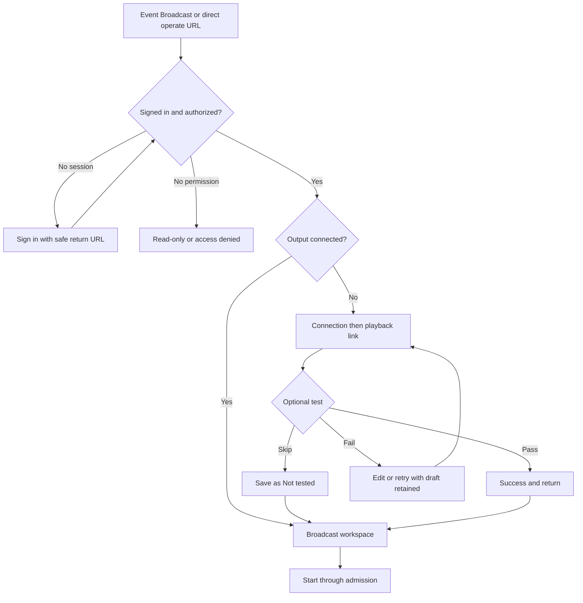
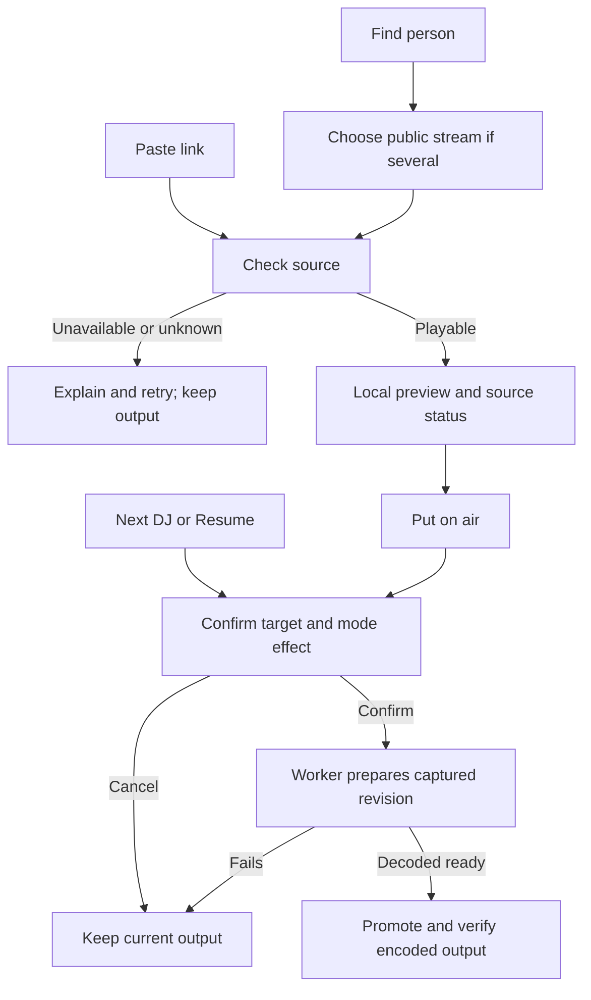

# Locked broadcast implementation plan

> **For agentic workers:** REQUIRED SUB-SKILL: Use superpowers:executing-plans to implement this plan task-by-task. Read the locked design and current production contracts before editing. Do not copy fixture timers, fake readiness, credentials or authorization into production.

**Goal:** Make the approved workspace work for real event hosts: connect an output, find/check/preview sources, and control continuous shared output.

**Architecture:** Retain the authorized `/[slug]/events/[eventSlug]/operate` route, Convex command/observation authority and continuous restream worker. Bind the locked presentation to those contracts. Add community-scoped secret provisioning and bounded connection-test jobs; qualify each additional source acquisition path separately.

**Tech Stack:** Next.js, React, TypeScript, Convex, existing playback adapters, Node/Python restream worker, FFmpeg, AWS secret storage and Terraform.

**Spec:** [Locked baseline](../../planning/broadcast-design-jam-2026-11-09.md), [final UX iterations](../../planning/broadcast-ux-review-2026-11-09.md), [setup journey](../../planning/broadcast-setup-flow-2026-11-09.md). These supersede conflicting earlier jam notes.

## Outcome and decisions

Locked decision: retain the shared header, compact destination card, contextual previews, person lookup and pasted-link paths, optional test and success return, copyable output URLs, mode-preserving Next, hold/resume and confirmations for live changes. Local preview audio uses player controls and is not permanently muted.

Locked delivery decision: BASIC requested one complete delivery, not separately released milestones. Implement the full workflow, secure setup/testing, qualified direct media and the supported YouTube path together. Tasks remain dependency-ordered engineering checkpoints, not release boundaries. The whole delivery is incomplete until the required source paths and acceptance checks are resolved.

Scope amendment, November 9: BASIC explicitly removed YouTube from this delivery and requested a follow-up issue for direct YouTube broadcasting, comparing yt-dlp/youtube-dl and other acquisition options. The remaining flow still ships together. Task 7 is now issue/research handoff only; direct-media, VRCDN and Twitch work remains in scope. Do not offer YouTube as an enabled broadcast input until that follow-up is implemented and qualified.

| Judgment needed | Recommendation | Tradeoff |
| --- | --- | --- |
| Release scope, locked | Deliver the complete plan together. | Integration and source qualification must all finish before release. |
| Output ownership | Community-scoped records authorized through existing event-management capability. | Fits ownership but requires secret provisioning and migration from deployment-owned bindings. |
| YouTube | Investigate a supported acquisition/output path before choosing worker architecture. | May require provider approval or a different approach; extraction is not assumed approved. |
| Uploaded audio/custom slate | Separate follow-up, starting with slate-only audio before mixing. | Avoids delaying the lock; transport, uploads, retention, gain and looping still need decisions. |

Implementation was authorized by BASIC after reviewing this plan. Deployment, provider-account changes, publishing test media and starting an event retain their separate approval gates.

## Global constraints

- Use Convex intent and fresh worker observations as authority. Provider Live, browser playback, decoder readiness and observed output are distinct states.
- Preserve measured allocation/admission, output reservation, immutable session settings, leases, idempotency and terminal cleanup. Never admit a preset using fixture evidence.
- Next preserves mode on successful commit. Unrelated takeover pauses automatic switching. Failure changes neither committed source nor mode.
- Confirm captured targets for every live output change. Lookup, preview, copy and unused-source creation are immediate. Preserve Stop and slate priority over ordinary preparation.
- Raw keys travel only through authenticated HTTPS to the secret service. Keep them out of Convex documents, URLs, logs, analytics, browser persistence and Terraform state. Workers receive scoped secret references.
- Reuse shared primitives/adapters. Preserve approved copy; materially different sentences return to BASIC for review. Load the Convex expert skill before implementing under `convex/`.

## Existing foundation and real gaps

| Area | Reuse | Required change |
| --- | --- | --- |
| Console | `event-operator-view.tsx`, operator state/projection and status route | Apply the locked presentation without weakening subscription fencing or diagnostic permissions. |
| Commands | Queue, schedule, stop, cancel and protocol-2 durable intent | Mode-preserving Next, explicit previous-source Resume and temporary-source lifecycle. |
| Sources | `eventMediaSources.create/replace/remove`, canonical validators | Person and link paths share authoritative source identity, readiness and promotion. |
| Search | `profiles.lookupPeople`, `EventIdentityPicker`, `getPersonBroadcastInputChoices` | Use production queries, not the jam's fixture-only `person-streams` route. |
| Preview | `EventOperatorPreview`, `LocalPreviewPlayer`, playback adapters | Player controls must acquire foreground audio when unmuting. Retain disposal and stale-callback fencing. |
| Connection | `configureVrcdnOutput`, `configureTwitchOutput`, `_vrcdnOutputAccounts.ts` | Current entitlements are deployment-owned. Add authorized dynamic records and secure key provisioning. |
| Worker | Current/candidate decoding, continuous renderer, sender and dispatcher | Reuse promotion evidence; requalify any changed final image and source mix. |

Concrete source mismatch: `_eventBroadcastControl.ts` currently selects manual mode for ordinary Next, and legacy worker completion also maps it to manual. UI changes alone cannot fix this. Current preview documentation requires muted creation plus external monitoring. The lock changes the interaction, not foreground audio ownership.

The current source validator admits VRCDN/Twitch only. Direct-media and YouTube recognition in the jam is not acquisition support. Existing capacity and verification documents explicitly retain open acceptance gates; checkout evidence does not establish current deployment readiness.

## Host journeys

## Review focus

1. A second host changes the lineup/source while a confirmation is open. Task 2 rejects stale targets rather than switching something else.
2. Credentials change during a test. Tasks 3–4 fence results by connection revision.
3. Search/provider/SDK responses arrive after replacement. Tasks 1 and 5 dispose or ignore stale results, including audio callbacks.
4. A browser preview plays but worker acquisition fails. Task 2 preserves output and mode.
5. A test times out or a worker stops ambiguously. Task 4 retains reservation until actual cleanup; retries cannot bypass admission.

## Task 1: Bind the locked workspace to production state

**Files:** modify `apps/web/src/app/_components/event-operator-view.tsx`, `event-operator-sources.tsx`, `event-operator-diagnostics.tsx`, `apps/web/src/lib/event-operator-state.ts`, and the existing operate page/status route. Create `apps/web/src/app/_components/event-broadcast-setup.tsx` for wizard presentation.

**Interfaces:** consume `OperatorStatus` from `events.getEventMediaControlStatus`; retain existing mutation callbacks. Derive display state through `operatorViewState`. A successful submission or provider Live must not imply On air.

- [ ] Extend `tests/web/event-operator-state.test.ts` and `event-operator-status.test.ts` for initial opening screen, terminal session selection, stale evidence, reconnect Last on air and accurate next-start summary. Run them before editing to establish failing expectations.
- [ ] Port layout/header/cards onto production components. Keep one configured destination as text and Set up broadcast only when absent. Copy output URLs from connection metadata, independently of source selection.
- [ ] Add one captured-target confirmation for Next, take, hold, Resume, automatic mode and Stop. Default focus to Cancel, restore focus, prevent duplicate submissions and retain preparation cancellation.
- [ ] Extend `tests/web/event-operator-boundary.test.ts` and the production-component fixture for permission loss, late subscription replacement and navigation during preparation.
- [ ] Run targeted web tests and web typecheck. Commit with new wizard submission gated until Tasks 3–4 are complete.

## Task 2: Correct control semantics and temporary sources

**Files:** modify `convex/_eventBroadcastControl.ts`, `convex/_eventMediaControl.ts`, `convex/events.ts`, `convex/eventMediaWorker.ts`, `workers/restream/operator-control.mjs` and `workers/restream/live-control.mjs` where the traced command path requires it.

**Interfaces:** extend the existing command envelope with proposed optional `expectedIntentSequence` and `expectedTargetSourceId`. Existing callers remain compatible when absent; the new UI supplies both for source-targeted changes. Resolve/capture Next's source server-side at queue time. Add proposed `resume_previous` only if the traced API has no equivalent.

- [ ] Add failing cases in `tests/backend/event-broadcast-control.test.ts`, `event-broadcast-worker.test.ts` and `event-media-control.test.ts`: `next_preserves_automatic`, `next_preserves_manual`, `failed_next_preserves_intent`, `stale_next_is_rejected`, `quick_take_does_not_consume_lineup`, `resume_requires_previous_source`.
- [ ] Commit source, cursor and mode atomically after matching decoded-ready promotion. Reconcile protocol-2 and legacy completion. Inspect CLI/Discord callers before changing Next semantics; do not leave divergent meanings under the same command.
- [ ] Retain the last actually promoted source identity/revision for Resume. Reprepare it and reject missing/replaced sources. Never offer first-start Resume.
- [ ] Create temporary inputs through existing source ownership, marked temporary. Cleanup only after no operation/session references them. Never send an unowned worker-only URL shortcut. Stop/slate invalidate pending promotion; retries retain idempotency identity.
- [ ] Test two-host races, revocation, lost receipts, failed candidates and output continuity in the control/input-manager suites. Run targeted backend and worker checks; commit matching command/worker contracts together.

## Task 3: Secure output provisioning

**Files:** create proposed modules `convex/eventBroadcastConnections.ts`, `apps/web/src/app/api/event-broadcast/connections/route.ts`, `scripts/event-output-secret-broker.mjs`. Modify `convex/schema.ts`, `_vrcdnOutputAccounts.ts`, `events.ts`, dispatcher secret resolution and `infra/terraform/restream-worker/`.

**Interfaces:** connection metadata contains community, event binding, provider, sanitized server, playback links, opaque credential reference, revision and test state. Proposed `saveConnectionMetadata` is internal only. `POST /api/event-broadcast/connections` accepts event identity, provider, server, optional replacement key and expected revision; returns only connection ID/revision and sanitized state.

- [ ] Add `tests/backend/event-broadcast-connections.test.ts` and `tests/scripts/event-output-secret-broker.test.ts`: unauthorized community rejected, create needs a key, blank-key edit preserves reference, provider/server replacement requires a key, stale edit rejected, keys absent from logs/responses.
- [ ] Build authenticated server-to-server provisioning. The broker validates a short-lived event/community grant with audience, expiry and replay binding before writing an exact generated secret name. Browser-provided secret ARNs are never authority.
- [ ] Stage metadata/secret versions before binding commit. Clean orphaned staged versions after failed saves. Never modify a running session's frozen destination or delete a secret version still referenced by a session.
- [ ] Preserve existing deployment-owned account bindings during additive migration. Introduce community-owned resolution alongside them; prove old accounts still authorize exactly as before. Possession of a raw key alone does not grant access to an existing account record.
- [ ] Validate presets and custom ingest addresses server-side. Enforce destination/redirect/resolved-address policy at the actual connection boundary, including private-address rejection. Mask saved keys and clear draft secrets on exit.
- [ ] Define least-privilege broker/worker IAM, namespace, rotation/recovery/deletion and self-hosting configuration through Terraform/docs. Keep secret values out of IaC state. Run transaction/negative tests with mocked secret service before committing.

## Task 4: Bounded optional connection test

**Files:** extend `convex/eventBroadcastConnections.ts`, `convex/eventMediaWorker.ts`, dispatcher job handling and `workers/restream/output-sender.mjs`; create `workers/restream/connection-test.mjs`. Connect Task 1's wizard.

**Interfaces:** proposed `startConnectionTest({currentSlug, connectionId, expectedRevision, idempotencyKey})` returns a job ID; `cancelConnectionTest({jobId})` requests cleanup. Stage observations and evidence carry immutable connection revision, job identity and lease.

- [ ] Add `tests/backend/event-broadcast-connection-test.test.ts` and `event-broadcast-connection-test-worker.test.ts`. Assert skip saves Not tested; failure retains fields; changed config invalidates proof; duplicate requests do not publish twice; late receipts cannot test a replacement; timeout/cancel retain reservation until actual cleanup.
- [ ] Reuse admission and exclusive output reservations. Refuse tests on an already-live/reserved output. Proposed runtime limit: 60 seconds with a hard worker deadline and terminal reconciliation, not just a browser timer.
- [ ] Run only after the host chooses Run test and sees the approved test-screen notice. Verify decoded playback of the test identity. Socket connection or bytes sent alone cannot pass the test.
- [ ] Save sanitized proof metadata; preserve draft correction, retry and Skip. Show confetti/single return CTA only for matching success. Skip never bypasses ordinary Start requirements.
- [ ] Run synthetic media locally. An owned-provider rehearsal requires exact test-output authorization and cleanup evidence. Commit after cancellation and orphan-job checks pass.

## Task 5: Real person/link checks and local playback

**Files:** modify `event-operator-sources.tsx`, `event-operator-preview.tsx`, existing person picker only if necessary, `apps/web/src/lib/local-preview-player.ts` and playback adapters. Create `apps/web/src/app/_components/event-broadcast-quick-switch.tsx`.

**Interfaces:** consume `profiles.lookupPeople`, `events.getPersonBroadcastInputChoices`, authorized bounded status routes and canonical input validators. Selection yields source identity/revision. Resolve public person choices again server-side before take; dropdown data is not authorization.

- [ ] Reuse production people picker and avatar/trust presentation. Test keyboard/pointer selection, empty/error, one/multiple links, stale responses and edited URLs invalidating prior proof. Keep person lookup and pasted link equally available.
- [ ] Distinguish provider availability, actual local playback and worker readiness. Checking/previewing must not change live intent. Bound polling and candidate decoder allocation; never allocate workers per keystroke.
- [ ] Create real adapters only on explicit selection. Player/native/SDK unmute acquires foreground audio first. Dispose on close, replacement, navigation and lost authority. Retain stale-callback fencing without forcing permanent mute or adding an unrelated external toggle.
- [ ] Respect Twitch's 400×300 visible-player minimum and parent domains. Expand the selected preview responsively or use the existing external fallback where it cannot fit. The mockup's small rectangle cannot be a clipped Twitch embed. Review this required size adjustment visually.
- [ ] Extend `tests/web/event-operator-preview-lifecycle.test.ts`, `local-preview-player.test.ts`, `local-preview-twitch.test.ts`, `foreground-playback.test.ts`; add `event-broadcast-quick-switch.test.ts`. Assert no audible autoplay, foreground handoff, actual player volume operation and late SDK disposal.
- [ ] Exercise check → preview → confirm → prepare → encoded output, cancel/failure retention and no lineup consumption. Capture desktop/mobile screenshots using production components; commit M1 integration.

## Task 6: Qualified HTTPS direct media

**Files:** extend `convex/_eventBroadcastSources.ts`, validator/identity projections, `workers/restream/input-manager.mjs`, `input-supervisor.mjs`; create `workers/restream/direct-media-input.mjs` and corresponding browser adapter integration.

**Interfaces:** proposed canonical `{kind:"direct_media", url:string}` requires server/worker validation. Extensions are UI hints, not playable proof. Keep effective URL and finite/live classification internal; do not leak signed credentials.

- [ ] Add parser/acquisition tests for MP4/WebM/TS/HLS, wrong content, redirect loops/private redirects, manifest segments on private hosts, DNS changes, size/time limits, stalls and decoder exhaustion.
- [ ] Enforce egress policy on every redirect, resolved host and nested manifest/segment request. Bound bytes, time, codecs and resources. FFmpeg nested protocols cannot bypass the fetch boundary.
- [ ] Qualify continuous output, cancellation/restart and finite EOF. Recommended finite semantics: start from beginning on explicit take; EOF returns to opening screen in manual mode; recovery never silently replays an ended announcement. Resolve timestamp-bearing URL behavior before admitting it.
- [ ] Measure the final image/source mix for admission. Unsupported acquisition fails before promotion. Add backend/worker/browser tests and current-image capacity evidence before committing M2.

## Task 7: YouTube feasibility checkpoint

**Files:** first create `docs/engineering/event-broadcast-youtube-feasibility.md`. Amend this plan with exact adapter/files/tests only after choosing a supported path.

- [ ] Establish permitted acquisition/rendering, output redistribution rights and provider requirements from primary documentation and explicit provider approval where needed. Record blocked/private/removed videos, age/region restrictions, finite/live behavior, latency, audio capture, startup and runtime costs.
- [ ] Demonstrate owned-content playback through continuous shared output using the proposed approach. An official iframe in the browser is not that proof. Do not silently substitute downloading/extraction or browser capture as an approved path.
- [ ] If feasible, write an executable adapter amendment, package it reproducibly and test EOF, cancellation, failed promotion and capacity. If infeasible, present alternatives to BASIC. Do not quietly remove YouTube or call the broader objective complete.

## Task 8: Acceptance, migration and release

**Files:** update `docs/engineering/event-broadcast-operator-console.md`, `event-broadcast-verification.md`, `event-broadcast-quality-capacity.md`, `docs/deployment/restream-worker.md`, user setup docs and environment definitions. Extend `apps/web/src/app/playwright/event-operator/` to exercise production components; retain jam as design evidence.

- [ ] Run `pnpm typecheck:backend`, `pnpm typecheck:web`, `pnpm test:backend`, `pnpm test:web`, `pnpm test:scripts` and mandatory current-image native worker CI gates. Use targeted suites while implementing each task before this aggregate pass.
- [ ] Add browser cases for setup skip/pass/fail/retry, saved-key edit, discard recovery, person/link paths, audio control, both Next modes, Resume, reconnect, Stop, stale confirmations and read-only staff.
- [ ] Add `ci:browsers` and `ci:visuals` before the normal PR run. Inspect desktop/mobile screenshots and actual player interaction against the lock. Secret inputs never enter screenshots, session replay or analytics.
- [ ] Rehearse real owned-provider delivery only with explicit authorization: exact host and connection revision, decoded candidate, encoded promotion, published output, browser playback, separate PC/Quest device checks and cleanup. Source code/CI/provider/device proof remain separate in the report.
- [ ] Rehearse additive schema/account migration, old bindings and rollback. Rollback disables new submissions and UI routing while existing sessions finish or are explicitly stopped. Never deploy a worker incompatible with queued command semantics.
- [ ] Enable setup only after broker authority, secret resolution, test cleanup and measured allocation pass. Add per-community provisioning/test rate limits and retention/cleanup for abandoned secrets/jobs. Observe sanitized failure stage, startup/test duration, switch latency and reserved capacity.
- [ ] Document self-hosted broker configuration, secret store, network policy, packaged runtime and qualified formats. Keep uploads, capture and mixing out of defaults.
- [ ] Follow PR review and the exact-head 30-minute merge-readiness window. Deployment remains separate; merge readiness is not live-user acceptance.

## Sequence and stop conditions

Tasks 1–2 establish presentation/control. Tasks 3–4 establish secure setup. Task 5 integrates those paths. Task 6 adds direct media. Task 7 research runs during the earlier work, with implementation following the supported-path decision. Task 8 validates the complete delivery. Earlier M1/M2 references inside task steps describe internal checkpoints only and do not authorize separate releases.

Stop the affected milestone if authority, acquisition, cleanup or measured allocation cannot be established. Continue independent local work, identify the exact gap and obtain the necessary decision. Never replace missing media evidence with simulated success.

## Evidence appendix and self-review

Inspected this checkout on November 9, 2026, not deployed state. Source evidence: `convex/_eventBroadcastControl.ts`, `_eventBroadcastSources.ts`, `_vrcdnOutputAccounts.ts`, `events.ts`, `eventMediaWorker.ts`; operator components/state; worker input/control paths; existing verification, operator-console, deployment and capacity docs. Their dated runtime evidence remains scoped and must be refreshed before execution.

Primary provider references checked during planning:

- [Twitch video embeds](https://dev.twitch.tv/docs/embed/video-and-clips): minimum visible 400×300 player and parent-domain constraints.
- [YouTube developer policies](https://developers.google.com/youtube/terms/developer-policies) and [API services terms](https://developers.google.com/youtube/terms/api-services-terms-of-service/): audiovisual acquisition/modification/distribution restrictions. These support a feasibility gate, not an inferred restream license.

All locked flows map to Tasks 1–5, broader inputs to Tasks 6–7, and each review-focus failure to an owning test step. New modules/signatures above are proposals; existing API/test names are grounded in this checkout. Uploaded audio/custom slate content are explicitly separate. No implementation, provider operations, credential writes, deployment or implementation tests were performed for this planning task.
