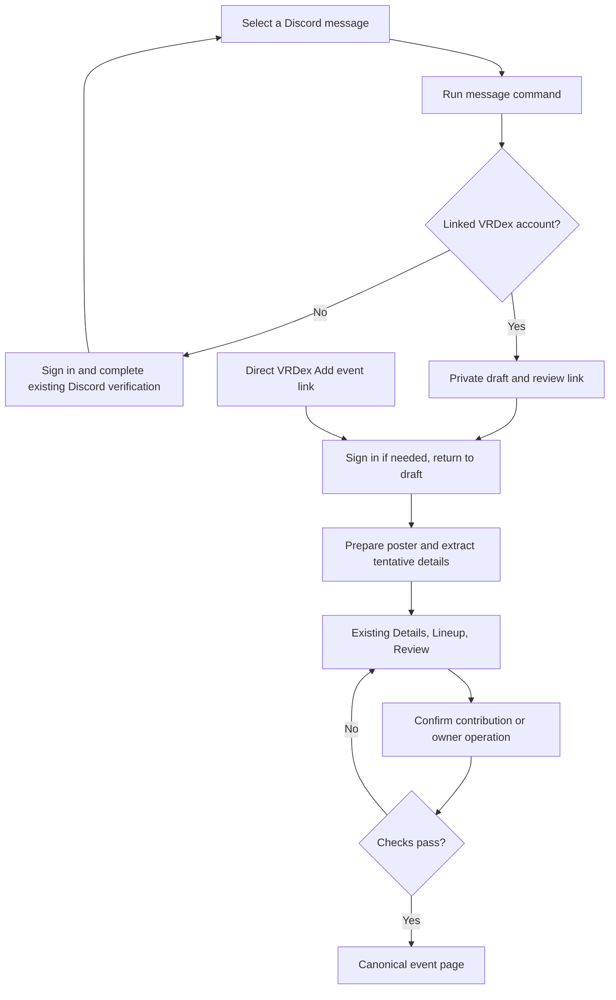

# Personal Discord event intake implementation plan

> **For agentic workers:** REQUIRED SUB-SKILL: Use superpowers:executing-plans to implement this plan task-by-task. Steps use checkbox (`- [ ]`) syntax for tracking. Recommended execution is native and sequential because these tasks share the draft and publication contract.

**Goal:** Select one Discord message, review its event details in the existing VRDex editor, and explicitly publish under the signed-in user's actual authority.

**Architecture:** Add a message-command adapter to the existing Gateway-first app. Save an ordinary actor-private intake draft with a private Discord submission record, then prepare its poster and extract suggestions through the current website import path. Keep contribution publication intact and add a thin owner commit adapter over existing event commands; neither path fabricates a connector.

**Tech Stack:** Existing discord.js v14, Node 24, Next.js, TypeScript, Convex, private poster storage, shared event-intake extractor, node:test/convex-test and Playwright. No new external dependency or service.

**Spec:** [Scope and confirmed decisions](../../planning/discord-personal-event-intake-scope-2026-11-16.md), [Discord capability research](../../planning/discord-user-app-capabilities-research-2026-11-16.md).

## Review brief

The user links their account once, selects one message, and receives a private link to the existing Details, Lineup and Review editor. Its poster is selected as artwork by default, with a visible remove option. Missing facts are corrected manually. Publication is always explicit.

For v1, reuse the existing Discord verification flow. It requires verified email and requests `identify guilds`, broader consent than message selection itself needs. This is a recommendation, not a previously approved implementation choice. An identify-only link would avoid that consent but add another OAuth path. Do not build both.

The new work is capture and retry protection, connecting captured posters to the current import action, and committing reviewed drafts through owner commands where appropriate. Existing editors, extraction prompts, quotas and connected-channel automation retain their responsibilities.

## Global constraints

- Locked decisions: one selected message, then VRDex review; link the VRDex account before capture; use its poster by default with a remove option.
- No passive monitoring, history fetch, reply-chain expansion, self-bot, user token, automatic publication or automatic updates.
- Installation and guild membership never grant VRDex ownership. Owner denial stops the operation; never retry it as a contribution.
- Reuse Details, Lineup, Review, tentative suggestions, saves, version checks, unsaved-change protection and canonical event navigation.
- Keep original Discord provenance separate from official management labels. Never publish private message URLs, author identifiers or chat quotations as event fields.
- Preserve source/draft quotas. Ordinary contributions remain at 10 new publication receipts per actor per rolling 24 hours, including elevated roles. No connector exemption or quota-policy change.
- Source removal retains accepted details. Existing events, unrelated fields and lineup rows survive imports and updates.
- Reuse approved copy. Show new command/reply/error/help wording exactly to BASIC before shipping; no public AI promotion or em dashes.
- This is planning authorization only. Implementation starts in an isolated branch from current main, preserving unrelated shared-checkout work. Provider configuration, publication and deployment retain their separate authorization boundaries.

## Journey: submit one announcement

The scope's reference captures did not establish cross-app authentication recovery. Reuse VRDex's sign-in return and saved draft URL. No new onboarding wizard or further flow research is needed for this settled sequence.

## Review focus

| Failure mode | Required behavior | Checks |
| --- | --- | --- |
| Changed or ambiguous Discord identity | No retained input without a unique verified mapping; wrong website account sees no evidence | Tasks 1 and 4 |
| Selection outside a guild | DM/group-DM inputs work without guild ID, bot membership or history calls | Tasks 1 and 5 |
| Refresh or late import completion | No repeated automatic extraction, overwritten manual edits or restored removed poster | Tasks 2 and 4 |
| Partial announcement for an existing event | Apply only reviewed changes, retaining untouched lineup rows and provenance | Task 3 |
| Private content reaches publication or diagnostics | No private source IDs, text, author details or signed URLs in public fields/logs/telemetry | Tasks 1, 3 and 5 |

## File map

These are implementation targets, not code changed by this planning task. New files are marked new. Keep this adapter outside the public REST/MCP operation catalog.

| Files | Responsibility |
| --- | --- |
| `apps/discord-gateway/src/personalIntake.ts`, `personalIntake.test.ts` (new) | Message command, selected-payload normalization, private reply |
| Gateway `src/index.ts`, `src/register-commands.ts`, current command tests | Dispatch and registration without relaxing/replacing existing commands |
| `convex/discordPersonalIntake.ts` (new), `schema.ts`, `http.ts` | Capture, actor-private submission read, preparation claim, owner commit |
| `convex/_eventIntake.ts`, `eventIntake.ts`, `events.ts`, `eventInventory.ts` | Reuse draft lifecycle, owner writers and artwork binding; exclude resolved personal drafts |
| `apps/web/src/lib/server/event-intake-session.ts`, `discord-intake-posters.ts`, `event-intake-agent.ts` | Session-authorized preparation using existing poster/extraction helpers |
| `apps/web/src/app/events/event-intake-form.tsx`, `event-intake-source.tsx` | Prepare imported input, choose poster, reuse form and publication callback |
| `tests/backend/discord-personal-intake.test.ts`, `tests/web/discord-personal-intake.test.ts` (new) | Transactions, sessions, private source boundaries |
| `tests/backend/helpers/discord-intake.ts`, affected intake/owner fixture helpers | Register the new Convex module and seed actor/source cases without changing connector authority fixtures |
| Current intake fixture/Storybook stories; `apps/web/e2e/discord-personal-intake.flow.spec.ts` (new) | Reuse production form for resume, conflicts and screenshots |
| `docs/backend/event-intake.md`, `event-intake-sources.md`, `docs/deployment/discord-gateway.md` | New entry, retention, command registration, activation and rollback |

### Task 1: Capture into an ordinary private draft

**Interfaces:** Add global message command `personalEventCommand`, supporting `USER_INSTALL` and `GUILD`, `BOT_DM`, `PRIVATE_CHANNEL`. Exact display name remains proposed copy. Add trusted `POST /discord-intake/selected-message`, gated by the existing `discordIntakeGate` and service credential. It invokes internal `discordPersonalIntake.captureSelectedMessage(input)` and returns `link_required`, `draft { draftId }`, `event { eventPath }` or a structured failure code.

Input: `{ interactionId, invokerDiscordUserId, channelId, guildId?, message: { messageId, authorId?, editedAt?, sourceText, attachments } }`. `sourceText` contains only selected content and useful embed title/description/field text. Attachment descriptors contain attachment ID, Discord CDN URL, MIME and declared bytes. Validate the exact properties and snowflakes at the trusted HTTP boundary. Reject text above the extractor's existing 12,000-character ceiling or more than 10 candidates rather than silently truncating; apply existing supported-image MIME and size rules.

- [ ] Add failing gateway tests `selected_message_uses_interaction_actor`, `private_context_omits_guild`, `selected_bot_announcement_is_allowed`, `no_history_fetch`, and `registration_preserves_management_command`. Assert private defer precedes network work; no message/channel fetch occurs; `/vrdex` retains Manage Server and guild-only contexts. Explicit selection must not inherit the passive relay's bot-post filter.
- [ ] Add backend tests `unlinked_capture_stores_nothing`, `ambiguous_mapping_refuses`, `replay_returns_same_draft`, `two_actors_are_isolated`, `poster_only_draft`, and `draft_quota_applies`. Use real `resolveDiscordUserId` and `saveIntakeDraft`. An installation owner differing from the interaction actor must never become the draft actor.
- [ ] Implement the adapter and route. Defer ephemerally within three seconds. Use the resolved selected message without fetching absent fields. Resolve identity before persisting source; link-required replies point to the existing authenticated verification start route. Preserve its verified-email, OAuth state and `identify guilds` controls. Build website URLs from configured public site origin, never message content.
- [ ] Add private `discordPersonalIntakeSubmissions`: actor/Discord/channel/message IDs, initial interaction ID, fingerprint, optional private author/guild IDs, draft/event links, attachment candidates, preparation status and timestamps. Index `(actorUserId, channelId, messageId)` and `draftId`. Add an optional typed `personalSubmissionId` reference to intake drafts. Create submission and draft atomically, without `connectorId` or writes to channel-connector message tables.
- [ ] Extend the internal draft helper only enough to accept a validated actor-owned personal submission as meaningful source for a poster-only draft. No fake title, text or SHA-256. Public draft patches cannot provide this reference; preserve the 20-active-draft quota and 30-day TTL. Unsupported input with neither text nor a usable image creates nothing.
- [ ] Return the existing draft or currently visible canonical event for repeated selection. A changed fingerprint never overwrites the snapshot or accepted fields: return a private source-changed status and the existing draft/event for manual correction. Expired/removed targets get explicit recovery, not history fetch or automatic recreation. This is snapshot import, not synchronization.
- [ ] Run `pnpm test:discord-gateway` and `node --conditions=import --import tsx --test tests/backend/discord-personal-intake.test.ts`; require new and existing management-command tests to pass, then commit this unit.

### Task 2: Reuse website poster preparation and extraction

**Interfaces:** Extend the website-only envelope with `discord_source_prepare { draftId, expectedVersion, attachmentId? }`. The server derives the session actor and reads the private submission; input cannot specify URL or actor. Return `{ draftId, version, fields, artworkSourceId, preparationStatus }` using current candidate/field types. Keep it outside public `eventIntakeOperations`.

- [ ] Add failing web tests `foreign_draft_refused`, `only_captured_cdn_attachment_fetched`, `expired_poster_keeps_text`, and `several_images_require_choice`. Use the current CDN allowlist, redirect refusal, checksum/MIME validation and `EVENT_POSTER_MAX_BYTES`. Bound actual streamed response bytes; declared size alone cannot authorize unbounded buffering.
- [ ] Add backend tests `prepare_replay_does_not_reextract`, `stale_prepare_preserves_edits`, and `removed_poster_is_not_restored`. Store a version-bound preparation claim on the submission, with a five-minute lease. One preparation runs at a time; a dead browser can retry after lease expiry. Preparation's own versioned saves advance its claim atomically; unrelated source/manual edits invalidate result application. Failures require explicit retry, not repeated automatic paid calls on every reload.
- [ ] Reuse `createDiscordPosterBridge.store` and `createEventPosterHandlers`. Return the completion version/artwork metadata the new caller needs while keeping the connector caller compatible. Attach the selected source through existing draft saves and automatic artwork preparation. Do not duplicate media validation/storage. Several images require private selection of one; do not fetch arbitrary embed image URLs. Unknown MIME uses manual upload rather than filename guessing.
- [ ] Reuse `createEventIntakeExtractor`, `candidatePatch` and the current versioned source-save flow to store tentative suggestions only. Run once when the authenticated imported draft opens and its poster selection is ready. Do not supply connector context or autonomous event-update tools. Extraction failure leaves manual editing and existing Retry/Extract controls available; attachment failure needs an explicit continue-without-poster or reattach choice.
- [ ] Reuse draft inactivity expiry for captured text, questions, evidence and pending URLs. On publication/discard, clear those resolved personal-source fields and retain minimal IDs/fingerprint plus event/audit linkage for provenance/replay. Image evidence keeps its existing expiry/hold rules, independent of public artwork. Extend existing bounded draft cleanup to delete orphan submission data; no new scheduler. Evidence removal must not erase accepted/public event fields.
- [ ] Run `node --import tsx --test tests/web/discord-personal-intake.test.ts tests/web/discord-intake-posters.test.ts` and the personal backend suite, including expiry/discard and connector bridge regression cases. Commit with source-policy documentation.

### Task 3: Commit through the existing contribution or owner writers

**Interfaces:** Add authenticated `discordPersonalIntake.publishReviewedDraft({ draftId, expectedVersion, idempotencyKey, operation })`. Owner operation is `{ kind: "owner_create", communitySlug }` or `{ kind: "owner_update", eventId, expectedUpdatedAt, patch, artwork: "keep" | "replace" | "remove" }`; patch uses the existing strict field-level intake update type. Return `{ eventId, eventPath, outcome: "published" | "updated" }`. Contributions keep `eventIntake.publishEventIntake`; settle a linked personal submission in that same commit, including exact-duplicate results.

- [ ] Add transaction tests `owner_create_has_official_authority`, `revoked_owner_never_falls_back`, `contribution_keeps_account_quota`, `owner_retry_creates_once`, and `wrong_draft_version_refuses`. Owner writes create no contribution receipt and no connector. Bind replay to actor, draft version, operation and target; changed intent with the same key conflicts.
- [ ] Add tests `partial_update_preserves_lineup`, `update_requires_loaded_revision`, `private_source_is_not_public_source_url`, `original_provenance_survives`, and `artwork_belongs_to_result_event`. Include untimed rows, private person matches, stream choices, a competing staff edit, overnight times and DST ambiguity.
- [ ] Reuse `normalizeIntakePublication`, current owner authorizers and create/update writers. Factor only the needed browser command bodies inside `events.ts` so the existing wrappers and new adapter share validation and transactions. Reuse `insertCommunityEventRecord` and the current owner-update transaction. Do not fabricate an API credential, widen the staff patch helper or add quota bypass flags to personal contributions.
- [ ] Updates require explicit event selection and loading canonical fields plus revision into the existing form. Apply reviewed differences against that baseline. Omit untouched lineup arrays; replacement requires review of the complete resulting lineup with stable keys and protected associations. A matching contribution is a link to an event, never update authority.
- [ ] Retain contribution duplicate checks and normal owner-create semantics, adding submission retry protection. If this source already maps to an event, direct the user to an explicit update instead of another create. Denial/conflict retains the selected operation.
- [ ] Reuse the narrow existing artwork/source binding code from `_eventIntake.ts`, extracting a helper only where needed. Verify actor/draft/version ownership and attach only the reviewed artwork. Updates preserve current artwork unless replacement/removal was reviewed; exact duplicate publication never replaces another draft's image. Keep Discord IDs and provenance separate from official `sourceType`, `sourceLabel`, public `sourceUrl` and original submitter.
- [ ] Atomically bind the submission to its event, mark the draft resolved, perform Task 2 private-text cleanup and enqueue normal event sync. Store the successful owner operation key/fingerprint/result on the submission for replay, not in a new receipt system. Exclude resolved personal drafts from reads/inventory while preserving existing contributor/held-connector rules. Concurrent version conflicts leave the draft intact.
- [ ] Run the personal transaction suite and affected existing owner, lineup, contribution and inventory suites. Regenerate Convex types through the supported local toolchain and run `pnpm typecheck:backend`. Commit once authority, preservation, replay and privacy assertions pass.

### Task 4: Connect and visually verify the existing editor

**Interfaces:** Include personal-submission metadata only in authenticated draft reads. `ConnectedIntake` invokes Task 2 and retains its current source action. Reuse managed-community/event queries for owner choices and public-community selection for contributions. Supply Task 3 as the owner publication callback; ordinary contribution publication keeps its existing callback.

- [ ] Add browser cases `sign_in_returns_to_private_draft`, `wrong_account_has_no_preview`, `resume_does_not_reimport`, `poster_defaults_on_and_can_be_removed`, `multiple_poster_choice`, and `owner_denial_stays_owner`. Use current gated fixtures and production form components; reopening a prepared draft makes no provider call.
- [ ] Reuse loading/error states, source controls, tentative acceptance, time questions, identity matching, version capture and My events resume. Keep Details editable on extraction failure. Add no separate review page or editor state store.
- [ ] Add only explicit owner operation/event selection and the current-field baseline required by Task 3. Show community, operation and resulting artwork in Review. Contributions retain their current post-publication correction behavior. Owner operations return to the canonical event and its normal editor for subsequent management.
- [ ] Add discard for unresolved personal submissions through current abandonment controls and Task 2 cleanup. Old discarded links are unavailable. Ensure new source controls inherit existing analytics/replay masking; URLs and ordinary logs contain no private input.
- [ ] Prepare exact new copy for BASIC, including command name, link-required reply, review link, source-changed/unsupported errors and new operation-choice text. Reuse utility labels, apply VR Johnny and unslop, and obtain exact-copy approval before shipping.
- [ ] Run `pnpm typecheck:web`, affected web tests and the new Playwright flow in the local fixture environment. Inspect desktop/mobile light/dark screenshots with the available VLM, fix accessibility/layout issues, and add `ci:browsers` plus `ci:visuals` before the implementation PR's normal run. Commit with editor documentation.

### Task 5: Verify delivery and prepare controlled activation

- [ ] Run `pnpm typecheck:discord-gateway`, `pnpm test:discord-gateway`, `pnpm typecheck:backend`, `pnpm test:backend`, `pnpm typecheck:web`, affected web tests, `pnpm verify:docs` and selected browser/visual coverage. Separate local fixtures from live provider evidence.
- [ ] Update the gateway runbook for user installation, the existing linking path, global registration, private retention/diagnostics and rollback. Registration currently bulk-overwrites global commands: retain all existing commands. Do not request bot permissions or privileged intents for selection, and keep the app Gateway-first.
- [ ] Reuse the existing intake enable flag and credentials. If a public site origin is absent from the gateway config, add only that nonsecret variable through Terraform/task configuration, with scope and owner documented. Record any portal-only User Install settings and their recreation steps. Do not change callback configuration or storage roles unnecessarily.
- [ ] Present exact copy, registration diff, portal changes, deployment targets, rollback and passing evidence as a concrete activation handoff. Provider settings, registration, deployment and fixture publication are outside this planning authorization. Rollback removes the personal command/dispatch without disabling existing announcement connectors; saved private drafts retain their expiry rules.
- [ ] After separately authorized activation, test owned fixture messages in a guild without bot membership, DM and group DM on desktop/browser, iOS and Android. Include denied external-public replies, embeds, posters, expired attachments, wrong/unlinked accounts, duplicate invocation and review beyond 15 minutes. Verify no channel reply exposes input. Publish controlled fixture events only if explicitly authorized.
- [ ] For a merge-ready implementation handoff, wait for terminal checks/clean mergeability, then inspect every feedback surface for the latest pushed head. Address valid feedback, reply/resolve handled threads and reread mutable summaries after fixes. Include the PR URL. Pending client/provider acceptance remains pending.

## Evidence appendix

- Audited GitHub main at `301286c713aa9ca1d55bb6ef68f372df669969db`, unchanged when rechecked for this plan. Inspect interface drift on current main before implementation.
- The shared checkout is an older design branch with unrelated untracked files. Planning changes only this plan and its associated scope/research notes. No worktree or implementation was requested.
- Source anchors: [Discord resolver](https://github.com/BASIC-BIT/VRDex/blob/301286c713aa9ca1d55bb6ef68f372df669969db/convex/_discordIntake.ts), [account semantics](https://github.com/BASIC-BIT/VRDex/blob/301286c713aa9ca1d55bb6ef68f372df669969db/convex/accounts.ts), [command registration](https://github.com/BASIC-BIT/VRDex/blob/301286c713aa9ca1d55bb6ef68f372df669969db/apps/discord-gateway/src/register-commands.ts), [intake form](https://github.com/BASIC-BIT/VRDex/blob/301286c713aa9ca1d55bb6ef68f372df669969db/apps/web/src/app/events/event-intake-form.tsx), [owner writers](https://github.com/BASIC-BIT/VRDex/blob/301286c713aa9ca1d55bb6ef68f372df669969db/convex/events.ts), [poster bridge](https://github.com/BASIC-BIT/VRDex/blob/301286c713aa9ca1d55bb6ef68f372df669969db/apps/web/src/lib/server/discord-intake-posters.ts).
