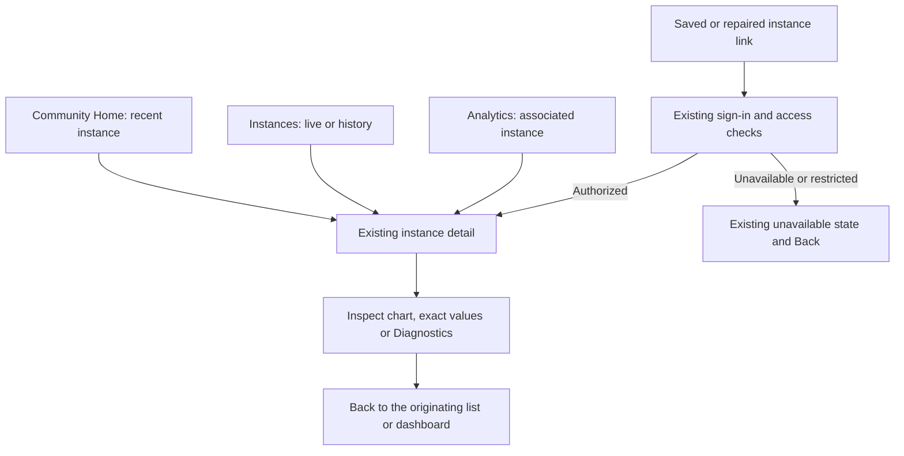

# Production instance history chart

## Outcome and review decision

Replace the single population graph in the existing private instance detail page with the Population, Windows, Android and Queue chart developed in the preview. Staff reach it through their existing instance links, with real retained observations and existing permissions. This is the production integration design, not another standalone Storybook deliverable.

**Current recommendation:** finish this integration in PR #445 before merging it. Its additive capture work is already implemented, but its chart currently renders synthetic data only. Keep recap PR #444 independent. The tradeoff is a slightly larger #445 in exchange for reviewing capture and its actual consumer together.

Locked decision: BASIC approved implementing this scope in #445 on November 11. The visual revisions below remain the production contract. Merge and production release remain separate decisions. No new navigation, public analytics, historical backfill or metric correction is proposed.

## Experience

Keep the existing instance page, event association, actions, Peak/Average/Opened/Closed values and Back behavior. Replace its graph in place. No new page or sample-case selector appears in production.

**Locked decisions from BASIC:**

- Use Population as the total label, with separate Windows and Android lines.
- Show Queue automatically if any retained sample in the complete session has queueSize greater than zero. No queue toggle. Otherwise omit its line and legend entry.
- Keep missing diagnostic samples unknown. Known zero remains zero in the exact-value table, even when its line is omitted.
- Show a closed-to-new-joins marker when a stored closure time is known. No marker toggle, and no truncation of population after closure.
- Remove the gap-explanation caption and the Reported population wording.

Use the preview's colors and line styles on one unstacked count axis: blue Population, green Windows, yellow Android and dashed gray Queue. Show each platform line/legend only if that platform has a known sample, including zero. Do not infer Windows or Android from userCount or the total, and do not assume those two platforms account for all users.

Keep Show data table and Diagnostics collapsed initially. The table includes full local timestamps and Population, Windows, Android and Queue values, with Unknown for absent data. Diagnostics exposes userCount, platform sum and every retained platform key. It is a private inspection aid, not a second occupancy metric. Reuse existing utility labels; changed candidate label Platform sum remains reviewable before shipping.

The closure marker uses the session's stored closedAt. That value represents a confirmed closure recorded by ingestion and can be the time closure was first observed, rather than the exact server transition. It is not a lobby-empty timestamp. Unknown closure stays unknown; lastObservedAt, a polling outage, or a failed close action must never create a marker.

## Question: how does staff reach the real chart?

Current: the detail uses ClubChart with population only. Proposed: every entry path renders the same production instance chart. Longer-term event recap queue totals are deferred because they need their own aggregation and interpretation rules. Recap long-tail behavior remains in #444.

## Data and component design

The existing useInstancePoints hook already loads all getInstanceSeries pages, 500 samples at a time, and waits for Exhausted before displaying the chart. Preserve that behavior so a positive queue sample on a later page cannot be overlooked. Keep the query window through max(openedAt + 1, closedAt, lastObservedAt + 1), including long tails. Preserve the existing loading/error states and raw-population summary calculation.

PR #445 adds optional userCount, queueSize and platforms to authorized getInstanceSeries page/before/after results. No additional query, index, schema migration or provider call is needed for the chart. Older records and workers remain valid.

Add an instance-specific adapter next to club-instances.tsx. Reuse observedChartPoints for its existing breakBefore and six-minute gap insertion. Attach diagnostics only to their matching observed source timestamp; synthetic gap points have null for every series. A missing individual field breaks only its own series. Keep isolated samples visible. Do not alter the shared ClubChart or its membership/activity consumers.

Use a dedicated ClubInstanceChart with real timestamp data and props, not the preview's fixed minute clock or hardcoded samples. The horizontal axis must be numeric elapsed time so unequal polling intervals remain proportional. Include local date context across midnight and timezone context in exact timestamps. Render a closure marker even when closedAt falls between two samples, without inserting a fabricated measurement. Do not draw lines through gaps or smooth sharp dips.

Promote the preview into a wrapper around this production component. Move its synthetic scenarios into the story/fixture layer. Production imports no synthetic data, Sample case control or preview-only heading. Storybook remains fast visual coverage of the real component, not a parallel implementation.

## Compatibility, cost and unknowns

Keep instance-history authorization and canonical-session resolution intact. Do not add diagnostics to public projections or the older private dashboard payload. Exact old links must still reach the repaired canonical history.

No new dependencies, infrastructure, recurring job, paid service, user identifiers or telemetry requests. The bounded optional fields add storage/response bytes and chart series; retain existing pagination and avoid a new read per sample. No new self-hosting configuration is required.

Historical queue and platform counts cannot be recovered from n_users. The high counts and dips remain measured facts, not repaired values. Paired future samples are needed to establish provider semantics. If malformed supplied diagnostics reject collection, preserve unknown coverage and investigate shape drift rather than showing zero.

## Delivery and acceptance

1. Complete #445 with the real model/component/page integration and regression coverage. Refresh the actual instance-detail preview, including desktop and mobile screenshots. A standalone component preview is insufficient acceptance.
2. First prove the real authenticated account route through the existing local Clerk/Convex analytics flow with synthetic observations. Its fixture endpoint deliberately requires a loopback backend. Then use the exact-head Vercel/Convex preview workflow for deployed route and authorization checks. Representative hosted history needs an approved isolated fixture setup; if unavailable, report that acceptance gap rather than weakening the local-only guard. Never copy production data into preview.
3. Before release, resolve or attribute the six broad backend failures recorded in #445, refresh CI/reviews and satisfy the repository's exact-head merge-ready gate. Planning approval is not merge/deploy authorization.
4. Deploy additive Convex support before the new collector can send fields. Baseline Checks deploys the backend; group-telemetry-release.yml starts after a successful main Baseline Checks run. Confirm that dependency and exact SHA still hold at release time. A direct worker workflow dispatch must not bypass backend compatibility.
5. Release the versioned collector, then verify exact deployed backend/web/worker revisions separately from runtime acceptance. An authorized natural active instance must yield retained paired fields when the provider supplies them. Heartbeats alone are not capture proof. If no instance is available, mark runtime capture pending without creating one.
6. Check one new paired instance, one old sparse instance, the repaired instance through an original link, a closed instance with a remaining population tail, and an unauthorized reader. Confirm Peak/Average and recap values have not changed from chart integration.

Rollback the web/collector to the previous immutable versions if needed; retain additive backend support and already captured fields. Do not delete observations or run another historical repair. If runtime evidence shows disagreement, retain it and document the comparison rather than changing the population definition.

## Engineering evidence

- Production consumer: apps/web/src/app/account/communities/[slug]/club-instances.tsx, useInstancePoints and InstanceDetailContent.
- Existing gap conversion: club-analytics-model.ts, observedChartPoints. It currently drops the diagnostic fields.
- Shared chart: club-chart.tsx, used outside instance history and intentionally left alone.
- Private API: convex/clubAnalytics.ts, getInstanceSeries; capture and validation: convex/communityTelemetry.ts and workers/group-telemetry/vrchat-client.mjs.
- Existing account fixture and repair-link coverage: club-analytics.stories.tsx and instance-session-repair.storybook.spec.ts.
- At planning time, the PR verification summary reports required and selected checks passed for ca100e2. That does not validate the future production integration or establish why the earlier Windows-only full-suite run failed.
- [Visual reference and locked revisions](2026-11-09-instance-count-diagnostics.md). Existing Mobbin evidence supports compact chart/table presentation; the navigation is settled and needs no new reference search.
- [Implementation plan](../plans/2026-11-09-instance-history-chart.md).
