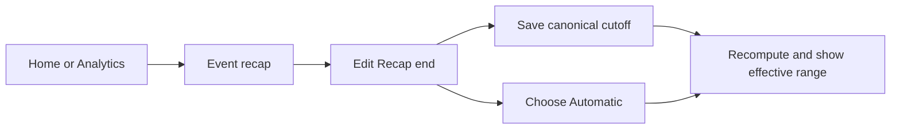

# Automatic recap tails with a canonical end override

## Outcome and scope

Recaps should include the observed afterparty automatically while allowing an operator to set a canonical recap end. The published event schedule stays unchanged. This avoids editing an event's advertised hours merely to include later attendance.

**Locked decision:** BASIC chose automatic tails with the ability to set a canonical end.

**Current recommendation:** make that canonical end an optional override on the recap. Setting it establishes the calculation cutoff; clearing it restores automatic calculation. BASIC approved this interpretation and design in chat on November 9, 2026.

## Operator experience

The existing event recap shows its calculation start and end alongside peak and player-hours. An operator with the existing event-management permission and recap visibility can edit `Recap end` in place, save a date/time or choose `Automatic`. Viewers can read the effective range without editing it. Input and display follow the existing local-time behavior, with no extra timezone selector or separate settings page.

The override is a recap boundary, not a claim that the instance emptied or closed at that time. Instance closure and any later population observations remain independently visible.

### Question: how does an operator change the recap cutoff?

This uses the existing recap location and permissions. The small inline edit has no unresolved navigation or authentication sequence that would benefit from external flow research.

## Calculation rules

1. Start at the event's scheduled start. Lead-in samples remain excluded.
2. With no override, end at the later of the scheduled end and the last observed sample from any explicitly confirmed, current-connection associated instance. Retain the existing six-hour scheduled-end fallback for events without an end. Include the final measured sample using the calculation's exclusive-end convention.
3. With an override, use that exact cutoff, including when it trims an afterparty or ends before the advertised schedule. It must be a finite timestamp after the event start and within the supported calculation range. Reject an invalid range rather than silently clipping it.
4. Keep the existing interpolation and coverage rules. Do not extrapolate occupancy across missing intervals or beyond the last measurement. If an override extends beyond available observations, that unobserved time remains a coverage gap.
5. Closure to new joins does not stop the population series or the recap. Unknown closure remains unknown.
6. Refresh the automatic range as new associated-instance observations arrive. Adding, removing or changing a confirmed association, editing the schedule or changing the override invalidates stale work. Old queued jobs cannot restore an obsolete cutoff or publish a mixed calculation.
7. Deduplicate canonical sessions and samples. Overlapping observations from distinct confirmed instances are summed at each timestamp under the existing rules.

**Tradeoff:** automatic attribution can include later unrelated activity in a long-lived lobby. The canonical cutoff gives the operator a way to limit that attribution without changing the public schedule.

## Implementation boundaries and coverage

Use one shared window resolver for recap creation, continuation validation and readback. Store only the optional override, with existing event-management authorization. Preserve bounded indexed reads, current-connection checks, calculation-version handling and stable rollup identity. Scheduled range and calculated range must remain distinct in API projections and UI.

Update the event recap scheduler, calculation jobs, recap reader, existing recap UI, fixtures and developer documentation together. Cover automatic extension, exact override, clearing it, absent event end, after-close samples, gap handling, overlapping instances, alias deduplication, epoch isolation, permission denial, invalid/oversized ranges and stale work following edits. Verify the inline edit and effective range visually on desktop and mobile.

Recompute the BITRATE example through a read-only preview before changing its stored recap after deployment. Other historical recaps need a separate scoped inventory rather than an automatic blanket rewrite.

## BITRATE preview and deferred work

The prior offline comparison extends this recap from November 8 at 6:00 AM to 10:03 PM Eastern, raising reported player-hours from 456.4 to 672.0. Peak stays 102; coverage becomes 85.7%. The public event schedule and raw samples remain unchanged. Recheck these values after implementation.

Queue capture, closure markers and population-field diagnostics remain separate from this recap-boundary change. `n_users` including queue remains a hypothesis. Do not change population semantics or rewrite suspicious historical values without evidence.

## Evidence

Production verification and private snapshots remain in the operator review packet. No production IDs belong in this specification.

## Implementation traceability

The delivered slice uses `convex/_eventRecapWindow.ts` for creation, continuation checks and private readback. `events.recapEndAt` stores the optional cutoff. `communityTelemetry.setEventRecapEnd` requires event-management permission and recap-category visibility. The existing inline recap UI keeps persisted metric boundaries visible while a requested range is updating.

The supported calculation range is 93 days, matching private analytics ranges. Reads reject more than 1,000 confirmed associations per event or 2,500 association resolutions per interactive page. Canonical sessions deduplicate repaired aliases. For contradictory retained rows at one canonical-session timestamp, calculation uses the earliest row in index order and leaves the raw rows intact. Distinct confirmed instances continue to sum.

Focused backend regressions cover tails, set/clear, closed-instance observations, missing advertised end, unknown manual extensions, overlapping sessions, canonical aliases, epoch isolation, permission denial, unsupported ranges and stale continuations. The editor has desktop/mobile save, clear, failure and view-only coverage. Production preview and rollout remain separate follow-up work. The unchanged recent-event cron naturally recalculates confirmed recaps starting in the prior 14 days, and future observations can refresh older attached events. The rollout review therefore needs an inventory of those recaps before deployment; there is no new all-history migration.
