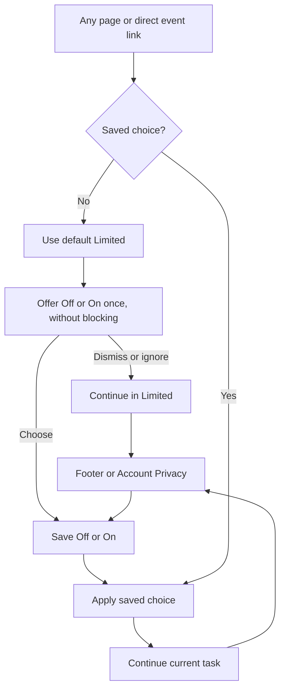

# Working analytics with a simple choice

## Outcome and status

BASIC approved this design on November 10, 2026 and requested a Superpowers implementation plan. That approval includes the one-time nonblocking offer and two public choices described below. New exact policy/consent prose and production activation retain their existing separate gates.

Get VRDex's existing PostHog integration working, with useful product events, account-linked analytics and masked replay. Keep one behavior for everyone. BASIC requested KISS and explicitly rejected region-based logic for the initial version.

Latest user direction supersedes the earlier three-option control: Limited is an internal interim state before a choice, not a user-selectable option. The public choice is analytics Off or On, with On meaning normal Full analytics. No benefit pitch or long explanations in the frontend; full definitions and data-handling detail belong in the privacy policy. The existing product journeys remain unchanged. Keep replay masking simple by reusing and checking the existing setup.

Current target: Limited while no choice exists; a saved choice is either Off or On. On enables Full analytics, including account linking and masked replay when available. Use the same behavior everywhere, without location lookup, jurisdiction tables or a custom consent platform. The blanket Off-before-choice proposal is rejected. Before activating interim Limited, verify that its actual data flow qualifies for collection without prior consent. This is an implementation acceptance check, not a new regional product policy or a claim already established by the label.

This is the current approved design and supersedes the earlier, larger foundation proposal. The [audit](../../planning/posthog-usage-audit-2026-11-10.md) remains the evidence record. The current request authorizes implementation planning; implementation and production activation have not started.

## User experience

Public control: **Off / On**, with a direct **Privacy policy** link. Limited never appears as a selectable option. Offer the choice once in a small nonblocking first-visit panel, with equally available actions. No forced choice or browsing interruption. Opening, ignoring or closing it never enables On. Dismissing it retains internal Limited and records only that the offer was shown, so we do not nag on every page or visit. Exact layout receives screenshot/VLM verification during implementation.

The footer's **Usage & privacy** entry reopens the same choice; Account > Privacy reuses it. On requires an explicit valid choice. Off stops optional collection rather than falling back to Limited. An unset choice must not be displayed as Off, since Limited collection may still be active. Keep any legally necessary short consent disclosure beside the initial choice, with the full explanation in the policy. Exact disclosure copy still needs review.

Guests save a browser choice. Signed-in users save an account choice. A stricter explicit browser choice wins; a successful explicit Save can update both. A failed account save must not relax a local restriction. Keep this state outside PostHog so resets cannot erase it. Online tabs/devices receive changes through existing browser notification and reactive account mechanisms. No application feature depends on allowing analytics.

### Question: how does a visitor choose and continue?

## What the modes do

| Mode | Behavior |
| --- | --- |
| Off | No optional PostHog capture or replay, on browser or backend. Essential application/security records continue for their actual purposes. |
| Limited, internal only | Used only before a choice. Small allowlist of browser product events, fresh in-memory page-lifecycle identity, no account link, persistent visitor ID, replay, person properties or later identity merge. No optional server user events initially. |
| Full, public On | Product events, persistent visitor continuity, opaque authenticated account mapping and masked replay when enabled. No email, display name, auth/provider identifiers or raw private content sent as analytics identity. |

Do not describe Limited as a legal anonymity guarantee. Its initial events are navigation by route class, search submission/result click, event-card click, fixed discovery-filter selection and lookup submission. Properties are deployment category, mode and existing bounded surface/entity/filter/lookup enums. No search text, raw URLs, slugs, referrers, workflow IDs or arbitrary strings. Disable autocapture for Limited. Start with the SDK's existing persistence/person-profile controls and a shared sanitizer, not a new telemetry framework. If the installed SDK cannot satisfy that contract, report the specific limitation before changing its meaning.

Default-Limited acceptance must examine the real browser/provider data, including generated IDs, IP/geolocation handling, provider reuse and any per-visitor reconstruction. Removing account IDs alone is insufficient. Start with aggregate audience/product counts and tighten the existing allowlist or remove page-lifecycle correlation if required to qualify. Do not build an exemption engine, silently enable Full, or assert compliance without evidence. If the existing PostHog route cannot support the default, report that concrete finding before any production activation. [ICO statistics exception](https://app-ico-public-prod-uksouth.azurewebsites.net/for-organisations/direct-marketing-and-privacy-and-electronic-communications/guidance-on-the-use-of-storage-and-access-technologies/what-are-the-exceptions/), [CNIL audience-measurement criteria](https://www.cnil.fr/fr/cookies-solutions-pour-les-outils-de-mesure-daudience).

Full reuses the existing masking, private-route blocking and URL sanitizers. Keep console content, network bodies/headers and canvas recording off. Run one synthetic smoke check covering a public page, a private/account screen and form input; confirm expected blocking/masking and token redaction using the existing tests. Fix demonstrated failures at their existing source. Do not introduce a masking framework, exhaustive selector inventory or additional user controls. Existing all-route replay intent applies only to eligible Full sessions.

## Smallest complete implementation

1. Fix the existing provider's navigation capture using a single history-change path. Set the proper PostHog UI host, keep the ingestion proxy and current SDK, and register deployment_category before capture. Use checked-in environment configuration; never infer production from NODE_ENV. Missing analytics configuration must not break the app or silently classify traffic as production.
2. Add one shared binary preference control and account preference mutation. Store only an explicit Off/On choice; absence derives Limited. Do not store Limited as a selectable preference. Resolve saved choice and authentication before capture. Do not load optional analytics for Off. Keep analytics silent while account/preference is unresolved, without blocking rendering.
3. Add an optional stable random analytics UUID to the existing user record when Full first needs it. The viewer returns only its caller's permitted analytics identity. Full events can be tied back to that account through the existing user record. Reset before logout/account changes and mode transitions. Anonymous intervals must never be merged retroactively into Full.
4. Apply the same preference at existing server event boundaries. Validate the request restriction and honor whichever is stricter, browser or account. Existing claim outcomes remain authoritative application records even when optional PostHog delivery is suppressed. Preserve retries, original timestamps, insert IDs and journey joins for eligible Full events.
5. Stop local recording/capture and discard browser-pending telemetry immediately on downgrade. Once the backend accepts the restrictive save, suppress pending account telemetry. Suppressed queue items cannot return after a later switch to Full; use the smallest account preference revision or terminal suppression mechanism that proves this. Store environment and permission context at event creation. Suppress pre-change user telemetry whose eligibility cannot be established. If the save fails, keep local restrictions, show the standard save error and offer retry; do not claim that disconnected backend work or other devices have already stopped. Guest workflows do not enqueue optional server user events initially. Do not create a generic policy/queue framework.
6. Reuse existing claim/auth dashboards with production and mode filters. Verify missing event receipts before claiming a delivery bug. Do not add speculative dashboards or new retention definitions. None/ Limited users are not included in account-retention conclusions.

Feature access uses Convex authorization and checked-in UI rollout defaults without requiring PostHog tracking. Unfinished Featured stays hidden. Check private-lookup and temporal flag callers so choosing Off does not remove authorized product access.

## Privacy and deployment basics

Use one preference record with choice, timestamp, policy version and source, recording affirmative consent when Full is selected. An absent record means default Limited, not implied Full consent. No regional branching, runtime exemption detection, consent scoring or periodic nagging. Material purpose changes can require a new choice; routine releases do not. A downgrade withdraws permission for the collection removed by that choice. A successful downgrade also triggers deletion of retained consent-based data that is no longer permitted, through supported provider operations; it does not wait for a separate privacy request. Delete asynchronously with retries rather than blocking the preference save. Preserve the existing privacy-request path for other rights requests. Do not invent another lawful basis after withdrawal to keep optional data.

The privacy policy explains collection, purposes, provider, account/cross-visit linking, replay, masking, retention, access and deletion. A brief required consent disclosure may still be necessary at the choice. CNIL's final replay recommendation calls for prior consent and a short first-layer replay notice; putting all information behind a link is not automatically sufficient. [CNIL](https://www.cnil.fr/fr/rejeu-de-session-recommandation)

Keep project 447783. Tag production and nonproduction events, and exclude tests from product reporting. Prove replay on synthetic staging sessions without admitting production traffic. Do not globally enable the shared project's recorder just to test it; use an existing isolated test target or a proven staging-only restriction. No new project, credential or spending without authorization.

Production activation is a separate concrete settings change after testing. Preserve current 30-day replay retention. Read effective billing limits before activation, use a bounded Full-session pilot and disable replay immediately on masking/performance failure. Do not build a billing management system.

## Files and verification

Change the existing PostHog provider/shared helper, auth/Convex boundary, account schema/viewer/preference mutation, actual server emitters/outbox, footer/account Privacy UI, Terraform/environment definitions, and their existing tests/docs. Read callers before changing contracts. Leave broadcast PR #447 and instance/recap owners' behavior alone.

Prove the behavior with focused checks:

- One pageview per intended navigation; correct environment; no token/query leakage.
- No optional requests for Off. An absent preference resolves to Limited after initialization; unresolved account/preference loading must not override an existing Off restriction. Limited has no account, replay, persistent IDs or later merge and passes the documented default-collection criteria. Full starts only after an explicit valid choice and has stable account continuity.
- Sign-out, A-to-B switching, interim-to-choice transitions, Off/On changes, reloads, tabs, delayed preferences and failed saves preserve restrictions. There is no user-selected return to Limited. Old async callbacks cannot restart capture after downgrade. A dismissed first-visit offer does not recur on ordinary navigation/reload.
- Backend honors browser/account restrictions; duplicate delivery stays idempotent; downgrades cannot revive queued events.
- One synthetic replay smoke check plus existing sanitizer/route tests confirms the current masking works. Inspect no real private session and do not expand the masking project beyond demonstrated failures.
- Appropriate lint/typechecks/backend/browser checks and screenshot/VLM review of the preference UI. Use ci:browsers and ci:visuals for the implementation PR as applicable.

## Intentionally deferred

No region detection, custom consent engine, additional projects, experiments, surveys, community groups, source maps, new error tracking, player metrics, speculative funnels or new retention definitions. No blanket legal-compliance claim: provider terms, required notice and actual deployment applicability still need a bounded review before activation.
