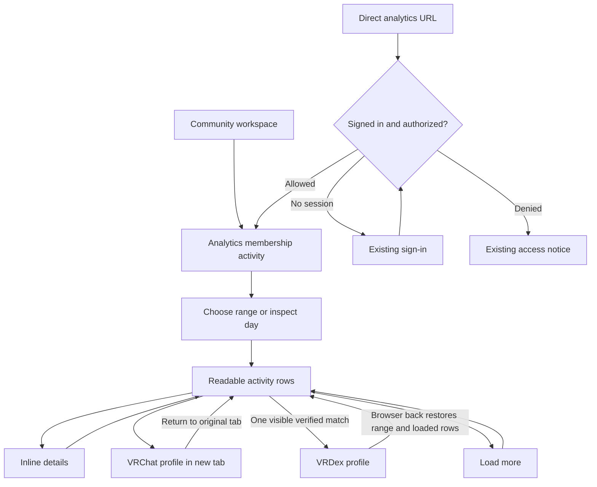

# Readable membership activity and identities

## Review brief

Show who an activity concerns, what happened, which role changed, and when. Link each resolvable person to VRChat and, when there is one verified and visible match, to VRDex. Keep IDs and original event types in expandable details for diagnosis.

**Locked decision:** BASIC chose latest known VRChat names in the main rows on November 11, 2026. Preserve names recorded with an event separately in details. A cached name is the latest observation, not a promise that VRChat still uses it.

**Locked decision:** BASIC approved the full design on November 11, 2026. Improve existing rows with exact-ID cache reads and verified profile links, then preserve validated actor and role metadata on future audit events. Do not hold the readable UI hostage to complete enrichment. Old records with discarded role metadata must remain incomplete unless a separately scoped recovery obtains the original event.

The design and its proposed copy are approved for implementation planning. The scope is membership activity first, followed by the comparable workspace labels in the inventory below. Production operations and deployment remain separate. No production queries, individual-profile collection, edits, migration, deployment or publication were performed for this research.

**Locked decision:** BASIC approved the visual direction shown in the `Clubs/Membership design / Role Activity` Storybook preview on November 11, 2026. This covers the displayed role assignment/removal rows, staff attribution, profile-link placement, missing-data fallbacks and expandable details. The preview uses synthetic data and disabled links. Its source is `apps/web/src/components/club-membership-design.stories.tsx`.

The full approval includes the incremental approach and proposed labels below. Provider payload support remains an engineering prerequisite. New copy or material changes to the approved design still require review.

Defer a new service that resolves every historical member. The existing destination queue requires visible profile references. Broadening it would change its purpose and collection scope.

## What exists today

The supplied screenshot was inspected locally. It shows full `usr_` values as the primary text, raw role assignment/unassignment event strings, and timestamps. No identities from it were looked up.

| Stage | Retained or available | Missing or discarded |
|---|---|---|
| Provider audit page | The adapter passes audit results to normalization. The referenced community specification describes actor ID/name, target ID, event type, description and event-dependent data. | The actual live shape of assignment/unassignment data was not checked. Do not assume every event has a role name or target user. |
| Collector normalization | Audit ID, event type, timestamp, and a user-shaped target ID. All in-window event types pass through, including future or non-membership types. | Actor fields, generic target IDs, description, and all event data are dropped. It never populates `targetDisplayName`. A test explicitly prevents using the actor's name as the target's name. |
| Convex membership events | Optional target name is allowed, along with target ID and immutable audit fields. Events are scoped by integration and epoch, then verified through scan passes. | No actor or role fields exist in this projection. Optional target-name support does not establish populated data. Duplicate events are skipped after checking immutable type, timestamp and target. |
| Activity query/UI | Verified rows, reverse chronological pagination. Starts with 25 rows; backend allows 1 to 100. Names fall back to IDs and then `Unknown member`. | No identity enrichment or links. Only join, leave and remove have readable labels. Even named rows show the full ID underneath. |

An old event can gain a latest known target name through an exact-ID cache hit. It cannot gain a historical target name, actor or changed role from the current stored record alone. Current member roles cannot establish which role changed in a past event.

## Existing identity and role sources

| Source | Reuse | Boundary |
|---|---|---|
| `profileLinkDestinations` | Indexed by a normalized key such as `vrchat_user:usr_...`; has resolved entity ID, name, status and observation time. Reuse exact-ID normalization and read cached names in the authorized activity projection. | It is a current-observation cache, not historical evidence or verified VRDex identity. Its queue only refreshes visible outbound profile links. No activity row should create a fake profile reference to obtain a refresh. |
| `profileExternalLinks` and connection verification | Reverse lookup by asset type, exact external ID and active state. Apply existing owner/proof verification and profile/field visibility rules, then deduplicate eligible profiles. | A directory reference or matching display name is insufficient. Associations are many-to-many. Zero or multiple eligible profiles mean no automatic VRDex link. Proof history used for display must not grant permission to act. |
| `clubProviderReadRequests` | Member pages retain projected user display names and role IDs; roles retain names and IDs. Reuse authorized results already available to a screen. | Subject-scoped temporary reads, with 60-second freshness and 15-minute retention. They are not a general durable identity cache. Do not read another staff member's cached page or grant `view_members`/role-assignment rights merely to label history. |
| Group member metadata/snapshots | Group-level count/history information. | Not a directory of individual names. |
| VRDex operation history | Has a different provenance from provider audit events and may retain the submitting staff subject and target/role payload. | A nearby timestamp or matching target does not prove it produced a particular VRChat audit event. Do not join these histories by guesswork. |

Use the existing Card, Button, Notice and local-time formatting patterns. There is no inspected shared membership-person link component to adopt wholesale. Extract only the small person/links renderer needed by the first two consumers, rather than creating an identity framework.

## Approaches

| Approach | Benefit | Limit | Status |
|---|---|---|---|
| Display-only labels, cache names and links | Smallest UI/backend change; helps existing rows immediately. | Future role names and staff attribution continue to be lost. | Insufficient alone. |
| Cache-backed rows plus a small future audit projection | Addresses the screenshot and prevents further loss of useful actor/role evidence. Existing rows degrade honestly. | Requires collector, validator and query changes. Many names may still be unresolved. | Approved by BASIC on November 11, 2026. |
| General resolver and historical replay | Could improve coverage across many screens. | New collection scope, scheduling and recovery cost; provider retention and payload coverage unknown. It still cannot guarantee old names. | Deferred. |

## Proposed row and links

Keep the current activity list and day/range navigation. Each desktop row has a person column, action/context column and local timestamp. On mobile these stack in the same reading order. Show actor context only when it is independently available. Use ordinary text links, not status badges or a clickable row containing other links.

Synthetic examples only. Names and roles below do not identify anyone in the screenshot.

| Before | Proposed main row |
|---|---|
| `usr_<A>` / `Joined` / time | `Lumen` with `VRChat` and eligible `VRDex` links / `Joined` / time |
| `usr_<B>` / `group.member.role.assign` / time | `Mira` with profile links / `Assigned role: DJ`, secondary `By Sol` when proven / time |
| `usr_<B>` / `group.member.role.unassign` / time | `Mira` with profile links / `Removed role: DJ` / time |
| Old role event with no stored role | Resolved person or `Unknown member` / `Role assigned`, secondary `Role unavailable` / time |
| Valid user ID with no name cache hit | `Unknown member` with `VRChat` link / readable action / time |
| A future unrecognized event type | Resolved person if the target is actually a user, otherwise `Unknown member` / `Other activity` / time |

Recommended link behavior:

- The person name links to VRChat when a validated user ID is present. Also show a plain `VRChat` link for an unresolved name. Use the established `https://vrchat.com/home/user/<id>` format, built from the validated ID rather than a supplied URL.
- Show a separate `VRDex` link only for one eligible verified person profile. Use its current canonical slug and existing redirect rules. Never generate a slug from the name or create a profile.
- VRDex opens within the app. VRChat opens in a new tab using the existing external-link convention and an accessible indication. This preserves the filtered activity list for return.
- `Details` expands inline. It retains the row and pagination position and shows original event type, audit ID, target ID, available actor and role IDs, and available name evidence with observation/recording times. Do not expose arbitrary provider data or another history category here.
- On destructive-action confirmations elsewhere, keep the exact ID visible alongside the name. Hiding identifiers is appropriate for scanning history, but not for removing the operator's ability to confirm the target.

### States and exact draft copy

The full design approval covers the strings in this section and the row examples. They are short factual labels under the VR Johnny lens, without promotional or technical explanations.

| State | Proposed display and behavior |
|---|---|
| First page loading | Preserve existing `Loading membership activity…`. |
| Loading another page | Preserve loaded rows and `Load more activity`; indicate pending work without blanking the list. |
| Name not resolved or lookup unavailable | `Unknown member`; valid VRChat link remains. Details expose the ID. No per-row spinner when no refresh was requested. |
| Latest name is an older cache observation | Show it as latest known. Details use `Name last checked` and its time. Do not claim current freshness. |
| An event-recorded name exists and current name is unavailable | Use it as a last-known fallback; identify `Name recorded with event` in details. Keep it separate from later observations. |
| Provider confirms account is deleted | Preserve permitted recorded evidence and ID in details; `Deleted user` is allowed only on explicit deletion evidence. A 403/404 or cache miss alone uses `Unknown member`. |
| Role ID exists with only a current role-name match | `Assigned role: DJ` or `Removed role: DJ`; details use `Latest known role name` with observation time. Do not call this the historical role name. |
| Role was renamed or deleted | Prefer an event-recorded role name when present. Details retain it and show a differing current name separately. Missing from a current role list alone does not prove deletion. |
| Role metadata absent | `Role assigned` or `Role removed`, with `Role unavailable`. Never infer it from today's role list. |
| Actor absent | Omit `By ...` rather than inventing an actor. A valid actor ID can use an unresolved person fallback in details. Explicit system/admin identities need separate validated handling, never a fabricated user link. |
| No VRDex match, hidden match or ambiguous matches | Omit `VRDex`; never reveal the hidden candidates or suggest an arbitrary profile. |
| Page query fails | Keep existing loaded rows when available, show `Unable to load activity.` and `Retry`. Permission loss clears rows and details using the workspace access handling. |
| No activity | Preserve `No recorded membership events.` |

## Page and action flow

Question: how does a staff member identify someone and return to the same activity?

Current: the same activity entry paths lead to plain names/IDs without profile links. Proposed: add the two profile destinations and inline details, without new authentication or purchase gates. Existing sign-in return behavior and list restoration must be verified during implementation, not assumed from this diagram. Longer-term bulk enrichment is deferred and adds no pages in this proposal.

Mobbin flow research was considered through the installed `mobbin-flow-research` skill. It was skipped because this preserves the settled workspace journey and uses standard links plus inline details. No unresolved onboarding, navigation sequence, purchase or recovery journey needs an external reference to choose the approach. No Mobbin operation was attempted and no connector access is claimed.

## Data handling and delivery boundaries

1. Authorize `listActivity` exactly as today, including individual-history category permissions, integration/epoch boundaries and verified event selection. Label enrichment must not expose named history on public aggregate charts.
2. Deduplicate target and actor IDs on the requested page before indexed local cache/profile lookups. Keep the default 25-row pagination and backend 100-row cap. Bound reverse-profile candidates with overflow detection; overflow is unresolved, not permission to pick the first result.
3. Reuse already resolved exact-ID destination names with source and observation time. Do not call VRChat from a query, browser row or hover. Do not make the public cache lookup API less restrictive to support history.
4. Future normalization should retain only validated actor ID/name and event-specific role ID/name fields when their meaning is known. Keep a missing field missing. Preserve generic target type/ID when needed to avoid treating every event as a member action. Do not retain the whole `data` object or description as a UI template.
5. Before implementing role parsing, confirm assignment and unassignment fixtures against a pinned provider schema or separately authorized sanitized evidence. The external schema read in this research only establishes that `data` is event-dependent. It does not establish role-field keys. Unknown optional metadata must not prevent otherwise valid audit evidence from being stored; malformed required scope/identity still follows existing schema-drift handling.
6. Keep original immutable audit evidence and scan verification unchanged. Add optional evidence without overwriting later names into event-recorded names. Existing duplicate-skip behavior means replay will not automatically enrich old rows. Any later recovery needs an explicit field-aware enrichment path and conflict rules, scoped separately.
7. No new provider enrichment traffic in the first slice. Existing destination refreshes retain their profile-reference requirements, one-day successful-refresh throttle, negative retry eligibility, leases and request budgets. Existing member/role read freshness remains mandatory for actions even if a historical label is available.
8. If coverage proves inadequate, propose one bounded background resolver separately: deduplicated IDs only from authorized pages, shared account/integration budgets, capped work per poll, negative caching, Retry-After handling and backoff. Decide retention and scope before reusing or extending any cache. Never scan all history on page load.

## Prioritized inventory

This is a source-backed inventory of comparable screens, not proof of every deployed UI or every identifier in the repository. Priorities describe sequencing within this improvement, not incident severity.

| Priority | Screen and source evidence | Recommendation |
|---|---|---|
| 1 | Membership activity, `club-membership.tsx:33,224` and `clubMembership.ts:502`. Raw target fallback and raw unmapped event types. | Deliver the proposed rows, links, details and future metadata preservation first. |
| 2 | Member workspace recent actions, `club-members.tsx:670`. Shows action label and raw `payload.targetUserId`; role context is not shown there. | Reuse person rendering and add known role context. Preserve submission outcome separately from provider audit facts. |
| 2 | Scheduled list/cancel confirmation, `club-scheduled.tsx:631,678`. Raw target and world IDs; staff name already available. | Names and appropriate links in the list; preserve exact target ID in confirmation. Resolve world names through existing world records, never from user-ID helpers. |
| 2 | Invitation outcomes, `club-invitation-batches.tsx:645`. Raw ID is already an external profile link; separately displays an originally reviewed ID. | Replace primary link text with a known name while preserving both identities when reviewed and actual recipient differ. Do not erase this audit distinction. |
| 2 | Member detail and role selectors, `club-members.tsx:319,335,367`. Role chips print IDs; selectors already prefer `role.name`. Directory rows at 606 prefer name but always add ID. | Reuse the existing authorized role-page name map, handle incomplete role pages, and move ordinary row IDs into details. Keep confirmation IDs visible. |
| 3 | Staff recent actions, `club-staff.tsx:592`. Actor name is readable, action uses underscore replacement. | Use explicit action labels and known target/role context rather than generic string formatting. Preserve owner-only access. |
| 3 | Event change history, `event-editor-form.tsx:1479`. Action is formatted, but `changedFields.join` exposes schema field keys. | Map known fields to editor labels; preserve exact keys in diagnostic detail. Coordinate with the event owner rather than changing it in this slice. |
| Keep deliberate IDs | Connection setup/status, `club-connection.tsx:111,160`; scheduled payload editor `club-scheduled.tsx:57,153,176`; bot admission has explicit copy-ID controls. | Retain exact values where users paste, copy or verify provider configuration. Add meaningful context if absent, without replacing required locators. |

No evidence here establishes that the same problem affects every community/event selector. Existing event list queries already return titles; ordinary React keys, option values and hidden payload IDs are not display defects.

## Implementation reach and acceptance

The first slice reaches collector normalization and its tests, worker/control-plane membership validators, the schema, ingest conflict/duplicate handling, activity query and UI types, page-scoped identity projection, membership stories and the existing visual test. Trace the control-plane route that dispatches `membership_scan_page` when planning the contract change. Later consumers are separate small follow-ups using the same renderer, not a simultaneous workspace rewrite.

Required checks when implementation is authorized:

- Fixture tests prove target and actor cannot be swapped; supported role events retain the correct role metadata; missing fields and future event types remain safe. Keep foreign-group, half-open window and malformed-page tests.
- Backend tests cover denied individual-history reads, no named data on public movement, epoch isolation, visible verified unique profile matching, suppressed/hidden profiles, revoked/directory-only links, ambiguity and overflow. Existing display-verification semantics for stale proof history remain distinct from authority to act.
- Query checks count bounded local reads for repeated IDs and assert no provider calls on render. Include cache miss, stale/negative cache states and absent historical metadata.
- Ingest tests preserve immutable conflicts and verification passes, and specify duplicate behavior for optional evidence. No backfill is implicit.
- Storybook/screenshots cover desktop/mobile, long names, role assign/remove, absent actor/role, no profile match, multiple matches, query failure, pagination and details keyboard interaction. Use existing `ci:browsers` and `ci:visuals` selection and VLM review before UI completion.
- Verify links, sign-in return and browser-back restoration of filters/pages in the running app. Review exact proposed copy with BASIC before shipping.

## Evidence appendix

Research date: November 11, 2026. Local source head: `d2f2febbafde7c02610f9fe10f93ef303d2c90a0`. The shared checkout had unrelated untracked files; none were changed. Findings describe inspected source, not the deployed release or live record coverage.

Primary local references, relative to the repository:

- `workers/group-telemetry/membership-audit.mjs:5` and `membership-audit.test.mjs:6`: normalization and actor/target regression test.
- `workers/group-telemetry/membership-collection.mjs:5`: named-membership gate, fresh authority, `group-audit-view`, account/integration budgets and durable page scan.
- `workers/group-telemetry/club-provider.mjs:119`: audit results pass through; roles fetched once, bounded and sliced locally.
- `convex/clubMembership.ts:24,232,400,502`: event shape, ingest, individual-history authorization and paginated projection.
- `convex/schema.ts:718,734,1878,1950,2966`: temporary provider reads, destination cache, membership projection, group aggregate metadata and profile external associations.
- `convex/_profileLinkDestination.ts:16`, `_profileLinkDestinationCache.ts:43`, `profileLinkDestinations.ts:36,80`: normalized keys, reference-driven refresh and result validation.
- `convex/_profileConnectionVerification.ts:9,39`: display verification, owner/proof matching, visibility and historical proof semantics.
- `convex/_clubProviderReads.ts:51` and `workers/group-telemetry/club-read-jobs.mjs:47`: temporary member/role projections and freshness.
- `apps/web/src/components/club-membership.stories.tsx` and `apps/web/e2e/club-membership.storybook.spec.ts`: existing story and visual entry points.

External source: the [VRChat API community specification's audit entry](https://github.com/vrchatapi/specification/blob/main/openapi/components/schemas/GroupAuditLogEntry.yaml) describes actor fields and event-dependent data. It is community-maintained specification evidence, not a provider guarantee or a live payload check. Attempts to read two event-specific raw schema URLs failed with cache misses; exact assignment/unassignment field names remain unverified.
