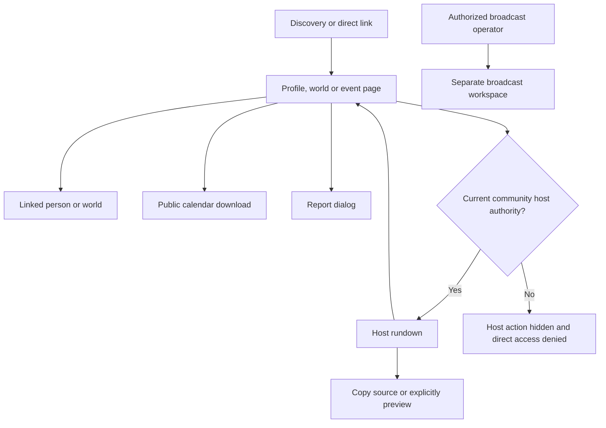
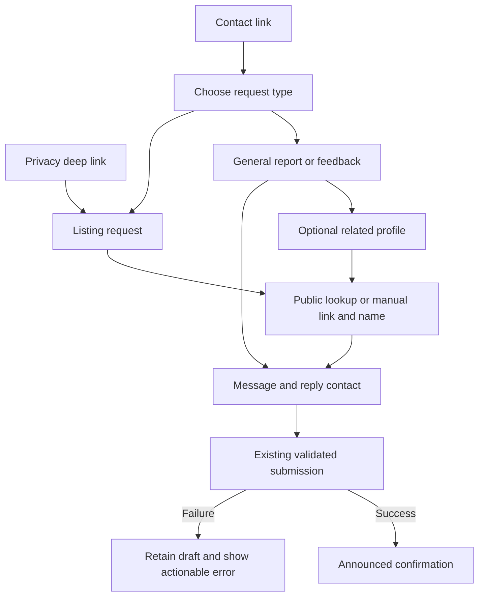

# Integrate the accepted public UI

## Review brief

Bring the accepted UI jam onto current main as one integration branch and one PR. Preserve the pages BASIC reviewed while reconciling newer broadcast, timeline and analytics work. The result should feel consistent across discovery, profiles, worlds, events and support, with authorization and regression evidence for normal release review.

The visual direction and one-PR approach are approved. This document proposes the production integration contract. BASIC is asked to approve that contract before the implementation plan is written. Merge and deployment remain separate decisions.

## Decisions and approaches

| Approach | Tradeoff | Status |
| --- | --- | --- |
| One integration branch and PR, grouped commits | Keeps the accepted experience together; reviewers cover several related surfaces | Locked decision, approved November 11 |
| Separate UI and host-permission PRs | Smaller authorization review, but more sequencing and partial UI states | Considered, not selected |

Current recommendation: create a fresh codex integration branch from refreshed main and transplant accepted changes by feature group. Preserve the jam branch and checkpoint for comparison and rollback. Avoid rewriting that checkpoint or wholesale replacing current-main files.

These are commit groups within one project, not separately tracked projects:

1. Shared shell, logo and design-system controls.
2. Profile links, stream cards, media and world references.
3. Contact/report interactions.
4. Event presentation and host access.
5. Integrated regression repairs, visual baselines and documentation.

The builder can adjust commit boundaries when dependencies require it.

## Accepted experience

### Shared navigation and identity

The root layout owns the common header and footer. Pages contribute contextual actions rather than competing brand navigation. Migrate affected public, account, auth and fixture callers together.

Keep the smaller, farther-left transparent wordmark. Dark mode uses the pale original; light mode uses VR #17212D and DEX #547EAE. Keep one visible accessible logo per theme. Shared dropdown arrows remain inset from the right edge, with native selection and keyboard behavior intact.

Preserve current-main analytics consent, provider nesting, sign-in context, playback ownership and footer privacy behavior. Retain these behaviors while adding the shared header.

### Discovery, profiles, media and worlds

- Preserve full timeline width and the accepted floating desktop detail panel and full-screen phone detail panel. Retain current-main activity retention and schedule behavior. Closing details returns to existing browsing state.
- Keep schedule padding and remove the generic No events in this range message, retaining meaningful filtered/favorites states.
- Keep consistent profile link cards, including Discord copying, VRChat account subtitles, Twitch links and verified destination information. Retain destination URLs and full clipboard values.
- Keep compact VRCDN cards with single-line copy rows and the existing in-site player. Provider-live confirmation, lazy startup and player cleanup remain unchanged.
- Keep file format, size, source link and provenance inside Details & history. Preserve actor links and nullable history data. Do not invent provenance for real assets.
- Keep world artwork and linked creator pictures, plus world thumbnails in profile credits and timeline references. Use existing public images and safe URL projection; missing images use existing fallbacks. No new provider retrieval is included.
- Remove redundant page-level Add a missing profile and Back to discovery controls where the accepted source removed them. Shared navigation remains available.

### Events and the host rundown

Public event pages retain lineup, poster, community/world links and contextual playback. Remove the DJ-links accordion and raw VRCDN source copy entries. Keep ordinary event links.

The banner groups calendar, report and authorized Host view icons. Each has an accessible name and hover/focus tooltip. Calendar retains the public ICS endpoint. Report opens the existing form in a native dialog, preserving validation, mutation permissions, Escape, close and focus return. Contributor correction/takeover controls remain available to authorized users.

Host view is for scanning the lineup, source-status observations and copying links. It is separate from the broadcast workspace and never issues broadcast commands. DJ names lead to profiles. Alternatives and full URLs remain available; source preview stays explicit, muted, singular and disposed when closed.

Up next means the earliest future timed set, using stable lineup position to resolve tied times. Source priority matches the roster: selected public source, otherwise VRCDN, otherwise the first public source. Do not skip an upcoming performer because they have no links or are offline. Untimed sets remain in the roster but cannot drive the shortcut. Hide the shortcut when no future timed set remains. Provider-live status never changes scheduled selection, and the shortcut does not guarantee decoded-media readiness. Preserve manual access to all roster links during delays and failed status checks.

### Host authorization

Add community-wide host_events to existing role/capability validators and the staff permission picker, labeled Host events. Community owners and manage_events staff retain access, including seeded admins. Other hosts receive access through the existing authorized invitation/role-assignment flow. Do not broaden who can grant roles.

This capability grants the rundown only. It does not grant event editing, private broadcast diagnostics, media control or provider credentials. view_event_operations or manage_event_media alone is not a host grant. No per-event assignments or automatic VRChat role synchronization are included.

Action visibility, reactive host projection, server page and status endpoint enforce the same current authority for published and private events. Anonymous, unrelated, revoked and wrong-community callers receive no host data. Remove the public-event fallback after denied authorization. Sign-out or revocation withdraws the host surface; shared caches must not retain privileged projections. Broadcast permissions and current-main source-control APIs stay separate.

### Contact and reporting

/support starts with request type and no assumed profile. General reports and feedback use the existing feedback intake topic with optional related profile and reply contact. Listing-specific requests use the existing public person/community picker with explicit selection and manual link/name fallback. Name-only suppression requests retain explicit profile type.

Keep message before reply contact. Dispute, transfer and recovery require a contact. Preserve deep links, reset behavior, pending-request generation guards, error handling, limits and live outcome announcements.

Keep ordinary supportRequests and profileSuppressionRequests separate. General reports must never trigger suppression automation. No new delivery system, moderation queue, topic schema or support persistence model is included.

Checkpoint labels include Contact VRDex; Ownership dispute; Transfer a profile; Recover account access; Remove my listing; Listing safety concern; Report a problem or send feedback; Related profile (optional); Profile type; Find profile; Enter a link or name. Preserve accepted labels and existing outcome/error prose. Any substantive new public prose during integration must be shown to BASIC before shipping.

## User journeys

### Find a profile or run an event

### Contact without assuming a person

## Production and fixture boundary

Synthetic artwork, performers, schedule data and upload/approval/publication history remain test data. Media-history fixture responses require the existing non-production fixture flag, exact sample profile and known asset ID, and pass normal response validation and request guards. Disabled fixtures and production use the real backend and must not fall back to fabricated history or authority.

Verify signed-in role assignment separately from fixture access. A mocked role or synthetic preview cannot prove real identity, assignment or revocation.

Deferred work includes automatic VRChat world/group-banner retrieval, new image-cache/worker behavior, provider acceptance, broadcast redesign, per-event hosts and Discord user-link capabilities. Existing provider images may be displayed where available. Do not add per-page provider fetches or overwrite owner artwork.

## Integration and verification

Start with refreshed main. Inventory overlap against the immutable checkpoint, then integrate each group with its callers, fixtures, tests and docs. Current main wins for newer broadcast implementations, event retention and analytics contracts; restore accepted UI around those contracts. If this requires changing accepted behavior, bring that specific decision back to BASIC.

Replace obsolete assertions with assertions of the new behavior. Remove dead component tests and orphaned snapshot cases while retaining meaningful privacy, URL, lifecycle and authorization coverage in their owning surfaces. Refresh affected baselines from reviewed renders. Do not delete failing assertions merely to obtain green checks.

Required evidence:

- Web/backend TypeScript, changed-code lint, markdown checks and relevant backend/API tests.
- Shared-shell checks across public, account, auth, developer and support routes, including unconfigured public rendering, theme switching, desktop and phone overflow.
- Link destination/copy/verification checks; player startup, offline handling and disposal; media disclosure and production-vs-fixture history boundaries; decoded world thumbnails.
- Calendar/report interactions, schedule shortcut boundaries and manual copy availability during slow/failed status reads.
- Host matrix: owner, existing admin/event manager, host-only staff, operations-only staff, nonstaff, anonymous, cross-community and revoked users. Include assignment, server/status denial and host-only denial of broadcast/edit operations.
- Support general-report, optional-context, manual-fallback, deep-link, validation, retry and submission-routing checks without sending real support requests.
- Current-main regressions for analytics consent, broadcast control permissions and timeline activity retention.
- Desktop/mobile screenshots and visual review, affected public/Storybook baseline comparisons, and signed-in browser evidence for host grants/revocation on a test tenant.

Set ci:browsers and ci:visuals on the PR before its normal CI run. Apply the current repo readiness gate: checks must finish and every feedback surface must be refreshed for the exact current head. There is no fixed waiting period. A push, first green run or silent review surface is not merge readiness.

Retry earlier worker failures against current main. PR #451 changed broadcast fixtures after the jam base, so the previous 179/181 result is historical. Diagnose surviving failures and document genuine platform limits without weakening dispatch guarantees or claiming the full suite passed.

Review the integrated staging/preview experience before release. Design approval authorizes planning, not production deployment. Keep the integration branch available for normal review and retain the accepted checkpoint through delivery.

## Builder discretion

Reuse Next.js, TypeScript, Convex and shared UI primitives. No dependency or framework change is proposed. The builder chooses the fresh codex branch name, exact commit boundaries, narrowly necessary refactors, fixture setup and platform-appropriate commands. Avoid unrelated cleanup, new tracking systems and abstractions without demonstrated reuse.

## Evidence appendix

- Accepted checkpoint: 7bdee240d533b4d4736a24cdc6a5e5d785cb1c6e, codex/event-design-jam-1105.
- Original base: 2f58403fb2eb6ee66e8bf697bd34ad0ec223bc18.
- Main refreshed November 11: 25860865c, 16 commits beyond the jam base; recheck at execution.
- Checkpoint: 110 files, 1,085 additions and 865 deletions; many are mechanical header migrations.
- [Jam record](../../planning/event-design-jam-2026-11-05.md) contains accepted decisions, sampled references and local verification. This design supersedes open candidate wording for behavior specified here. Deferred work remains deferred.
- [Product direction](../../planning/product-direction.md), [event schema](../../backend/event-schema.md), [support intake](../../backend/community-submissions.md), [design system](../../engineering/design-system.md), [CI selection](../../testing/playwright-visual-preview.md).
- Main overlap includes layout/footer/privacy, event presentation/backend, timeline schedule/tests, schema and worker tests. Inspect actual diffs at execution rather than infer resolutions from this list.

## Design review status

Independent builder check completed November 11 with no important unanswered questions. Markdown validation passed. BASIC approved this written design November 11. The one-PR approach and visual checkpoint are also approved. The readiness wording was aligned with BASIC's replacement AGENTS instructions, which remove the fixed waiting period. No implementation or integration branch has started.

If a test tenant or other required verification is unavailable during execution, record the exact missing evidence and retain draft/non-ready status. Synthetic fixture checks must not substitute for signed-in authority proof. Do not expand this project into provisioning unrelated infrastructure to remove that limit.
