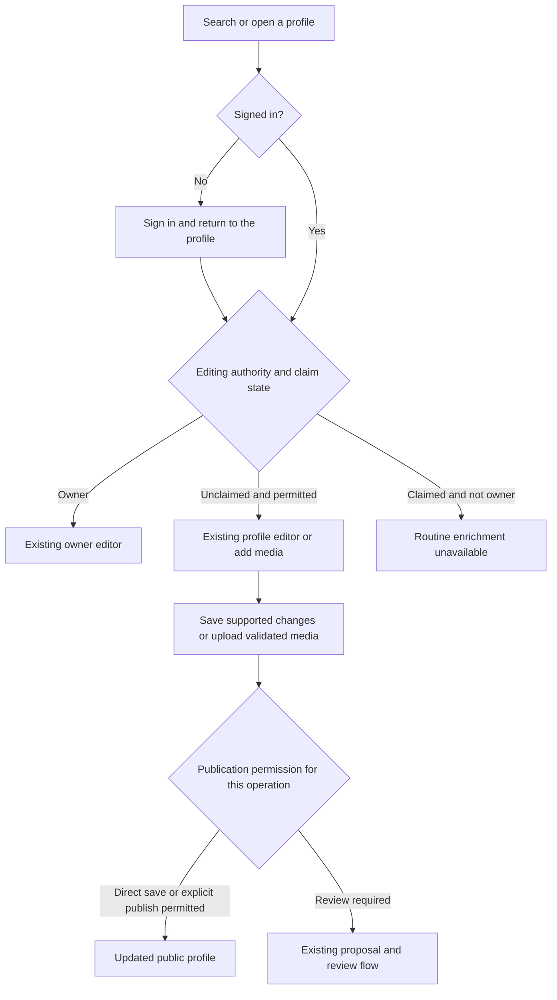

# Simple profile editing and contribution capacity

Status: approved by BASIC on November 11, 2026. Native implementation authorized.

## Outcome and decisions

Make adding reliable data to unclaimed VRDex profiles straightforward through the website and authenticated MCP. Separate editing authority, publication authority, and capacity. No temporary allowance, batch approval, or test-only policy is required to do ordinary work.

Confirmed by BASIC:

- Routine enrichment stops when someone claims their profile, including for superadmins.
- Superadmins need direct editing of unclaimed profiles without contributor quotas.
- Trusted contributors, media approvers, and trusted publishers receive the same higher contribution capacity.
- Higher capacity does not grant editing or publication permissions.
- A future superadmin override for claimed profiles needs a separate approval step and may be self-approved. It is deferred from this release.

The approach and numerical limits below are approved product choices, not measured throughput guarantees.

## Recommended approach

Use the existing profile editors, media lifecycle, account grants, and authenticated tools. Resolve three independent capabilities server-side for every operation. Add the missing superadmin editing path and apply real trusted limits. Remove temporary allowance and synthetic-policy machinery from the product and its tests.

A separate admin importer would duplicate editing, validation, and publication behavior. A batch-specific exception would recreate the approval work BASIC rejected. Neither is recommended. Existing collections may remain optional organizational tools, but must not control permissions or unlock capacity. Enabling or redesigning collections is outside this release.

## Editing authority

Ordinary and trusted users retain their existing field-level contribution permissions on public unclaimed profiles. Trust does not grant ownership or access to restricted fields.

Superadmins can routinely edit supported public profile data only on public, unsuppressed, non-opted-out unclaimed profiles: names, descriptions, links, genres, and media-kit assets. Reuse the existing field schemas and editor controls. Do not expose private seed evidence, private source references, account identifiers, ownership changes, or moderation controls as editable public data. Profile pictures and media-kit logos remain distinct selections. Routine editing cannot restore visibility or bypass suppression, opt-out, or legal holds. Existing moderation actions remain separate.

Claimed profiles remain owner-managed. Existing owner editing remains available. Superadmins and trusted roles cannot use routine enrichment or a media upload mode to bypass a claim. Recheck claim state and permissions when applying each change, including upload completion and publication. A profile claimed during an operation requires a fresh ownership-aware decision, without a partial public write.

## Publication authority

Ordinary contributors and trusted contributors retain the existing publication rules for each operation. This design does not newly require review for changes that already publish directly.

Media approvers may approve or reject eligible proposals under existing review rules. The approver role alone does not grant publication. Trusted publishers retain their explicit publication capability without acquiring wider profile editing or review authority.

Superadmins may save supported unclaimed-profile edits directly and explicitly publish validated media. A successful upload is not itself publication. Browser controls may combine an explicit publish action with the existing lifecycle, but failures must distinguish uploaded, validated, and published states. MCP retains explicit completion and publication operations. No capacity grant authorizes publication implicitly.

## Capacity

Resolve capacity independently of the operation's editing and publication checks. Any active trusted_contributor, media_reviewer, or trusted_publisher grant selects the trusted capacity tier. Superadmin takes precedence. Expired or revoked grants do not count, and combining roles does not multiply quotas.

| Actor limit | Ordinary, unchanged | Trusted, proposed | Superadmin |
| --- | ---: | ---: | --- |
| Media contributions per rolling 24 hours | 6 | 1,000 | No contributor quota |
| Open media proposals | 3 | 1,000 | No contributor quota |
| Admission burst | 1 per 30 seconds | 12 per minute | No contributor cooldown |
| Reserved upload bytes | 144 MiB | 20 GiB | Shared deployment budget |
| Concurrent processing per actor | 3 | 4 | Shared deployment concurrency |

Retain shared deployment storage and concurrency limits, file size/type/pixel checks, cleanup readiness, source-fetch protection, and intake pause. These protect service operation and still apply to superadmins.

For ordinary contributors, retain the existing per-profile limits. Proposed trusted per-profile admission limits are 100 contributions per rolling day and 20 open proposals. Superadmins bypass contribution-count and open-proposal limits for an unclaimed target, while target processing and byte safety checks still apply. Target counts remain shared across contributors; they do not grant authority over the target.

Higher pending-item counts do not promise that every pending item can simultaneously hold a maximum-size image. Byte capacity is separately bounded and reported. These limits apply consistently in local development and hosted environments. Tests use fixtures and injected time, not a separate product policy or privileged test identity.

## User journey

Proposed routine flow:

Authenticated MCP follows the same decisions without browser navigation. Executor supplies the signed-in account; VRDex derives identity and current grants from the verified session/token. Never accept a caller-supplied admin flag or rely on Executor approval as proof of a VRDex role. OAuth scopes remain necessary in addition to account permissions. Insufficient scopes produce the existing actionable reconnection response.

No new navigation or onboarding wizard is proposed. Reuse the current editing and contribution pages. External reference-flow research is unnecessary for this settled journey.

## Claimed-profile override, deferred

Record the future requirement without implementing an override now: a superadmin proposes exact changes with a reason, inspects a preview, and explicitly approves in a second step. The same person may approve. Approval binds the profile version and exact changes; changed data invalidates that approval. History identifies proposal, approval, and application actors. Future design must settle owner visibility and notification before shipping.

## Implementation coverage

The implementation must reach the shared role/capacity resolver, ordinary and superadmin profile edits, media admission/completion/publication, capacity discovery, browser capability responses, API contracts, MCP schemas/tools, tests, and operator docs. REST interfaces exposing the same commands must enforce the same capabilities.

Remove temporary allowance creation/approval, enforcement branches, misleading request tools, and synthetic policy selectors. Update or remove obsolete docs and tests rather than preserving dead workflow compatibility. Inspect existing allowance records before deciding schema cleanup; preserve existing contribution/media audit history and do not delete stored assets or rewrite published attribution.

Use paginated or indexed reads. Unlimited superadmin contribution volume must not become an unbounded history scan, an arbitrary giant numerical limit, or an unlimited worker queue. Capacity discovery must distinguish an inapplicable contributor quota from an exhausted quota, and report the real remaining technical bottleneck.

Verify installed Executor tool discovery after MCP changes and refresh its tool definitions if required. No new credential store or standalone Executor privilege policy is needed.

## Acceptance and release

Prove the role matrix across ordinary, each trusted role independently, combined roles, superadmin, revoked/expired grants, and insufficient OAuth scopes. Verify higher capacity never changes publication permission. Check boundary counts, burst windows, byte reservations, replay behavior, and shared safety limits.

Verify both browser and authenticated MCP can complete an unclaimed-profile edit and logo publication under their respective permissions. Verify claimed non-owner targets refuse consistently, including claim races and stale versions. Verify ordinary contributors still use the existing review flow and owners can still edit their claimed profiles.

Implementation and review follow design approval. Merge, deployment, and exact-account production verification remain separate actions. No source inspection or mocked test proves hosted behavior.

## Evidence and limits

Source inspected on November 11, 2026: convex/_accountFeatureModel.ts, convex/_contributionPolicy.ts, convex/_contributionCapacity.ts, convex/contributionCapacity.ts, convex/contributionUploads.ts, convex/profileMediaSubmissions.ts, convex/profiles.ts, and the contributor-collection documentation.

The authenticated capacity response previously reported baseline-v1, tier trusted, 6 creations per rolling day, and bulk disabled. An independent builder check identified the need to state the visibility boundary explicitly; the design now preserves suppression, opt-out, and legal-hold restrictions. The checked-out source assigns baseline limits to both ordinary and trusted tiers. Exact deployed-source parity and the user's current superadmin grant have not been established.
