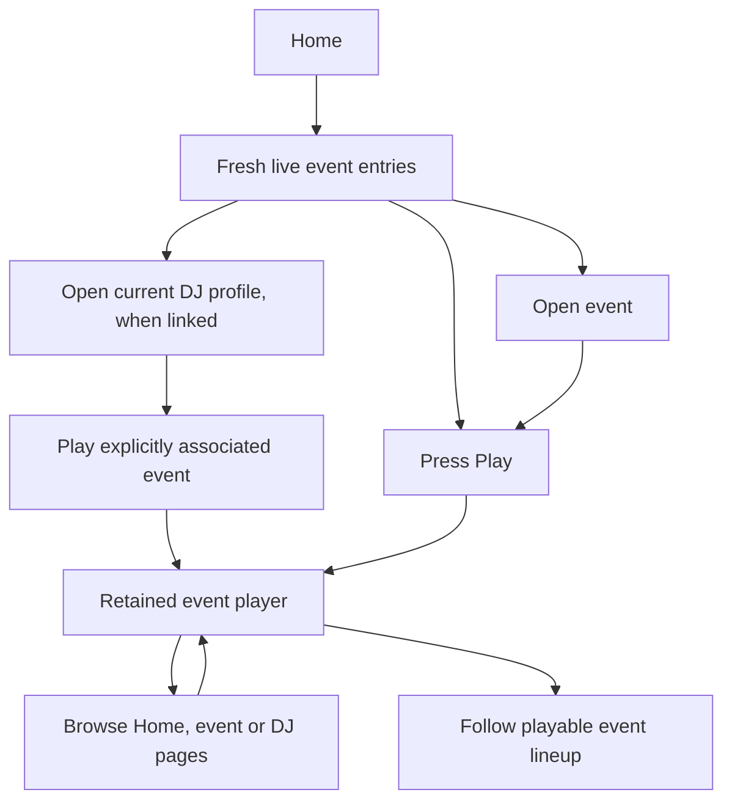

# Home Live now, first real slice

## Proposed outcome

Put the compact Live now row above the homepage schedule, using fresh shared stream observations instead of making each visitor wait for provider checks. Press Play once, keep browsing, and follow the associated event lineup. Starting from a DJ should promote their event; starting from an event should identify its actual current DJ.

BASIC has approved that hybrid listening direction and likes the compact mockup. This brief proposes the first production scope. Locked decision, November 12: BASIC selected current event performers first. All-linked-DJ discovery remains deferred. No production polling or relay configuration has been changed.

## Scope choices

| Approach | What visitors get | Tradeoff |
| --- | --- | --- |
| Current event performers, recommended | A useful event-led Live now row with bounded work | Misses spontaneous broadcasts outside events |
| All public linked DJs | Also finds spontaneous broadcasts | Continuously checks dormant links and needs larger provider budgets |
| Check on every page visit | Simpler initial wiring | Cold status arrives late and traffic multiplies provider requests, so this does not solve the reported problem |

## Experience already agreed

Keep event, current DJ and host identities, separate Play and navigation controls, and contained artwork. Use Live now without a station category or count. Public listening needs no VRDex account. Navigation stays silent. Playback uses the existing retained owner, rather than mounting another player in each card.

The active card follows the actual retained current performer. A scheduled boundary alone does not rename healthy overtime playback. Show an unlinked performer as a name, without inventing a profile link. Where an event association is ambiguous, do not silently select one on the DJ page.

### How does someone listen and keep browsing?

## Eligibility must match the player

A future performer's saved URL or broadcast cannot make an event playable while its current performer has no source. Resolve the current slot and inferred end through the same shared logic used by fresh Play. An enabled explicit event stream retains precedence. Missing, ambiguous, ended or unsupported current sources stay out of Live now.

The player repair is independently fixing this mixed-lineup defect. The homepage should consume that shared rule after it is reviewed, rather than duplicate a different version.

A live observation must match the selected canonical source and expire. A timeout or missing provider credentials is unknown, not proof of offline. Twitch can omit discovery-restricted broadcasts, so an absent API result must not be described as universal proof that the broadcaster is offline. Stale or unknown observations remove the browse entry. They do not destroy an already-playing listener's healthy stream. Recheck public event/profile visibility and stream selection before projecting entries and again on Play.

## Proposed data path

Use one bounded scheduled refresh and persistent shared observations. Homepage reads never probe providers or start media. Store only public source identity, status, observation/expiry times and public associations. Deduplicate shared sources and prevent overlapping refreshes. Reuse provider parsers, current-slot selection and public projections.

The current Next server has on-view VRCDN/Twitch caches. It has no implemented homepage live index or configured Vercel cron. Choose the scheduled host during implementation based on the existing Convex scheduler and secret bindings, with configuration recorded in source. Do not add a second scheduler or copy secrets merely to preserve the old module location.

Before activating VRCDN background probes, resolve or explicitly accept the documented uncertainty about whether brief transport reads consume viewer capacity. [Issue 217](https://github.com/BITRATE-Labs/VRDex/issues/217) remains open as checked November 12; its later mechanism correction supersedes the original HLS-probe claim. Keep strict source/concurrency/time caps and a manual off switch. Twitch batch reads can reuse its documented public stream API and normal rate-limit headers. Exact cadence and capacity remain engineering proposals, not accepted provider entitlements.

## Images and rollout

The row can ship with artwork. Cached stream images are independent research, not a prerequisite. Twitch supplies thumbnails in its current stream response; VRCDN's public schema exposes no image endpoint. Never open a hidden player or stream before Play just to obtain an image. See [cached-image research](../../planning/cached-stream-images-research-2026-11-12.md).

First qualify the shared eligibility and cache behavior with mixed-profile lineups, stale/unknown status, explicit-stream precedence, hidden records, source edits, missing provider credentials and Twitch discovery-restricted or omitted results. Browser checks must prove that Home opens no media, Play retains one owner across navigation, and empty results hide the row. Visually review desktop/mobile placement. Provider-live and iPhone/background evidence remain separate from synthetic fixture success.

No new marketing sentences are proposed. Utility labels remain Live now and Play. Existing source review and release rules apply before shipping.

## Evidence and review

The [local fixture preview](http://127.0.0.1:3217/playwright/home-radio) was restored and inspected on November 12. Its Current source missing state removes the affected entry while retaining other entries. This is synthetic design evidence, not a deployed feature or live provider proof.

The earlier design used the inspected [Apple Music browsing capture](https://mobbin.com/flows/e7c28ffc-abd2-4f81-846c-6b309d41e1d1) for separating browsing from retained playback. This brief reuses that settled flow evidence. It makes no new reference-app claims about authentication, recovery or background audio.

Source inspected: canonical production and remote main e89d7cdae18ee2317444c29d7ca3adc543d37a6d. Existing preview checkout remains home-radio-jam, based on an older main with uncommitted fixture work preserved. Player regression repairs are isolated in codex/player-regressions-20261112.

BASIC confirmed the requested scope choice: current event performers first. The approved hybrid UI stays intact. Provider activation and any new paid capacity remain separate release decisions.
