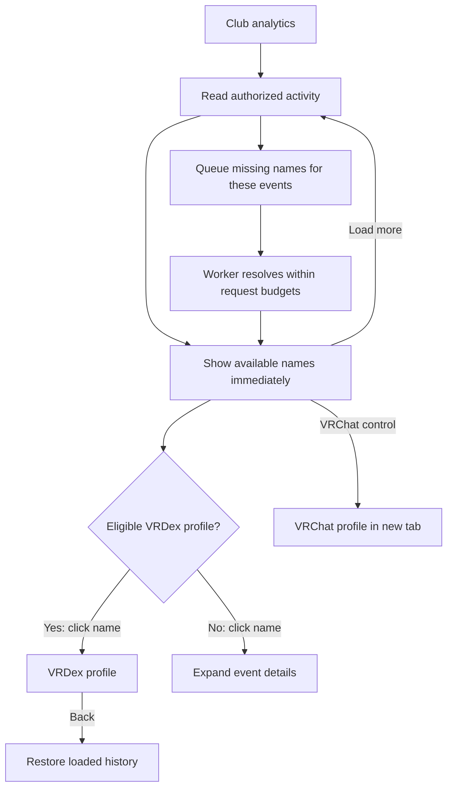

# Membership activity: useful names and clear controls

## Review brief

Make activity history readable without sending every name click to VRChat. The main name opens a verified visible VRDex profile when one exists. Otherwise it opens the row's details. A larger, separate VRChat control remains available. Remove the redundant VRDex link.

Resolve missing people automatically in the background, for new activity and recently viewed history. BASIC selected this approach on November 12. Historical role recovery is also proposed below; it is not yet approved or implemented. Production data and provider sessions have not been changed for this design.

The requested judgment is whether the row interaction and the bounded role-recovery proposal are right. The main tradeoff is additional provider traffic in exchange for useful names. Some records will remain incomplete when the provider no longer has the evidence.

Preview: [interactive Storybook study](http://127.0.0.1:6007/iframe.html?id=clubs-membership-recovery-design--row-interactions&viewMode=story). Data is synthetic. The demo lookup button is a preview control, not proposed product UI.

## Decisions and changes from the previous design

| Status | Decision |
| --- | --- |
| Locked decision | Keep latest known VRChat names in rows and event-recorded names in details. |
| Locked decision | Automatically resolve missing people in new activity and recently viewed history. BASIC selected this over manual-only lookup. |
| Requested revision | Main names link to VRDex when a unique visible verified match exists. Otherwise the name controls details. |
| Requested revision | Enlarge the separate VRChat control and remove the extra VRDex link. Apply the same destination rule to actor names. |
| Current recommendation | Recover recent historical role/actor evidence through a bounded audit replay, stored separately from immutable original events. |
| Current recommendation | Show a stable, distinct member identifier when no name can be obtained. Do not imply a lookup is running when it is not. |

The [previous approved design](./2026-11-11-membership-activity-identities-design.md) deliberately used existing cached names and deferred a new resolver and replay. Live inspection showed that this leaves many rows unresolved. This revision expands that scope and changes the primary link destination. The prior implementation remains shipped; this document proposes its successor.

## What causes the gaps

Confirmed from source and the signed-in BITRATE page:

- Activity reads names from `profileLinkDestinations`. Its refresh queue serves publicly visible profile links, not every member in activity history. A valid member ID can therefore have no cached name.
- The current collector does not populate target display names. It now preserves optional actor and role evidence for future events.
- Existing immutable audit events can lack role IDs as well as role names. A current role list cannot identify which role an old event changed when that ID was discarded.
- Some audit entries describe group activity rather than a person. Rendering these as `Unknown member` misidentifies the subject.
- Current rows make both the main name and a small VRChat link lead to the same provider page, while VRDex is a separate small link.

## Row experience

| Row state | Main control | Secondary control | Details |
| --- | --- | --- | --- |
| Named person with an eligible VRDex profile | Name links to that VRDex profile. | VRChat, at least a 40-pixel target. | Separate Details toggle. |
| Named person without an eligible VRDex profile | Name and chevron toggle details. | Same VRChat control. | Open beneath the row. |
| Name pending or unavailable | `Member 318b18fc` and chevron toggle details. | Same VRChat control when the full ID is valid. | Lookup state, full ID, last successful observation if any. |
| Group event without a person target | Recognized subject, such as `Group settings`, toggles details. | No fabricated person link. | Original event type and audit ID. |
| Role event without recoverable role metadata | Normal person control and `Role assigned` or `Role removed`. | Normal person controls. | `Role not recorded`; omit repeated `Role unavailable` text from the row. |

The short member reference uses enough of the normalized ID to distinguish visible collisions, expanding when needed. The full ID remains in details. It is a fallback identity, not a fabricated display name. A resolved name replaces it in place without reordering rows or closing details.

Names, roles and actor labels retain Unicode isolation. Accessible control names remove directional controls. Links and accordion controls remain separate keyboard targets; no nested interactive controls. Actor names follow the same VRDex-first rule, with an explicitly labelled actor-details toggle when no profile exists. There is one VRChat control per person, with an accessible destination and new-tab description.

Do not use a verified VRDex profile's chosen name as though it were a VRChat observation. It may serve as a final readable fallback for that exact verified person, but details identify its source as `VRDex profile name`.

### Journey: read history and return from a profile

This keeps the current account and workspace navigation. Mobbin research is skipped: profile destinations and inline disclosure are settled by BASIC's requested interaction; the open work is provider resolution and historical evidence recovery.

## Name resolution

Use the existing collector and request-budget machinery, with a separate private activity lookup queue. Reuse exact-ID parsing and provider response validation. Do not invent public outbound-link references to feed the existing destination queue. That queue's public-reference checks remain intact.

1. New verified audit events schedule unresolved target/actor IDs. On viewing older history, a small authenticated mutation accepts at most 25 audit IDs from the rendered page. It rechecks membership-history permission and derives provider IDs from those exact visible records in the current integration/epoch. Arbitrary user IDs are not accepted.
2. Deduplicate work by integration, epoch and normalized provider ID. Repeated renders, viewers and page restoration do not create additional jobs or reset cooldowns. Each newly returned page can request its own missing IDs. Merely restoring a large range does not scan the rest of history.
3. Return existing names immediately. Among valid VRChat observations, use the most recent observation from the existing destination cache or the private activity cache. Keep a valid stale name during refresh or transient failure. Fall back to recorded evidence, then an eligible VRDex profile name with its source identified, then the distinct member reference.
4. The collector verifies active scope and authority again before each request. It fetches only the exact user and retains the validated ID, display name, source, observation time and retry state. Do not store the complete user response or fetch artwork for a name lookup.
5. Convex subscriptions update the row when the observation arrives. The UI never calls VRChat directly, and queries remain read-only.

Builder defaults proposed for review: ten jobs claimed at a time; no more than two enrichment requests per minute per collector account, shared across its integrations and subordinate to the existing total provider budget. Membership collection and operational work take priority. A successful name becomes refresh-eligible after 24 hours when it is viewed or observed again. Negative results wait at least 24 hours. Transient failures use bounded exponential backoff and honor Retry-After; auth failures stop work through existing account controls.

Keep observations private to the integration and epoch that admitted them. Do not publish activity-derived associations or create VRDex profiles. Shared public-cache names may be read, but private results do not populate that cache. Retain an observation only while a retained audit record in the same scope references it; removal of the integration/epoch removes its queue and observations through the existing cleanup lifecycle. Cancellation or stale leases cannot write back into a replaced epoch. Last-known names survive ordinary provider failures.

## Roles and historical evidence

For future events, retain event-provided role ID/name and actor ID/name, as the shipped collector now does. Reuse the existing role-list read to cache exact role ID/name observations once per group, rather than fetching for each row. A role cache is eligible for refresh after six hours when relevant activity needs it. Preserve the last observed name after a role disappears.

Prefer the name recorded in the event. If only the role ID is known, a current/last-observed role name can make the action readable, with its source and observation time in details. Never claim that a current label was the label at event time.

For older records with no role ID, propose one owner-initiated `Recover recent history` operation covering the last 30 days, capped at 10,000 audit entries and the existing account/group request budget. It shows progress and a terminal partial or complete result. It can be stopped and resumed from durable checkpoints; repeated requests reuse the job. This is repair work, not a replay triggered by every render.

Match replayed entries by integration, epoch and exact audit ID, verifying event type, timestamp and target ID against the stored event. Store only validated supplemental actor/role evidence with its source and recovery time. Do not rewrite immutable original fields, replace conflicting evidence or make duplicates fail ingestion. The activity projection combines original and supplemental evidence, keeping provenance in details. Stop a superseded or unauthorized job before more provider traffic or writes.

If the audit entry is no longer available, keep the event readable as `Role assigned` or `Role removed`. Do not infer an old role from current membership, fuzzy-match people, or parse free-form audit descriptions to invent missing IDs. A missing role cannot be guaranteed recoverable.

## Provider evidence and checkpoint

The maintained community API specification documents [exact user lookup](https://vrchat.community/reference/get-user), [group roles](https://vrchat.community/reference/get-group-roles), and [audit logs with bounded pages and date filters](https://vrchat.community/reference/get-group-audit-logs). These are community-maintained references, not a provider guarantee. The current destination resolver already reads `/users/{id}`; it also fetches artwork, which this name-only path must skip. The existing club provider supports role and audit reads.

Before promising recovery coverage, run a small read-only check using the authorized collector account and one consenting group: missing-name IDs visible in that group's history, its role list, and the exact recent audit interval needed for the observed role gaps. Record counts and field presence, not raw payloads or credentials. Confirm returned IDs and whether the provider still supplies role and actor fields. No test role changes, profile edits or membership changes are part of that checkpoint.

If the checkpoint fails, keep the row controls and honest fallback design, and report the exact unsupported provider behavior before implementation of automatic traffic. Source fixtures alone do not establish provider coverage.

## Delivery and verification

One implementation slice should cover row controls plus bounded name resolution. A second should cover the authorized historical repair and role observations after the provider checkpoint. No new paid tier, service, full directory crawl, avatar import or infrastructure deployment is proposed.

Verify automatic deduplication, account-wide budgets, retries, negative caching, stale-name preservation, authority loss, epoch replacement and cleanup. Verify that hidden/ambiguous/unverified profiles never gain links. Recovery tests must preserve original evidence and reject mismatched replay entries. Browser checks cover both name actions, the larger VRChat target, distinct unresolved people, non-person events, in-place resolution, desktop/mobile layout and existing pagination recovery.

Only the throwaway Storybook study exists today. It demonstrates the row interaction and a simulated name resolution, without backend or provider requests. Local desktop/mobile screenshots received visual review; name disclosure and in-place resolution were exercised. Focused story lint passed. A fresh builder check found no important unanswered planning questions. Final product copy in this document and preview remains proposed for BASIC's exact-copy review.
