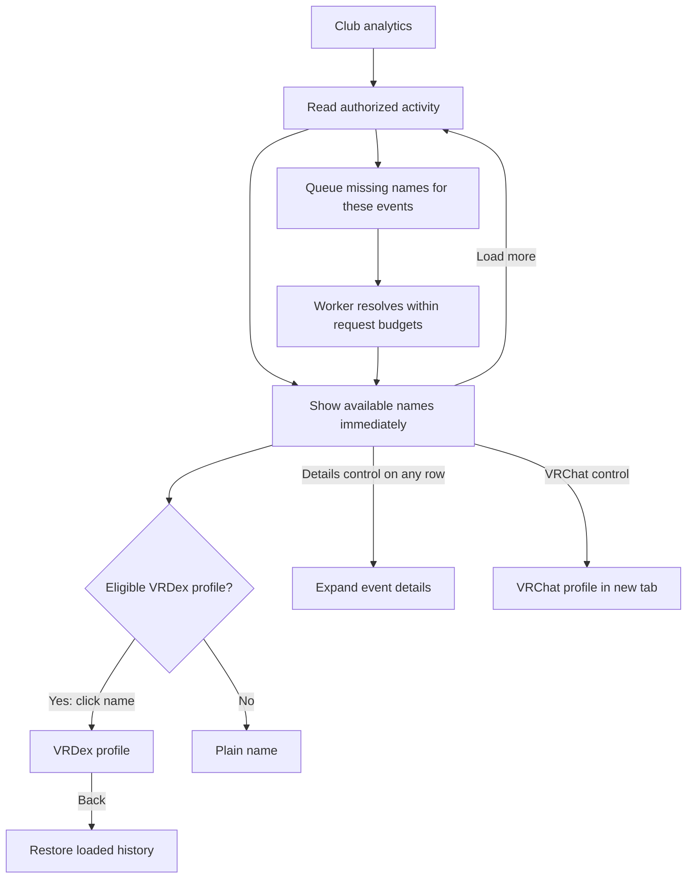
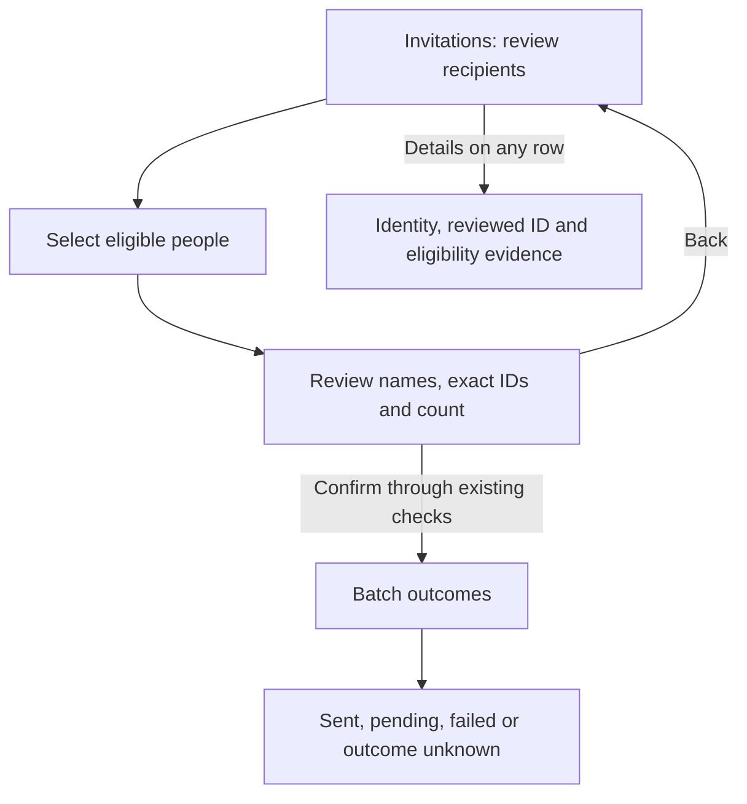
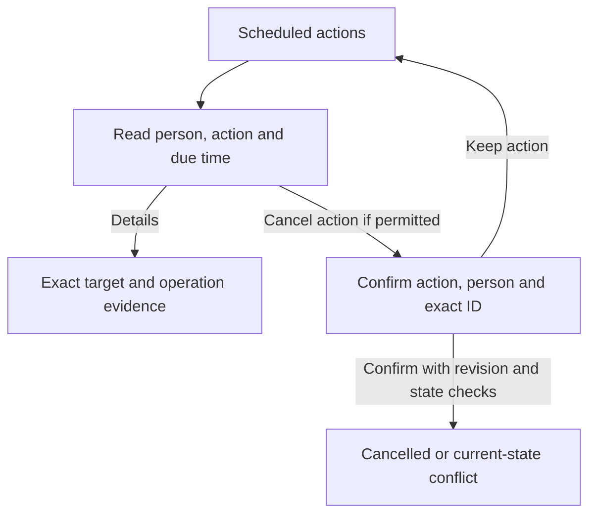

# Membership activity: useful names and clear controls

## Review brief

Make activity history readable without sending every name click to VRChat. The main name opens a verified visible VRDex profile when one exists and is plain text otherwise. Every row has the same separate Details control. A larger, separate VRChat control remains available. Remove the redundant VRDex link.

Resolve missing people automatically in the background, for new activity and recently viewed history. BASIC selected this approach on November 12 and subsequently approved this expanded design for implementation, independent review and PR iteration until merge-ready. The provider checkpoint remains required before claiming historical recovery coverage. Production rollout and historical repair execution are separate from this implementation approval.

The requested judgment is whether the row interaction and the bounded role-recovery proposal are right. BASIC also requested the related workspace improvements below, starting with invitations and scheduled actions. The main tradeoff is additional provider traffic in exchange for useful names. Some records will remain incomplete when the provider no longer has the evidence.

Preview: [interactive Storybook study](http://127.0.0.1:6007/iframe.html?id=clubs-membership-recovery-design--row-interactions&viewMode=story). Data is synthetic. The demo lookup button is a preview control, not proposed product UI.

New previews: [invitations](http://127.0.0.1:6007/iframe.html?id=clubs-people-flows-design--invitations&viewMode=story) and [scheduled actions](http://127.0.0.1:6007/iframe.html?id=clubs-people-flows-design--scheduled-actions&viewMode=story). Switch between them with the preview tabs. All actions are simulated; profile controls do not navigate to real people.

## Decisions and changes from the previous design

| Status | Decision |
| --- | --- |
| Locked decision | Keep latest known VRChat names in rows and event-recorded names in details. |
| Locked decision | Automatically resolve missing people in new activity and recently viewed history. BASIC selected this over manual-only lookup. |
| Current recommendation | Names only navigate: link to VRDex when a unique visible verified match exists, otherwise plain text. Every row uses the same separate Details control. This addresses BASIC's November 12 correction that controls should be consistent. |
| Requested revision | Enlarge the separate VRChat control and remove the extra VRDex link. Apply the same destination rule to actor names. |
| Current recommendation | Recover recent historical role/actor evidence through a bounded audit replay, stored separately from immutable original events. |
| Current recommendation | Show a stable, distinct member identifier when no name can be obtained. Do not imply a lookup is running when it is not. |

The [previous approved design](./2026-11-11-membership-activity-identities-design.md) deliberately used existing cached names and deferred a new resolver and replay. Live inspection showed that this leaves many rows unresolved. This revision expands that scope and changes the primary link destination. The prior implementation remains shipped; this document proposes its successor.

## What causes the gaps

Confirmed from source and the signed-in BITRATE page:

- Activity reads names from `profileLinkDestinations`. Its refresh queue serves publicly visible profile links, not every member in activity history. A valid member ID can therefore have no cached name.
- The current collector does not populate target display names. It now preserves optional actor and role evidence for future events.
- Existing immutable audit events can lack role IDs as well as role names. A current role list cannot identify which role an old event changed when that ID was discarded.
- Some audit entries describe group activity rather than a person. Rendering these as `Unknown member` misidentifies the subject.
- Current rows make both the main name and a small VRChat link lead to the same provider page, while VRDex is a separate small link.

## Row experience

| Row state | Main control | Secondary control | Details |
| --- | --- | --- | --- |
| Named person with an eligible VRDex profile | Name links to that VRDex profile. | VRChat, at least a 40-pixel target. | Separate Details toggle. |
| Named person without an eligible VRDex profile | Plain name. | Same VRChat control. | Separate Details toggle, opening beneath the row. |
| Name pending or unavailable | Plain `Member 318b18fc`. | Same VRChat control when the full ID is valid. | Same Details toggle; lookup state, full ID, last successful observation if any. |
| Group event without a person target | Plain recognized subject, such as `Group settings`. | No fabricated person link. | Same Details toggle; original event type and audit ID. |
| Role event without recoverable role metadata | Normal person control and `Role assigned` or `Role removed`. | Normal person controls. | `Role not recorded`; omit repeated `Role unavailable` text from the row. |

The short member reference uses enough of the normalized ID to distinguish visible collisions, expanding when needed. The full ID remains in details. It is a fallback identity, not a fabricated display name. A resolved name replaces it in place without reordering rows or closing details.

Names, roles and actor labels retain Unicode isolation. Accessible control names remove directional controls. Links and accordion controls remain separate keyboard targets; no nested interactive controls. Actor names follow the same VRDex-link-or-plain-text rule. Their evidence lives in the row's Details section. There is one VRChat control per person, with an accessible destination and new-tab description.

Do not use a verified VRDex profile's chosen name as though it were a VRChat observation. It may serve as a final readable fallback for that exact verified person, but details identify its source as `VRDex profile name`.

### Journey: read history and return from a profile

This keeps the current account and workspace navigation. Mobbin research is skipped: profile destinations and inline disclosure are settled by BASIC's requested interaction; the open work is provider resolution and historical evidence recovery.

## Name resolution

Use the existing collector and request-budget machinery, with a separate private activity lookup queue. Reuse exact-ID parsing and provider response validation. Do not invent public outbound-link references to feed the existing destination queue. That queue's public-reference checks remain intact.

1. New verified audit events schedule unresolved target/actor IDs. On viewing older history, a small authenticated mutation accepts at most 25 audit IDs from the rendered page. It rechecks membership-history permission and derives provider IDs from those exact visible records in the current integration/epoch. Arbitrary user IDs are not accepted.
2. Deduplicate work by integration, epoch and normalized provider ID. Repeated renders, viewers and page restoration do not create additional jobs or reset cooldowns. Each newly returned page can request its own missing IDs. Merely restoring a large range does not scan the rest of history.
3. Return existing names immediately. Among valid VRChat observations, use the most recent observation from the existing destination cache or the private activity cache. Keep a valid stale name during refresh or transient failure. Fall back to recorded evidence, then an eligible VRDex profile name with its source identified, then the distinct member reference.
4. The collector verifies active scope and authority again before each request. It fetches only the exact user and retains the validated ID, display name, source, observation time and retry state. Do not store the complete user response or fetch artwork for a name lookup.
5. Convex subscriptions update the row when the observation arrives. The UI never calls VRChat directly, and queries remain read-only.

Builder defaults proposed for review: ten jobs claimed at a time; no more than two enrichment requests per minute per collector account, shared across its integrations and subordinate to the existing total provider budget. Membership collection and operational work take priority. A successful name becomes refresh-eligible after 24 hours when it is viewed or observed again. Negative results wait at least 24 hours. Transient failures use bounded exponential backoff and honor Retry-After; auth failures stop work through existing account controls.

Keep observations private to the integration and epoch that admitted them. Do not publish activity-derived associations or create VRDex profiles. Shared public-cache names may be read, but private results do not populate that cache. Retain an observation only while a retained audit record in the same scope references it; removal of the integration/epoch removes its queue and observations through the existing cleanup lifecycle. Cancellation or stale leases cannot write back into a replaced epoch. Last-known names survive ordinary provider failures.

## Roles and historical evidence

For future events, retain event-provided role ID/name and actor ID/name, as the shipped collector now does. Reuse the existing role-list read to cache exact role ID/name observations once per group, rather than fetching for each row. A role cache is eligible for refresh after six hours when relevant activity needs it. Preserve the last observed name after a role disappears.

Prefer the name recorded in the event. If only the role ID is known, a current/last-observed role name can make the action readable, with its source and observation time in details. Never claim that a current label was the label at event time.

For older records with no role ID, propose one owner-initiated `Recover recent history` operation covering the last 30 days, capped at 10,000 audit entries and the existing account/group request budget. It shows progress and a terminal partial or complete result. It can be stopped and resumed from durable checkpoints; repeated requests reuse the job. This is repair work, not a replay triggered by every render.

Match replayed entries by integration, epoch and exact audit ID, verifying event type, timestamp and target ID against the stored event. Store only validated supplemental actor/role evidence with its source and recovery time. Do not rewrite immutable original fields, replace conflicting evidence or make duplicates fail ingestion. The activity projection combines original and supplemental evidence, keeping provenance in details. Stop a superseded or unauthorized job before more provider traffic or writes.

If the audit entry is no longer available, keep the event readable as `Role assigned` or `Role removed`. Do not infer an old role from current membership, fuzzy-match people, or parse free-form audit descriptions to invent missing IDs. A missing role cannot be guaranteed recoverable.

## Provider evidence and checkpoint

The maintained community API specification documents [exact user lookup](https://vrchat.community/reference/get-user), [group roles](https://vrchat.community/reference/get-group-roles), and [audit logs with bounded pages and date filters](https://vrchat.community/reference/get-group-audit-logs). These are community-maintained references, not a provider guarantee. The current destination resolver already reads `/users/{id}`; it also fetches artwork, which this name-only path must skip. The existing club provider supports role and audit reads.

Before promising recovery coverage, run a small read-only check using the authorized collector account and one consenting group: missing-name IDs visible in that group's history, its role list, and the exact recent audit interval needed for the observed role gaps. Record counts and field presence, not raw payloads or credentials. Confirm returned IDs and whether the provider still supplies role and actor fields. No test role changes, profile edits or membership changes are part of that checkpoint.

If the checkpoint fails, keep the row controls and honest fallback design, and report the exact unsupported provider behavior before implementation of automatic traffic. Source fixtures alone do not establish provider coverage.

## Delivery and verification

Start with invitations and scheduled actions, then apply the shared identity presentation to activity and members/requests. Keep historical repair separate until the provider checkpoint passes. Activity filters and lookup-progress presentation are included in the design below. No new paid tier, service, full directory crawl, avatar import or infrastructure deployment is proposed.

Verify automatic deduplication, account-wide budgets, retries, negative caching, stale-name preservation, authority loss, epoch replacement and cleanup. Verify that hidden/ambiguous/unverified profiles never gain links. Recovery tests must preserve original evidence and reject mismatched replay entries. Browser checks cover profile links versus plain names, consistent Details controls on every row, the larger VRChat target, distinct unresolved people, non-person events, in-place resolution, desktop/mobile layout and existing pagination recovery.

Only throwaway Storybook studies exist today. They demonstrate the row interaction, simulated name resolution, invitation selection/review/results, and editing/cancelling Mira's scheduled action. Desktop/mobile screenshots received visual review, and the interactive demo paths were exercised. A time-input event issue found during the preview check was corrected and the changed time was verified in the list. Focused story lint passed. The expanded builder check found gaps in pre-batch lookup authorization and non-audit retention; both are specified below, and its follow-up found no important unanswered planning questions. No backend/provider requests or real operations are part of these studies. Final product copy remains proposed for BASIC's exact-copy review.

## Invitations and scheduled actions first

### Shared identity presentation

Lead with the latest available name. Link that name only to an eligible VRDex profile, otherwise use plain text. Keep one larger VRChat control and the same separate Details disclosure. Hide full IDs from ordinary list rows; show them in details and consequential confirmations. This changes presentation, not how actions identify their targets.

Names are decorations on immutable IDs. A name refresh must never change the selected recipient, scheduled target, role, selection count or authorization. Preserve the existing target-review and expected-revision checks. If recipient mapping or operation revision changes, require the existing review process again; a familiar name cannot substitute for that check. Keep original reviewed IDs and current effective IDs distinguishable in details when the existing workflow supports such mappings.

The name queue must admit these sources explicitly, rather than pretending they are audit events. An authenticated request accepts bounded batch-recipient or operation IDs, checks the permission required to read that specific source, and derives exact person IDs from current records in the active integration/epoch. Provider work uses the same shared budgets, deduplication and cleanup policy as activity lookups. Reading names does not grant permission to invite, edit, cancel or manage a member.

Before a batch exists, add a new permission-checked recipient-review grant. The existing `clubInvitations.preview` checks access and normalizes/deduplicates IDs; it does not issue an eligibility token. The new grant must verify invitation capability for the selected destination, bind the actor, integration/epoch and at most 100 explicitly entered valid target IDs, expire after 15 minutes, and allow at most one active review per actor/integration. Edits replace the grant rather than accumulating parallel grants. Revalidate authority and the grant before enqueueing. Its purpose is name lookup for that exact invitation review, not proof that the provider will accept an invitation. Sending retains the existing operational validation. A workspace read permission alone cannot create this grant. No raw-ID lookup endpoint is exposed outside that invitation-authoring scope.

### Retention across workspace sources

Every lookup needs a private source reference, with source-specific expiry. This extends the earlier audit-only retention rule; it does not extend the lifetime of the underlying operational records.

| Source reference | Admission and retention boundary |
| --- | --- |
| Audit event | Retained event in the current integration/epoch and current history-read authority. |
| Unsubmitted invitation review | Active 15-minute grant. Expiry/replacement stops pending work. Observations supported only by abandoned reviews are removed within 24 hours of grant expiry. |
| Invitation recipient | Retained authorized batch/recipient, while pending or for 30 days after its terminal outcome. Removing the record ends the reference sooner. |
| Scheduled operation | Retained authorized operation while pending, then 30 days after completion/cancellation. Cancellation stops new work; cached names can still label the outcome. |
| Members or requests | Exact returned row in a permission-checked group read, with a reference expiring after 24 hours unless a fresh read renews it. No membership inference from a name cache. |

Remove queued work when its last authorized reference expires or disappears. Retain a name while another valid source reference needs it, and otherwise delete it within 24 hours. Integration/epoch removal ends every reference and prevents stale writes. Reference cleanup and expired grants are swept in bounded batches; repeated viewing may renew a valid reference but cannot reset provider freshness or negative-cache cooldowns. Lookup reads always recheck source access, so retention never grants access. These durations are proposed builder defaults for review.

### Invitations: review the people, then confirm exact recipients

The current outcome view leads with a monospace user ID linking to VRChat. Replace it with the shared identity presentation in both recipient review and results. Keep eligibility and delivery state as separate plain labels. A name lookup pending state does not make an otherwise eligible recipient ineligible.

- Recipient rows have a selection checkbox, name, eligibility, VRChat control and Details. Already-member or otherwise ineligible rows preserve existing selection restrictions and reasons.
- Show the selected count and the batch's community/event context. Names updating cannot silently change the selection.
- Final confirmation lists the selected names alongside their full immutable IDs. Keep existing capacity, policy and recipient-review checks. Unresolved names may still proceed when existing eligibility checks permit it and the exact ID is reviewed.
- Results show the same people with the existing delivery states. Do not translate `Submitted` or `Outcome unknown` into `Sent`. An uncertain send does not gain an automatic resend button or a retry policy from this design.
- Keep the original reviewed identity available when the effective target differs. A new name is not evidence that such a change was approved.

#### Journey: confirm an invitation batch

### Scheduled actions: see who, what and when

The current list names the operation but often exposes only a raw target ID. Show the action, person, viewer-local due time and scheduling actor together. Use the same name/VRChat/Details pattern as invitations. Keep edit and cancel as explicit actions governed by existing capability and ownership rules; they never move onto the person's name.

- Edit preserves the exact target and existing revision checks. Changing a recipient or role identity follows the current authoring/review process rather than being inferred from a label.
- Editing a time keeps existing timezone-authoring context. The list renders in the viewer's timezone; do not add duplicate canonical/viewer times. Event-relative schedules keep their event and offset visible.
- Cancellation confirmation shows the action, person, full target ID, role where relevant, due time and event/community context. Use the existing permission, revision and pending/claimed-state checks. Do not offer cancellation after the operation is no longer cancellable.
- Keep pending, submitted, succeeded, cancelled and outcome-unknown states distinct. Labels and cached names never change execution state.
- Non-person actions show their actual subject, such as a post or instance, without a fabricated member or irrelevant VRChat-person control.

#### Journey: cancel the intended scheduled action

The local preview exercises invitation selection, final review and simulated mixed outcomes, plus editing and cancelling Mira's scheduled role action. Other scheduled rows illustrate related targets. These fixtures do not prove eligibility, permission checks or provider execution. The established workspace/confirmation journey remains; no Mobbin research is needed for a new sequence or gate.

## Related areas included after the first two previews

### Members and join requests

Use the same name-link-or-plain-text rule, larger VRChat control and separate Details. Move the existing name-click management behavior onto an explicit member-management control. Preserve approve/reject, role assignment, removal and ban controls and their permission checks. Their confirmations show names with exact target IDs. Staff-account identities and VRChat identities remain distinct unless an exact verified connection exists.

### Activity filters

Add person and event-kind filters alongside the current date range, covering joins/departures and role changes. Filter the authorized backend result before pagination; never filter only the already loaded rows and imply that the search covered all history. Encode filters in the URL and include them in the page-chain/session-restoration key. A direct link must restore the same view after sign-in. Retain known event-type fallbacks and scope-loss clearing.

### Lookup progress without a wall of placeholders

Show one quiet list-level status only when actual admitted work is pending. Count distinct people, not repeated rows; cached names remain visible while refreshing. Put individual lookup state, observation time and failure evidence in Details. A stopped, unauthorized, negatively cached or exhausted job must not keep saying it is checking. Name progress is always separate from invitation or scheduled-action execution progress. Proposed status wording is reviewed with the rest of the UI copy before shipping.

### Additional verification

Test that a resolved name leaves selected IDs and operation payloads unchanged; review-token expiry, foreign batch/operation IDs and stale revisions cannot admit work or execute actions; uncertain invitation results cannot trigger duplicate sends; cancelled/superseded operations do not keep enqueueing lookups. Exercise filters across multiple pages and restoration, explicit member-management controls, long names, keyboard navigation and mobile confirmations. Existing operational uncertainty labels remain intact.
