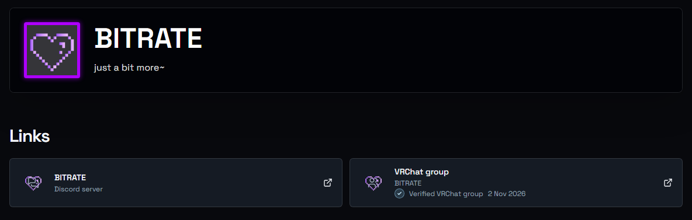

# People and communities

VRDex profiles bring together the people, clubs, and communities you meet in VRChat. A DJ's profile can link to their music or streams. A community's profile can link to its VRChat group, Discord server, and hosted events.

Claiming a profile gives you control of its VRDex page. VRDex verifies a connection by checking who controls the linked account or group. The profile badge also depends on whether that account or group is recognized as belonging to the profile.
