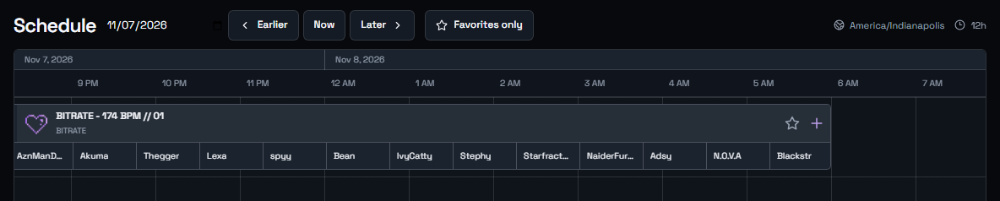

# Events in VRDex

The schedule shows what's on in VRChat and when each DJ is due to play. Times appear in your local time zone. A lineup can link to performer profiles, so you can look up a DJ before their set.

**My night** is your shortlist. Save a whole event or just the sets you want to catch. Your shortlist stays in the browser where you made it.
